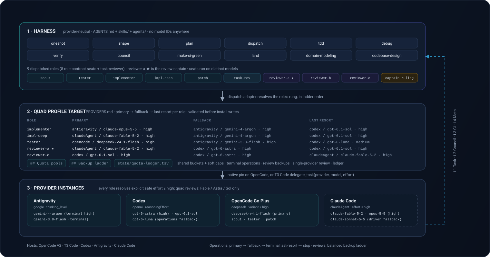
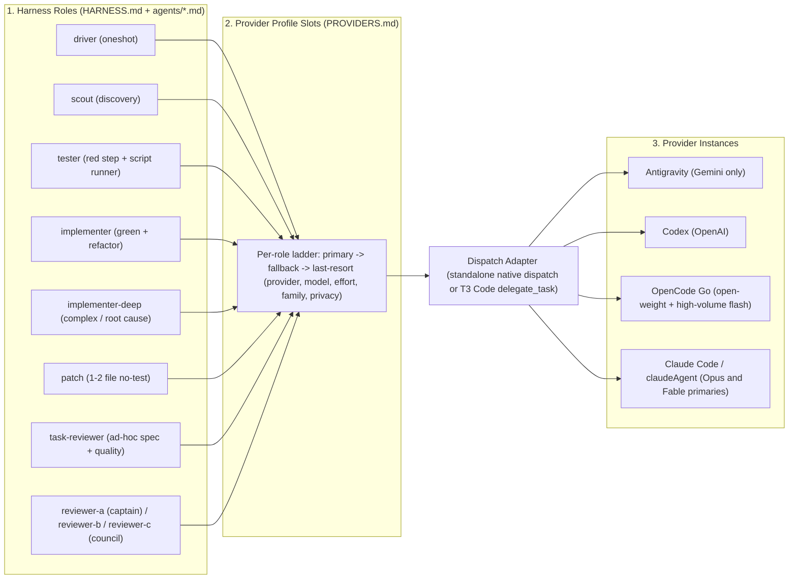
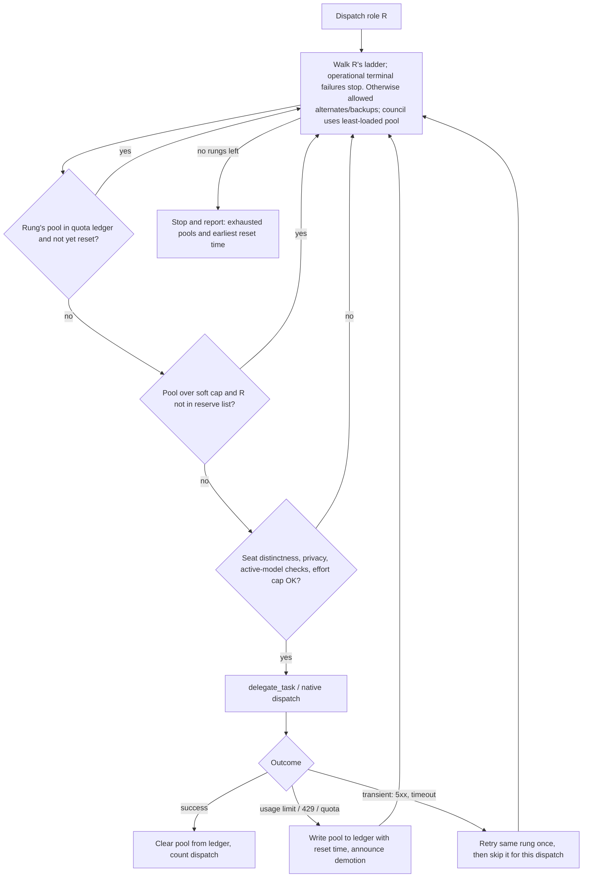

<p align="center">
  <picture>
    <source media="(prefers-color-scheme: dark)" srcset="docs/assets/logo.svg">
    
  </picture>
</p>

<h1 align="center">Cybernetic SDLC Harness</h1>

<p align="center">
  <a href="LICENSE"></a>
  
  
  
  
  
  =3.2" />
  
  
</p>

Autonomous software delivery for **T3 Code** and standalone **OpenCode V2**, **Codex**, **Antigravity**, and **Claude Code**. Orchestrates **12 composable pipeline skills** and **8 role-contract subagent seats** across four closed feedback loops (**L1 Task**, **L2 Branch Council**, **L3 CI**, **L4 Meta**).

The harness is provider-neutral: which provider, model, and effort runs each role comes from a swappable provider profile (default `tri`, `quad` with Claude Code, portable host-oriented `opencode-go`, `codex`, `antigravity`, `claude`, dynamic composition via `--providers <list>`, or any custom file via `--profile-file`). Every dispatch names an explicit rung so subagents never inherit the main session model. Every seat enforces last-match-wins permission guardrails so subagents never leak secrets.

---

## 🛠️ Installation & Setup

### Prerequisites
- **Shell**: Bash >= 3.2 (default on macOS, Linux, and WSL).
- **Supported Hosts**: T3 Code (multi-provider orchestrator), OpenCode V2, Codex CLI/Desktop, Antigravity, and Claude Code.

---

### Step-by-Step Quickstart

#### Step 1: Clone the repository
```sh
git clone https://github.com/DennisLoska/skills.git
cd skills
```

#### Step 2: Choose your profile & run the installer
Select the command matching your environment and available AI subscriptions:

| Environment & Available Subscriptions | Profile | Install Command | What Gets Wired |
| --- | --- | --- | --- |
| **T3 Code: Antigravity + Codex + OpenCode Go** *(Recommended)* | `tri` (default) | `./install.sh --target all` | Multi-provider orchestration across all hosts |
| **T3 Code: Antigravity + Codex + OpenCode Go + Claude Code** | `quad` | `./install.sh --profile quad --target all` | Claude Code carries Anthropic primaries |
| **T3 Code: Custom Provider Stack** | Dynamic | `./install.sh --providers <list> --target all` | e.g. `--providers antigravity,codex` |
| **OpenCode V2 Standalone** | `opencode-go` | `./install.sh --profile opencode-go` | Standard `~/.config/opencode` |
| **Codex CLI/Desktop Standalone** | `codex` | `./install.sh --profile codex --target codex` | Standard `~/.codex` (`$CODEX_HOME`) |
| **Antigravity Standalone** | `antigravity` | `./install.sh --profile antigravity --target antigravity` | Standard `~/.antigravity` rules & skills |
| **Claude Code Standalone** | `claude` | `./install.sh --profile claude --target claude` | Standard `~/.claude` (`CLAUDE.md`) |

> [!TIP]
> **Running T3 Code?** Always pass `--target all`. This installs skills and contracts across all host locations so T3 Code's `delegate_task` can seamlessly dispatch subagents to any connected provider.

#### Step 3: Register instructions (OpenCode only)
- **Codex, Antigravity, and Claude Code**: **Zero configuration needed!** The installer writes to standard host locations (`AGENTS.md`, `rules/`, `CLAUDE.md`) which are auto-loaded by these platforms.
- **OpenCode V2**: OpenCode requires registering instructions in `~/.config/opencode/opencode.json`:
  ```jsonc
  {
    "$schema": "https://opencode.ai/config.json",
    "instructions": [
      "~/.config/opencode/HARNESS.md",
      "~/.config/opencode/PROVIDERS.md"
    ]
  }
  ```

#### Step 4: Verify installation health
Run the non-destructive verification tool (alias `--doctor`) to check manifest integrity, permissions, and host wiring:
```sh
./install.sh --verify
```
Exit code `0` confirms a complete, healthy installation.

---

### Installer Options & Maintenance

```sh
./install.sh [flags]
```

| Flag | Description | Default |
| --- | --- | --- |
| `--target <targets>` | Comma-separated host targets: `opencode`, `codex`, `antigravity`, `claude`, or `all`. | `opencode` |
| `--profile <name>` | Shipped profile: `tri` (default), `quad`, `opencode-go`, `codex`, `antigravity`, `claude`. | `tri` |
| `--providers <list>` | Compose the fixed policy with selected connection preferences: `antigravity`, `codex`, `claude`, `opencode`. | None |
| `--profile-file <path>` | Bind to a custom external profile file. Recorded in manifest and preserved on updates. | None |
| `--pm <tracker>` | Backlog tracker for findings the review captain defers: `auto`, `github` (`gh` CLI), `linear` or `jira` (via MCP), `none`. Recorded as `# pm <value>` and reused on refresh; interactive installs without a recorded value ask once. | `auto` |
| `--verify`, `--doctor` | Non-destructive health check (checks manifests, files, symlinks, state). | - |
| `--force` | Overwrite existing destination files and repair symlinked directories. | `false` |
| `--prune` | Remove obsolete files recorded in earlier manifests while preserving user state. | `false` |
| `-h`, `--help` | Print usage summary and exit. | - |

**Backlog tracker (`--pm`):** the installer renders the choice as a trailing `## Project management` section (`backlog_tracker: <value>`) in the installed `PROVIDERS.md`. After a merge, `land` files one ticket per deferred council finding: `github` runs `gh issue create --label backlog` (retrying without the label if it is missing), `linear`/`jira` use your connected Linear or Jira MCP tools, `auto` picks Linear MCP, then Jira MCP, then an authenticated `gh` on a GitHub remote with issues enabled, else `none`. With `none` (or any filing failure) the deferred findings stay listed under `## Backlog` in the PR body.

```sh
./install.sh --profile quad --target all --pm linear
```

**Updating to latest version:**
Pull upstream updates and refresh your installed targets while keeping your machine-local quota ledger intact:
```sh
git pull
./install.sh --force --prune
./install.sh --verify
```

---

## 🧭 Cybernetic Architecture

<p align="center">
  
</p>

**At a glance**

| Question | Answer |
| --- | --- |
| **What is it?** | A gated SDLC controller (`oneshot`) plus 12 pipeline skills and 8 role-contract subagent seats, wired by four closed feedback loops. |
| **What runs where?** | Every role resolves to a *rung* (`primary` &rarr; `fallback` &rarr; `last-resort`) in a swappable provider profile, then to a provider instance, model, and effort. No harness file names a model. |
| **What does it guarantee?** | Tests-first task loops, evidence-before-claims verification, a three-seat council on distinct models with a review captain who defers out-of-scope findings to the backlog (but can never waive a real bug), effort at most `high` except council seats/rulings (at most `xhigh`), and hard budget stops instead of silent model downgrades. |
| **Where does it install?** | OpenCode, Codex, Antigravity, and Claude Code, one profile bound at install time (`--target all` for every host). |
| **How do I start?** | Run the track command for your host in [Installation & Setup](#️-installation--setup), then prompt `oneshot <task>`. |

### Three-Layer Routing Architecture



### Pipeline Flow

```mermaid
flowchart LR
  U(["User: 3 Gates or Auto-Approve"]) --> C["oneshot (driver)"]
  C --> P1["1. shape + domain-modeling + codebase-design (via scout)"]
  P1 -- "spec + GLOSSARY/ADR" --> P2["2. plan (via scout)"]
  P2 -- "TDD task plan" --> P3["3. dispatch + tdd (tester -> implementer / implementer-deep / patch + task-reviewer)"]
  P3 <-- "root cause" --> D["debug (tester + implementer-deep)"]
  P3 --> P4["4. verify (via tester)"]
  P4 --> P5["5. land (file PR)"]
  P5 --> P65["6.5 make-ci-green (tester + implementer / implementer-deep / patch)"]
  P65 --> P6["6. council (reviewer-a captain, reviewer-b, reviewer-c in parallel)"]
  P6 -- "any FAIL or red/yellow" --> CR["6. captain ruling (accept / defer / reject)"]
  CR -- "accepted findings: fix pushed" --> P65
  CR -- "deferred findings" --> BL["backlog tickets (gh / Linear / Jira)"]
  P6 -- "all PASS" --> P7["7. land (Gate 3, backlog tickets & handoff)"]
  CR -- "PASS + green" --> P7
  CR -- "round 3 FAIL" --> STOP(["stop: user"])
```



---

## 🧩 All 12 Skills by Role

| Role in Cybernetic Loop | Skill | When It Runs |
| --- | --- | --- |
| **Master Controller** | [`oneshot`](./skills/oneshot/SKILL.md) | Orchestrates Phases 1 &rarr; 7 end-to-end |
| **Spec & Planning** | [`shape`](./skills/shape/SKILL.md) | Phase 1: Socratic design exploration & spec commit |
| **Spec & Planning** | [`domain-modeling`](./skills/domain-modeling/SKILL.md) | Phase 1 (or standalone): builds/sharpens `GLOSSARY.md` & `docs/adr/` |
| **Spec & Planning** | [`codebase-design`](./skills/codebase-design/SKILL.md) | Phase 1 (or standalone): deep modules, seams, `DESIGN-IT-TWICE.md` |
| **Spec & Planning** | [`plan`](./skills/plan/SKILL.md) | Phase 2: bite-size TDD task decomposition |
| **L1 Task Loop (Actuation)** | [`dispatch`](./skills/dispatch/SKILL.md) | Phase 3: per-task subagent execution (`tester` &rarr; `implementer`) + 2-stage review |
| **L1 Task Loop (Discipline)** | [`tdd`](./skills/tdd/SKILL.md) | Phase 3: failing test first &rarr; minimal code &rarr; refactor |
| **L1 Task Loop (Repair)** | [`debug`](./skills/debug/SKILL.md) | Phase 3 & 4: 4-phase root-cause investigation on failures |
| **Gate Sensor** | [`verify`](./skills/verify/SKILL.md) | Phase 4 (and post-fix in L1/L2/L3): fresh command evidence check via `tester` |
| **L2 Branch Sensor/Loop** | [`council`](./skills/council/SKILL.md) | Phase 6: 3-seat adversarial review, captain ruling, fixer loop |
| **L3 CI Sensor/Loop** | [`make-ci-green`](./skills/make-ci-green/SKILL.md) | Phase 6.5: watches PR checks & bots (`tester` logs/reruns, implementation fixes) |
| **PR & Handoff Actuator** | [`land`](./skills/land/SKILL.md) | Phase 5 (files PR) & Phase 7 (Gate 3 merge, backlog tickets, next-feature handoff) |

---

## 🚀 Usage & Example Prompts

### 1. Full Autonomous Pipeline (`oneshot` - 3 Human Gates)

Trigger the end-to-end controller by prefixing a task with `oneshot` (or `"use oneshot"`, `"use the oneshot harness"`):

```text
oneshot build a rate-limited webhook delivery worker with exponential backoff, dead-letter queue, and SQLite persistence
```

**Pipeline execution flow (7 numbered phases plus 6.5):**
1. **Phase 1 &ndash; `shape` + `domain-modeling` + `codebase-design`:** ensures feature branch/worktree, explores context via `scout`, updates `GLOSSARY.md`/ADRs, commits spec to `docs/specs/`. *Pauses at Gate 1 for design approval.*
2. **Phase 2 &ndash; `plan`:** targets exact `path:line` references via `scout`, decomposes spec into bite-size TDD tasks in `docs/plans/`. *Pauses at Gate 2 for plan approval.*
3. **Phase 3 &ndash; `dispatch` + `tdd` (L1 Task Loop):** dispatches `tester` for failing tests, `implementer`/`implementer-deep`/`patch` to make them pass, and runs 2-stage review via `task-reviewer`. The driver orchestrates without writing code inline.
4. **Phase 4 &ndash; `verify`:** runs full test suite, lint, and build via `tester` to collect fresh pass/fail command evidence.
5. **Phase 5 &ndash; `land` (PR Filing):** pushes branch and opens GitHub PR with summary, test plan, and quota budget block.
6. **Phase 6.5 &ndash; `make-ci-green` (L3 CI Loop):** polls GitHub Actions / review bots, inspects logs via `tester`, and dispatches implementation fixers.
7. **Phase 6 &ndash; `council` (L2 Branch Loop):** three seats on distinct models review in parallel (`reviewer-a` is the review captain, plus `reviewer-b` and `reviewer-c`). If any seat fails or raises a red/yellow finding, the captain rules on every finding: accept (fix now), defer (backlog ticket), or reject (wrong, with evidence). PASS modes: `single` (one available reviewer, green actual checks), `nominal` (&ge;2/3), `degraded` (2/2 with one seat lost), or `captain` (captain PASS over FAIL votes whose findings were all deferred or rejected). Self-review is allowed; zero available members records SKIPPED with actual green verification. Max 3 rounds, then stop to the user.
8. **Phase 7 &ndash; `land` (Gate 3 Handoff):** presents finish options (merge PR, keep PR open, keep branch, discard). Merging requires Phase 6 `council_verdict: PASS` (`mode=nominal|degraded|captain|single`) or explicit `SKIPPED` (`mode=unavailable`) with configured attempt/skip reasons and green actual verification with `head=<sha>` match via `gh pr merge --squash --match-head-commit <sha>`, then files the deferred findings as tickets per `--pm`, and is worktree-aware.

### 2. Zero-Gate Unattended Mode (`oneshot` Auto-Approve)

Include `auto-approve` (or `skip all approvals`, `no approval gates`, `full autonomy no questions`) to run without human pauses:

```text
oneshot auto-approve: fix the race condition in session token refresh when concurrent requests hit an expired JWT
```

### 3. Confidential Mode (Privacy Gate)

Prefix with `[confidential]` to automatically skip any rungs marked `privacy: trains` across all seats:

```text
oneshot [confidential] implement HMAC signature rotation for partner billing webhooks
```

### 4. Standalone Skills & Individual Loops

Every skill and agent seat can also run independently outside `oneshot`:

| Example Prompt | Unit Triggered | What It Does |
| --- | --- | --- |
| `"shape a plugin hook system for custom tool permissions"` | `shape` | Socratic design exploration; writes spec to `docs/specs/` |
| `"write a plan for docs/specs/2026-11-04-plugin-hooks-design.md"` | `plan` | Produces a bite-size TDD task plan in `docs/plans/` |
| `"dispatch docs/plans/2026-11-04-plugin-hooks.md"` | `dispatch` | Runs L1 per-task subagent loop (`tester` &rarr; `implementer`) + 2-stage review |
| `"implement this feature with tdd"` | `tdd` | Enforces red-green-refactor with failing behavioral tests first |
| `"debug why test/webhook-retry.test.ts fails intermittently"` | `debug` | 4-phase root-cause investigation before any fix |
| `"verify this branch is ready"` | `verify` | Dispatches `tester` to run test/lint/build commands and confirms output |
| `"council review this branch"` | `council` | Runs the 3-seat review, captain ruling, and fixer loop |
| `"make ci green on this PR"` | `make-ci-green` | Watches PR checks/bots; inspects logs via `tester` and fixes real bugs |
| `"model the domain for the billing module"` | `domain-modeling` | Builds and sharpens `GLOSSARY.md` and ADRs |
| `"deepen this module's interface"` | `codebase-design` | Applies deep-module vocabulary, seams, and deepening moves |
| `"land it"` / `"next feature"` | `land` | Files or merges PR, files backlog tickets, fast-forwards default branch, and reports ready |

---

## 🧠 Provider Layer & Core Concepts

The harness separates concerns into three decoupled layers:

| Layer | Owns | Files |
| --- | --- | --- |
| **Harness (provider-neutral)** | Pipeline, feedback loops, caps, gates, council rules, permission policies, role contracts, and the Dispatch Adapter | `skills/**`, `agents/*.md` (no `model:` line), [`AGENTS.md`](./AGENTS.md) |
| **Provider (swappable)** | Role rungs (`primary` &rarr; `fallback` &rarr; `last-resort`), model families, effort, privacy tags, and quota pools | `providers/<profile>.md`, dynamic `--providers <list>`, or external file |
| **Install (binding)** | Binds active profile to selected host targets (`opencode`, `codex`, `antigravity`, `claude`, or `all`) | `install.sh --profile <name>` or `install.sh --providers <list>` |

---

### 💡 High-Level Concepts: Tri vs Quad, Council, and Fallbacks

#### 1. `tri` vs `quad` Profiles: The Multi-Subscription Strategy

All six shipped profiles and all 15 `--providers` combinations use the same model policy, documented in [the complete 12-skill routing map](docs/skill-model-routing.md). Names record connection preferences and preserve portable cross-provider roles; they do not limit dispatch to a provider subset.

- **Drafts:** `designer` and `planner` use Fable 5.2 with Sol fallback only. Workers return read-only drafts; the driver owns conversation, approvals, canonical documents and phase advancement.
- **Cheap work:** scout, tester and patch use Deepseek V4.1 Flash, then Luna, then terminal Gemini 3.8 Flash. Compaction uses Gemini Flash then Luna at low effort. OpenCode routes only Deepseek Flash.
- **Implementation:** Claude Code Opus 5.5 primary and Fable 5.2 deep; both use Codex Sol fallback, then terminal Antigravity Gemini Argon. Every shipped profile and generated combination uses these exact provider paths.
- **Reviews:** task review starts on Sol; council A/captain is Opus at xhigh, B Sol at xhigh, C Argon at high. Council fallbacks, backups and recovery stay within those three models; task reviews retain Sol/Astra/Fable at high. Self-review is allowed.
- **Unavailable providers:** mark rungs unreachable and walk configured fallbacks; skip unavailable review members and proceed with remaining members, or record SKIPPED with zero. Green actual verification remains required.

#### 2. The Council: Three Seats and a Review Captain (Phase 6)

- **Why multiple models?** Single-model reviews suffer from self-confirmation bias, hallucinated validations, and identical blind spots. The council runs three distinct models in parallel when available, using the active profile's allowed review models. Every shipped/generated policy permits only Opus, Sol, and Argon for council; task review retains Sol, Astra, and Fable at high.
- **Council Seats**:
  - **Seat A (`reviewer-a`), review captain**: Anthropic `claude-opus-5-5` via Claude Code at `effort=xhigh`. If Seat A has no eligible rung, captaincy passes to Seat B, then Seat C.
  - **Seat B (`reviewer-b`)**: OpenAI `gpt-6.2-sol` via Codex at `reasoningEffort=xhigh`.
  - **Seat C (`reviewer-c`) in every shipped profile**: Google `gemini-4-argon` via Antigravity at `thinking_level=high`.
- **Captain ruling**: the captain reviews like every seat. When any seat votes FAIL or raises a red/yellow finding, a fresh captain ruling labels each merged finding `accept` (fix in this PR), `defer` (valid but unrelated, overengineering, or out of scope: it becomes a backlog ticket), or `reject` (wrong, with `path:line` evidence), then votes `Captain verdict: PASS | FAIL`.
- **Captain limits**: a red the driver confirms as an in-scope correctness, security, or data-loss bug introduced by the diff can never be deferred or rejected (`captain overruled: <finding-id>`). Green tests are always required. Fixers address only accepted findings.
- **Verdict modes**:

  | mode | PASS condition |
  | --- | --- |
  | `nominal` | &ge;2/3 seats PASS, zero unresolved accepted findings, green tests (or the `no-tests` exception) |
  | `degraded` | 2/2 healthy seats PASS (one seat lost), zero unresolved accepted findings, green tests |
  | `single` | 1 available reviewer final PASS, zero unresolved accepted findings, green actual checks (no no-tests exception) |
  | `captain` | captain PASS; every finding behind a FAIL vote deferred or rejected; zero unresolved accepted findings; green tests |

Council tries configured members and quota/reachability fallbacks, skipping unavailable members. One available reviewer may PASS regardless of provider count, inside or outside oneshot. The sole reviewer is captain and returns a real final `reviewer_vote: PASS|FAIL reviewer=<provider/model> head=<sha>` after fresh rulings. Single verdict: `council_verdict: PASS|FAIL round=<n> mode=single reviewer=<provider/model> head=<sha>`. Zero reviewers records `council_verdict: SKIPPED round=<n> mode=unavailable head=<sha>` with all configured attempts/skips and reasons, never PASS. Land accepts this skipped review with green actual verification and matching local/remote HEAD via `--match-head-commit`; no no-tests waiver for single/unavailable. Actual review FAIL and unresolved accepted findings still block. Authorship is audit-only; active model distinctness, allowlists, privacy, effort limits and three-round caps remain.

- **Core Council Invariants**:
  - **Authorship:** audit-only; self-review is allowed. Simultaneously active council seats use distinct models.
  - **Availability:** unavailable members are skipped; one reviewer proceeds, zero records SKIPPED with actual green verification.
  - **Actionable Severity Syntax**: findings follow `path:line: emoji severity: problem. fix.` (RED = bug, YELLOW = risk, BLUE = nit on request). No praise.
  - **Closed Fixer Loop**: accepted findings trigger `implementer` fixes &rarr; `tester` regression checks &rarr; `make-ci-green` &rarr; re-review by all active seats plus a fresh ruling, for at most 3 rounds (15 reviewer dispatches: 9 seat, 3 rulings, 3 demotions). A round-3 FAIL stops to the user; there is no escalation seat.

#### 3. Cybernetic Fallbacks & Quota Resilience

- **Operational Ladder**: Shipped operational roles define `primary` &rarr; `fallback` &rarr; terminal `last-resort`, using separate provider pools. An unavailable terminal rung stops the original role.
- **Same-Model Alternate**: before leaving a primary/fallback rung (never an operational terminal rung), the driver uses a `## Backup ladder` row with the identical model on another pool (when a custom profile supplies an eligible alternate).
- **Balanced Seat Fallback**: a council seat that loses its primary takes the eligible rung whose quota pool has the fewest dispatches this run, within the active profile review allowlist; shipped council recovery includes Argon at high.
- **Single-Provider Review**: Sol on Codex, Opus on Claude Code, Argon on Antigravity. A sole available reviewer can PASS without provider-count gates.
- **Context-scoped effort ceiling:** Non-council work, including driver sessions, defaults, advisory/design work, task-reviewer, fixing and testing, must never request or inherit effort above `high`. Only runtime council reviewer-a/b/c seats and fresh captain rulings may use profile-configured `xhigh`; council is the only skill permitting above high, with maximum `xhigh`. `max`, `ultra`, `ultrathink`, `ultracode`, and equivalent higher levels are forbidden everywhere. Verify provider capabilities before dispatch; use explicit provider-native options from `PROVIDERS.md`. Argon uses explicit `thinking_level=high` because it has no xhigh support. Unknown/unsafe defaults require an explicit safe option or an unreachable rung; non-council defaults must be verified at most `high`. Shared reviewer contracts do not grant task reviews the council exception. Invoking a skill never changes the driver session or its ceiling.
- **Shared Quota Pools & Soft Caps**: Models sharing an underlying subscription pool (e.g. `claude-code`; Fable has its own `claude-fable` limit) are grouped into pools. Soft caps prevent workhorse tasks from consuming tokens reserved for critical seats.
- **Machine-Local Quota Ledger (`state/quota-ledger.tsv`)**: When a 429 or rate limit occurs, the pool and its cooldown timestamp are recorded in the ledger. Subsequent dispatches immediately skip dead pools without burning API calls or latency.
- **Legacy Emergency Routing**: Only operational roles without explicit `last-resort` retain sibling hand-off and backup walks. Reviews keep balanced backup routing; shipped backups are review-only.
- **Hard Budget Stops**: When all eligible rungs are exhausted, the harness stops cleanly with `budget stop: <role>` and reports the earliest reset time, refusing to silently downgrade to an inferior model or hallucinate.

---

`--providers` records and reuses the selected connection list on refresh. It keeps fixed provider paths regardless of selected connections. It retains cross-provider roles, including Fable on Claude Code and Deepseek on OpenCode, even if those providers were not selected. It is not an exclusive provider allowlist. The three profile selection flags remain mutually exclusive.

### Which profile do I pick?

| Subscriptions you have | Profile to install | Command |
| --- | --- | --- |
| **Antigravity + Codex + OpenCode Go** | `tri` (default) | `./install.sh` (or `./install.sh --profile tri --target all`) |
| **Antigravity + Codex + OpenCode Go + Claude Code** | `quad` | `./install.sh --profile quad --target all` |
| **Only OpenCode Go** | `opencode-go` | `./install.sh --profile opencode-go` |
| **Only Codex / ChatGPT** | `codex` | `./install.sh --profile codex --target codex` |
| **Only Antigravity** | `antigravity` | `./install.sh --profile antigravity --target antigravity` |
| **Only Claude Code** | `claude` | `./install.sh --profile claude --target claude` |
| **Any other mix** (e.g., Codex + Claude, Antigravity + OpenCode) | Dynamic composition (or custom file) | `./install.sh --providers <list>` (e.g., `./install.sh --providers codex,claude --target all`) or `./install.sh --profile-file <path>` |

### Provider Setup Overview

| Provider | Instance ID | Effort Option ID & Values | Example Model IDs | Limit Inspection |
| --- | --- | --- | --- | --- |
| **OpenCode Go** | `opencode` | `variant` (`low\|medium\|high`, or verified safe `-`) | `muse-spark-1.3-contributor`, `deepseek-v4.1-flash`, `mimo-v2.6-flash`, `glm-5.3-flash` | `opencode.ai/docs/go` console (monthly $ allowance + 5h rolling cap) |
| **Antigravity** | `antigravity` | `thinking_level` (`low\|medium\|high`) | `gemini-4-argon`, `gemini-3.8-flash` | `/status` in Antigravity (rolling 5-hour window) |
| **Codex** | `codex` | `reasoningEffort` (`low\|medium\|high`; council Sol also `xhigh`) | `gpt-6.2-astra`, `gpt-6.2-sol`, `gpt-6-luna`, `gpt-6-sol` | `/status` in Codex (rolling 5-hour window) |
| **Claude Code** | `claudeAgent` | `effort` (`low\|medium\|high`; only council seats/rulings permit `xhigh`) | `claude-fable-5-2`, `claude-opus-5-5`, `claude-sonnet-5-5`, `claude-haiku-5-5` | `/status` in Claude Code (rolling 5-hour window) |

### Dispatch Adapter Paths

The Dispatch Adapter in [`AGENTS.md`](./AGENTS.md) resolves each role's rung in ladder order:
- **Path 1 (T3 Code Orchestration):** Dispatches across all enabled providers (`antigravity`, `codex`, `claudeAgent`, `opencode`) via `delegate_task`.
- **Path 2 (Standalone OpenCode Pin):** When `t3-code` is absent, runs natively via `subagent`/`task` matching the seat's rendered `model:` pin without override. A seat with no `opencode` ladder rung installs without a `model:` pin and never uses Path 2.
- **Path 3 (Standalone Same-Provider Dispatch):** Native dispatch when active host matches the rung's provider (`opencode`, `codex` `spawn_agent`, `claudeAgent` `Agent`, or `antigravity` `invoke_subagent`).
- **Path 4 (Unreachable):** Rung is unreachable on current host; skipped immediately at zero council budget cost.

### Quota Ledger & Budget Fallback



- **Shared Quota Pools:** Groups models sharing a subscription bucket (e.g., `claude-fable` for Claude Code Fable models, `claude-code` for the other Claude Code models; first matching row wins).
- **Soft Caps & Reserves:** Limits non-essential dispatches so a pool's remaining quota stays reserved for the roles listed in `reserve`. Per-pool dispatch counts (`soft_cap_counts`) also drive balanced seat fallback.
- **Machine-Local Ledger:** Tracks exhausted pools at `<dest>/state/quota-ledger.tsv`. Pruned automatically on read; can be inspected or cleared anytime:
  ```sh
  cat ~/.config/opencode/state/quota-ledger.tsv
  rm -f ~/.config/opencode/state/quota-ledger.tsv
  ```
- **Profiles Summary:** See [`providers/tri.md`](./providers/tri.md) (default multi-provider), [`providers/quad.md`](./providers/quad.md) (with Claude Code), [`providers/opencode-go.md`](./providers/opencode-go.md), [`providers/codex.md`](./providers/codex.md), [`providers/antigravity.md`](./providers/antigravity.md), and [`providers/claude.md`](./providers/claude.md) for full routing tables, quota pools, and backup ladders.

### Default ladders (all shipped/generated profiles)

Non-council work is at most high; only council seats and captain rulings may use xhigh. See [skill-model-routing.md](docs/skill-model-routing.md) for every skill, advisory role, fallback, and review eligibility rule.

| role | primary | fallback | last-resort |
| --- | --- | --- | --- |
| `scout`, `tester`, `patch` | Deepseek V4.1 Flash (high) | GPT6 Luna | Gemini 3.8 Flash (terminal) |
| `implementer` | Opus 5.5 (Claude Code) | Sol | Gemini 4 Argon (terminal) |
| `implementer-deep` | Fable 5.2 | Sol | Gemini 4 Argon (terminal) |
| `designer` (optional draft) | Fable 5.2 | Sol | — |
| `planner` (optional draft) | Fable 5.2 | Sol | — |
| `task-reviewer` | Sol | Astra | Fable 5.2 |
| Council A / B / C | Opus 5.5 (xhigh) / Sol (xhigh) / Argon (high) | Only eligible models from the same three-model set | One available reviewer proceeds; zero records SKIPPED |

Claude Code provides the Opus primary. Antigravity has no Anthropic routes or Claude quota pool. Review backups and single-provider rows cannot widen the closed review set. Codex-only council permits Sol; Claude-only permits Opus; Antigravity-only permits Argon. Each may review its own code and proceed alone. Zero available members records SKIPPED; never widen the council allowlist.

---

## ⚙️ Configure Models

To customize models without modifying the repository, copy a profile, edit the rows, and install with `--profile-file`:

```sh
mkdir -p ~/.config/oneshot
cp providers/tri.md ~/.config/oneshot/my-profile.md
# edit ~/.config/oneshot/my-profile.md
./install.sh --force --profile-file ~/.config/oneshot/my-profile.md
```

**One-row override example** (setting an implementation fallback to Gemini 4 Argon; reviews keep their closed allowlist):

```text
| role | rung | provider | model | effort | family | privacy |
| --- | --- | --- | --- | --- | --- | --- |
| implementer | fallback | antigravity | gemini-4-argon | thinking_level=high | google | ok |
```

- Each profile must define a `primary` row for all nine dispatched roles (`scout`, `tester`, `implementer`, `implementer-deep`, `patch`, `task-reviewer`, `reviewer-a`, `reviewer-b`, `reviewer-c`), with pairwise-distinct council primary models (families may overlap).
- Optional sections: `## Quota pools` (bucket definitions), `## Backup ladder` (safety net rungs), and `## Single-provider review` (`provider | model | effort | family | privacy` review models per provider). `## Project management` is rendered by `--pm`.
- Every non-council model/provider row, advisory row, fallback, and ad-hoc call must stay at or below `high`; council seats/rulings alone may use `xhigh`. A `-` default is usable only when verified safe; otherwise explicitly set `high` or mark unreachable.
- Rows for the retired escalation role are ignored with a warning, so older custom profiles keep installing.

---

## 🤖 Agent Quickstart

| You want to change | Touch only | Then verify |
| --- | --- | --- |
| Which model runs a role | `providers/<profile>.md` (all matching profiles) | Update pin expectations in `test/install.sh`, then `bash test/install.sh` |
| Routing, loops, caps, permissions | [`AGENTS.md`](./AGENTS.md) + affected `skills/*/SKILL.md` | `bash test/install.sh` (HARNESS.md must equal AGENTS.md) |
| A seat's contract | `agents/<seat>.md` (never add a `model:` line) | `bash test/install.sh` |
| Installer behavior or host target | `install.sh` | Add pass-gated test in `test/install.sh`, then run under `bash` and `/bin/bash` |
| A pipeline stage | Owning `skills/<name>/SKILL.md` | `bash test/install.sh` and verify state artifact consistency |

**Invariants:**
- Harness files (`skills/**`, `agents/*.md`, `AGENTS.md`) contain **no** concrete model IDs or provider quotas.
- Every profile defines a `primary` row for all nine dispatched roles; advisory rows (`driver`, `compaction`) remain optional. Optional ad-hoc `designer`/`planner` require a primary only when mentioned and never create native agent files. Shape/design skills and plan own these handoffs; workers return drafts without edits, commits, execution or child delegation. Already-dispatched workers draft directly without skill recursion. Profiles without these roles retain legacy driver drafting.
- Council seats use distinct simultaneously active models. Self-review is allowed; unavailable members are skipped without an availability stop. The captain may defer out-of-scope findings but never a confirmed in-scope bug.
- Non-council models/providers/roles may not request or inherit reasoning above `high`; council seats/rulings alone may use `xhigh`; unknown defaults require an explicit safe option or an unreachable rung.
- In T3 Code, Path 1 (`delegate_task`) dispatches every provider; standalone OpenCode uses Path 2 only when the rung matches its installed pin, or Path 3 same-provider dispatch.
- Never commit or push to `main`/`master`; work on `feat/<topic>` and land through a PR.

**Verification commands:**
```sh
bash -n install.sh && bash -n test/install.sh   # syntax gate
bash test/install.sh                            # full contract suite (throwaway HOME)
/bin/bash test/install.sh                       # macOS Bash 3.2 compatibility
```

---

## 📂 Structure

```text
agents/           8 role-contract seats:       implementer, implementer-deep,
                  tester, scout, patch,        reviewer-a (captain),
                                               reviewer-b, reviewer-c
skills/           12 pipeline skills:          oneshot, shape, plan, dispatch,
                                               tdd, debug, verify, council, land,
                                               make-ci-green, domain-modeling,
                                               codebase-design
providers/        swappable provider profiles: tri (default), quad (same fixed policy),
                                               opencode-go, codex, antigravity, claude
docs/             design specs and plans:      docs/specs/, docs/plans/
docs/assets/      vector visuals:              logo.svg, architecture.svg
test/install.sh   154-assertion contract suite (runs in throwaway HOME on Bash >=3.2)
AGENTS.md         harness routing instructions (installed as <dest>/HARNESS.md)
install.sh        multi-host installer         (opencode, codex, antigravity, claude, all)
NOTICE            upstream MIT attribution     (mattpocock/skills)
LICENSE           MIT license
```

---

## 🧪 Testing

Run the 154-assertion installer contract suite (hermetic throwaway `HOME` under `$TMPDIR`):

```sh
bash -n install.sh && bash -n test/install.sh
bash test/install.sh
/bin/bash test/install.sh   # macOS Bash 3.2 compatibility
```

---

## 📄 License

MIT. See [LICENSE](LICENSE) and [NOTICE](NOTICE).

Operational migration: refreshing a shipped profile adopts the fixed ladders above. For scout, tester, patch and both implementation seats, an explicit last-resort is terminal: ineligibility or routing failure stops the original role without terminal alternates, sibling hand-off or any backup rows; a transient retries once. Primary/fallback keep same-model alternates. Task failures keep fix/debug caps. Shipped backups are review-only. Custom profiles without explicit operational last-resort retain legacy sibling/backup routing. Standalone hosts may reach an unavailable terminal rung and stop; provider selection does not replace models or guarantee a complete pipeline. Review, design and planner policy is unchanged.
