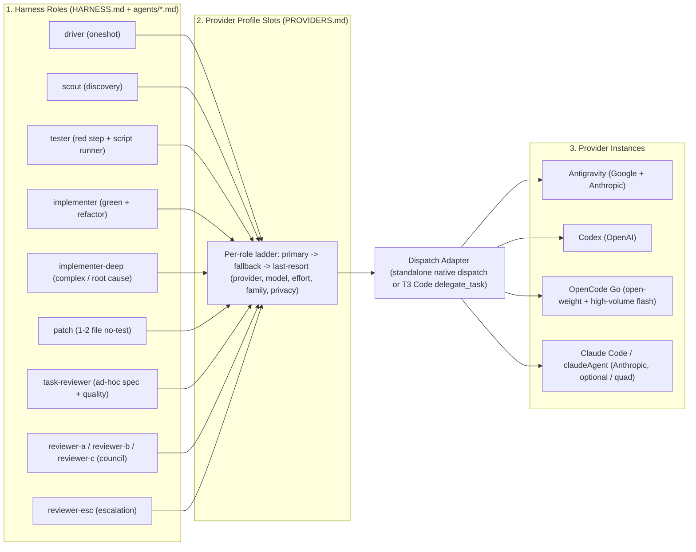
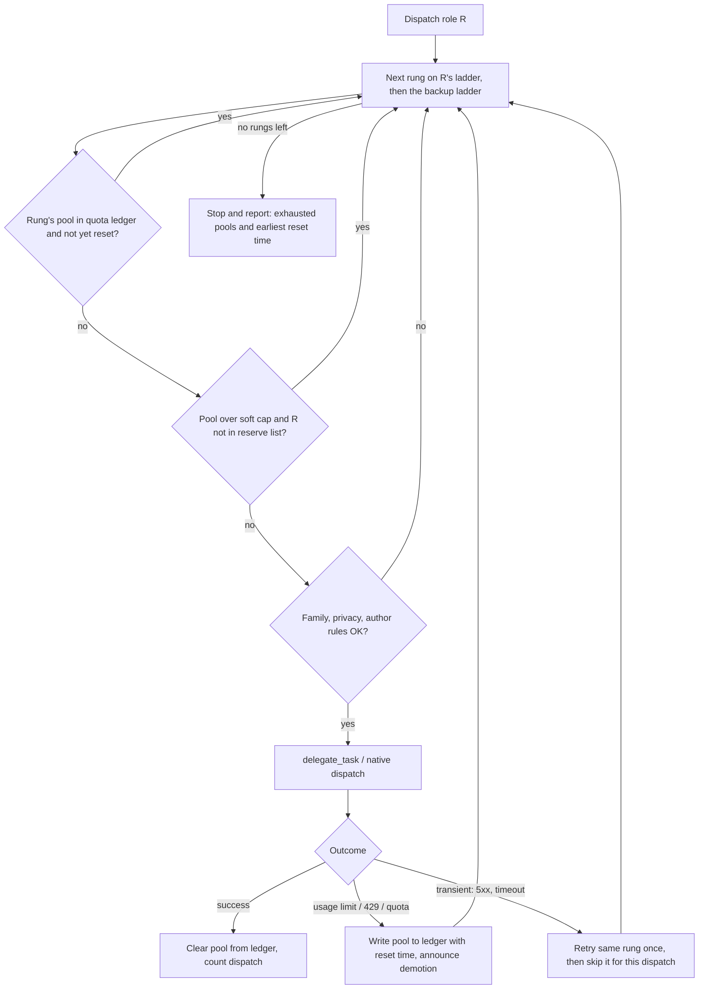

<p align="center">
  <picture>
    <source media="(prefers-color-scheme: dark)" srcset="docs/assets/logo.svg">
    
  </picture>
</p>

<h1 align="center">Cybernetic SDLC Harness</h1>

<p align="center">
  <a href="LICENSE"></a>
  
  
  
  
  
  =3.2" />
  
  
</p>

Autonomous software delivery for **T3 Code** and standalone **OpenCode V2**, **Codex**, **Antigravity**, and **Claude Code**. Orchestrates **12 composable pipeline skills** and **9 role-contract subagent seats** across four closed feedback loops (**L1 Task**, **L2 Branch Council**, **L3 CI**, **L4 Meta**).

The harness is provider-neutral: which provider, model, and effort runs each role comes from a swappable provider profile (default `tri`, `quad` with Claude Code, standalone single-provider `opencode-go`, `codex`, `antigravity`, `claude`, dynamic composition via `--providers <list>`, or any custom file via `--profile-file`). Every dispatch names an explicit rung so subagents never inherit the main session model. Every seat enforces last-match-wins permission guardrails so subagents never leak secrets.

---

## 🛠️ Installation & Setup

### Prerequisites
- **Shell**: Bash >= 3.2 (default on macOS, Linux, and WSL).
- **Supported Hosts**: T3 Code (multi-provider orchestrator), OpenCode V2, Codex CLI/Desktop, Antigravity, and Claude Code.

---

### Step-by-Step Quickstart

#### Step 1: Clone the repository
```sh
git clone https://github.com/DennisLoska/skills.git
cd skills
```

#### Step 2: Choose your profile & run the installer
Select the command matching your environment and available AI subscriptions:

| Environment & Available Subscriptions | Profile | Install Command | What Gets Wired |
| --- | --- | --- | --- |
| **T3 Code: Antigravity + Codex + OpenCode Go** *(Recommended)* | `tri` (default) | `./install.sh --target all` | Multi-provider orchestration across all hosts |
| **T3 Code: Antigravity + Codex + OpenCode Go + Claude Code** | `quad` | `./install.sh --profile quad --target all` | Offloads Anthropic fallbacks to dedicated Claude Code |
| **T3 Code: Custom Provider Stack** | Dynamic | `./install.sh --providers <list> --target all` | e.g. `--providers antigravity,codex` |
| **OpenCode V2 Standalone** | `opencode-go` | `./install.sh --profile opencode-go` | Standard `~/.config/opencode` |
| **Codex CLI/Desktop Standalone** | `codex` | `./install.sh --profile codex --target codex` | Standard `~/.codex` (`$CODEX_HOME`) |
| **Antigravity Standalone** | `antigravity` | `./install.sh --profile antigravity --target antigravity` | Standard `~/.antigravity` rules & skills |
| **Claude Code Standalone** | `claude` | `./install.sh --profile claude --target claude` | Standard `~/.claude` (`CLAUDE.md`) |

> [!TIP]
> **Running T3 Code?** Always pass `--target all`. This installs skills and contracts across all host locations so T3 Code's `delegate_task` can seamlessly dispatch subagents to any connected provider.

#### Step 3: Register instructions (OpenCode only)
- **Codex, Antigravity, and Claude Code**: **Zero configuration needed!** The installer writes to standard host locations (`AGENTS.md`, `rules/`, `CLAUDE.md`) which are auto-loaded by these platforms.
- **OpenCode V2**: OpenCode requires registering instructions in `~/.config/opencode/opencode.json`:
  ```jsonc
  {
    "$schema": "https://opencode.ai/config.json",
    "instructions": [
      "~/.config/opencode/HARNESS.md",
      "~/.config/opencode/PROVIDERS.md"
    ]
  }
  ```

#### Step 4: Verify installation health
Run the non-destructive verification tool (alias `--doctor`) to check manifest integrity, permissions, and host wiring:
```sh
./install.sh --verify
```
Exit code `0` confirms a complete, healthy installation.

---

### Installer Options & Maintenance

```sh
./install.sh [flags]
```

| Flag | Description | Default |
| --- | --- | --- |
| `--target <targets>` | Comma-separated host targets: `opencode`, `codex`, `antigravity`, `claude`, or `all`. | `opencode` |
| `--profile <name>` | Shipped profile: `tri` (default), `quad`, `opencode-go`, `codex`, `antigravity`, `claude`. | `tri` |
| `--providers <list>` | Dynamically generate profile from active providers: `antigravity`, `codex`, `claude`, `opencode`. | None |
| `--profile-file <path>` | Bind to a custom external profile file. Recorded in manifest and preserved on updates. | None |
| `--verify`, `--doctor` | Non-destructive health check (checks manifests, files, symlinks, state). | - |
| `--force` | Overwrite existing destination files and repair symlinked directories. | `false` |
| `--prune` | Remove obsolete files recorded in earlier manifests while preserving user state. | `false` |
| `-h`, `--help` | Print usage summary and exit. | - |

**Updating to latest version:**
Pull upstream updates and refresh your installed targets while keeping your machine-local quota ledger intact:
```sh
git pull
./install.sh --force --prune
./install.sh --verify
```

---

## 🧭 Cybernetic Architecture

<p align="center">
  
</p>

**At a glance**

| Question | Answer |
| --- | --- |
| **What is it?** | A gated SDLC controller (`oneshot`) plus 12 pipeline skills and 9 role-contract subagent seats, wired by four closed feedback loops. |
| **What runs where?** | Every role resolves to a *rung* (`primary` &rarr; `fallback` &rarr; `last-resort`) in a swappable provider profile, then to a provider instance, model, and effort. No harness file names a model. |
| **What does it guarantee?** | Tests-first task loops, evidence-before-claims verification, three independent council families (with non-blocking model independence), author-independent PASS, and hard budget stops instead of silent model downgrades. |
| **Where does it install?** | OpenCode, Codex, Antigravity, and Claude Code, one profile bound at install time (`--target all` for every host). |
| **How do I start?** | Run the track command for your host in [Installation & Setup](#️-installation--setup), then prompt `oneshot <task>`. |

### Three-Layer Routing Architecture



### Pipeline Flow


---

## 🧩 All 12 Skills by Role

| Role in Cybernetic Loop | Skill | When It Runs |
| --- | --- | --- |
| **Master Controller** | [`oneshot`](./skills/oneshot/SKILL.md) | Orchestrates Phases 1 &rarr; 7 end-to-end |
| **Spec & Planning** | [`shape`](./skills/shape/SKILL.md) | Phase 1: Socratic design exploration & spec commit |
| **Spec & Planning** | [`domain-modeling`](./skills/domain-modeling/SKILL.md) | Phase 1 (or standalone): builds/sharpens `GLOSSARY.md` & `docs/adr/` |
| **Spec & Planning** | [`codebase-design`](./skills/codebase-design/SKILL.md) | Phase 1 (or standalone): deep modules, seams, `DESIGN-IT-TWICE.md` |
| **Spec & Planning** | [`plan`](./skills/plan/SKILL.md) | Phase 2: bite-size TDD task decomposition |
| **L1 Task Loop (Actuation)** | [`dispatch`](./skills/dispatch/SKILL.md) | Phase 3: per-task subagent execution (`tester` &rarr; `implementer`) + 2-stage review |
| **L1 Task Loop (Discipline)** | [`tdd`](./skills/tdd/SKILL.md) | Phase 3: failing test first &rarr; minimal code &rarr; refactor |
| **L1 Task Loop (Repair)** | [`debug`](./skills/debug/SKILL.md) | Phase 3 & 4: 4-phase root-cause investigation on failures |
| **Gate Sensor** | [`verify`](./skills/verify/SKILL.md) | Phase 4 (and post-fix in L1/L2/L3): fresh command evidence check via `tester` |
| **L2 Branch Sensor/Loop** | [`council`](./skills/council/SKILL.md) | Phase 6: 3-family adversarial review + fixer loop |
| **L3 CI Sensor/Loop** | [`make-ci-green`](./skills/make-ci-green/SKILL.md) | Phase 6.5: watches PR checks & bots (`tester` logs/reruns, implementation fixes) |
| **PR & Handoff Actuator** | [`land`](./skills/land/SKILL.md) | Phase 5 (files PR) & Phase 7 (Gate 3 merge / next-feature handoff) |

---

## 🚀 Usage & Example Prompts

### 1. Full Autonomous Pipeline (`oneshot` - 3 Human Gates)

Trigger the end-to-end controller by prefixing a task with `oneshot` (or `"use oneshot"`, `"use the oneshot harness"`):

```text
oneshot build a rate-limited webhook delivery worker with exponential backoff, dead-letter queue, and SQLite persistence
```

**Pipeline execution flow (7 numbered phases plus 6.5):**
1. **Phase 1 &ndash; `shape` + `domain-modeling` + `codebase-design`:** ensures feature branch/worktree, explores context via `scout`, updates `GLOSSARY.md`/ADRs, commits spec to `docs/specs/`. *Pauses at Gate 1 for design approval.*
2. **Phase 2 &ndash; `plan`:** targets exact `path:line` references via `scout`, decomposes spec into bite-size TDD tasks in `docs/plans/`. *Pauses at Gate 2 for plan approval.*
3. **Phase 3 &ndash; `dispatch` + `tdd` (L1 Task Loop):** dispatches `tester` for failing tests, `implementer`/`implementer-deep`/`patch` to make them pass, and runs 2-stage review via `task-reviewer`. The driver orchestrates without writing code inline.
4. **Phase 4 &ndash; `verify`:** runs full test suite, lint, and build via `tester` to collect fresh pass/fail command evidence.
5. **Phase 5 &ndash; `land` (PR Filing):** pushes branch and opens GitHub PR with summary, test plan, and quota budget block.
6. **Phase 6.5 &ndash; `make-ci-green` (L3 CI Loop):** polls GitHub Actions / review bots, inspects logs via `tester`, and dispatches implementation fixers.
7. **Phase 6 &ndash; `council` (L2 Branch Loop):** 3 independent reviewer families (`reviewer-a`, `reviewer-b`, `reviewer-c`, plus `reviewer-esc` escalation). Forbids identical-model author self-review. Requires &ge;2/3 PASS and &ge;1 non-author family PASS (or intra-family model-level independence when families overlap).
8. **Phase 7 &ndash; `land` (Gate 3 Handoff):** presents finish options (merge PR, keep PR open, keep branch, discard). Merging strictly requires an audited Phase 6 `council_verdict: PASS` with `head=<sha>` match via `gh pr merge --squash --match-head-commit <sha>`, and is worktree-aware.

### 2. Zero-Gate Unattended Mode (`oneshot` Auto-Approve)

Include `auto-approve` (or `skip all approvals`, `no approval gates`, `full autonomy no questions`) to run without human pauses:

```text
oneshot auto-approve: fix the race condition in session token refresh when concurrent requests hit an expired JWT
```

### 3. Confidential Mode (Privacy Gate)

Prefix with `[confidential]` to automatically skip any rungs marked `privacy: trains` across all seats:

```text
oneshot [confidential] implement HMAC signature rotation for partner billing webhooks
```

### 4. Standalone Skills & Individual Loops

Every skill and agent seat can also run independently outside `oneshot`:

| Example Prompt | Unit Triggered | What It Does |
| --- | --- | --- |
| `"shape a plugin hook system for custom tool permissions"` | `shape` | Socratic design exploration; writes spec to `docs/specs/` |
| `"write a plan for docs/specs/2026-11-04-plugin-hooks-design.md"` | `plan` | Produces a bite-size TDD task plan in `docs/plans/` |
| `"dispatch docs/plans/2026-11-04-plugin-hooks.md"` | `dispatch` | Runs L1 per-task subagent loop (`tester` &rarr; `implementer`) + 2-stage review |
| `"implement this feature with tdd"` | `tdd` | Enforces red-green-refactor with failing behavioral tests first |
| `"debug why test/webhook-retry.test.ts fails intermittently"` | `debug` | 4-phase root-cause investigation before any fix |
| `"verify this branch is ready"` | `verify` | Dispatches `tester` to run test/lint/build commands and confirms output |
| `"council review this branch"` | `council` | Runs 3-family adversarial review loop + fixer loop |
| `"make ci green on this PR"` | `make-ci-green` | Watches PR checks/bots; inspects logs via `tester` and fixes real bugs |
| `"model the domain for the billing module"` | `domain-modeling` | Builds and sharpens `GLOSSARY.md` and ADRs |
| `"deepen this module's interface"` | `codebase-design` | Applies deep-module vocabulary, seams, and deepening moves |
| `"land it"` / `"next feature"` | `land` | Files or merges PR, fast-forwards default branch, and reports ready |

---

## 🧠 Provider Layer & Core Concepts

The harness separates concerns into three decoupled layers:

| Layer | Owns | Files |
| --- | --- | --- |
| **Harness (provider-neutral)** | Pipeline, feedback loops, caps, gates, council rules, permission policies, role contracts, and the Dispatch Adapter | `skills/**`, `agents/*.md` (no `model:` line), [`AGENTS.md`](./AGENTS.md) |
| **Provider (swappable)** | Role rungs (`primary` &rarr; `fallback` &rarr; `last-resort`), model families, effort, privacy tags, and quota pools | `providers/<profile>.md`, dynamic `--providers <list>`, or external file |
| **Install (binding)** | Binds active profile to selected host targets (`opencode`, `codex`, `antigravity`, `claude`, or `all`) | `install.sh --profile <name>` or `install.sh --providers <list>` |

---

### 💡 High-Level Concepts: Tri vs Quad, Council, and Fallbacks

#### 1. `tri` vs `quad` Profiles: The Multi-Subscription Strategy

- **`tri` (The 3-Subscription Foundation: Antigravity + Codex + OpenCode Go Plus)**:
  - **Philosophy**: Allocates expensive frontier reasoning tokens where human judgment matters most, while running high-volume pipeline phases on high-allowance open-weight models.
  - **Workload Split**:
    - **Antigravity**: Carries Google Gemini frontier reasoning (`gemini-4-carbon`, `gemini-4-argon`) for primary implementation (`implementer`, `implementer-deep`), plus Anthropic Claude (`claude-opus-5-5`, `claude-sonnet-5-5`).
    - **Codex**: Carries OpenAI frontier reasoning (`gpt-6-astra`) for Council Seat A, `gpt-6.1-sol` for the pipeline driver, `gpt-6.1-terra` for task reviews, and `gpt-6-luna` for fast testing/compaction.
    - **OpenCode Go Plus**: Carries open-weight models with massive 5-hour rolling allowances (~60,000&ndash;90,000 req/5h) for `scout` (`mimo-v2.6-flash`), `tester` & `patch` (`deepseek-v4.1-flash`), Council Seat C (`muse-spark-1.3-contributor`), and escalation (`mimo-v2.6-flash` / `glm-5.3-flash`).
- **`quad` (The 4-Subscription Powerhouse: `tri` + Dedicated Claude Code)**:
  - **The Problem in `tri`**: In Antigravity, Anthropic Claude quota is subject to tight 5-hour rolling caps. If workhorse fallbacks (`implementer` fallback, `driver` fallback, `task-reviewer` fallback, or compaction) consume Anthropic tokens in Antigravity, they can exhaust the quota needed for Council Seat B (`claude-opus-5-5`) before Phase 6 review even begins!
  - **The Quad Solution**: Connects your standalone Claude Code subscription (via T3 Code provider instance `claudeAgent`). `quad` offloads all high-volume Anthropic tasks to `claudeAgent`, shielding Antigravity's Claude pool strictly for Council Seat B (`reviewer-b`).

#### 2. The Council: Adversarial Multi-Family Review (Phase 6)

- **Why Multi-Family?** Single-model reviews suffer from self-confirmation bias, hallucinated validations, and identical architectural blind spots. The Council enforces rigorous, multi-perspective scrutiny before any branch can merge.
- **Council Seats**:
  - **Seat A (`reviewer-a`)**: OpenAI frontier family (`gpt-6-astra` via Codex).
  - **Seat B (`reviewer-b`)**: Anthropic frontier family (`claude-opus-5-5` via Antigravity or `claudeAgent`).
  - **Seat C (`reviewer-c`)**: Meta / Open-source frontier family (`muse-spark-1.3-contributor` via OpenCode Go).
  - **Escalation (`reviewer-esc`)**: A 4th independent family dispatched if the council deadlocks after 3 rounds.
- **Core Council Invariants**:
  - **Author-Reviewer Independence**: A model that authored code (`implementer`, `tester`, `patch`, or fixers) cannot review its own code. Identical-model self-review is strictly forbidden.
  - **Non-Blocking Model Independence**: Council requires &ge;2 distinct non-author reviewer models. If families overlap or a seat is lost, model-level independence satisfies the author vote so development proceeds without deadlocks.
  - **Actionable Severity Syntax**: Findings must strictly follow `path:line: emoji severity: problem. fix.` (RED = bug/must-fix, YELLOW = risk, BLUE = nit on request). Zero subjective chatter or performative praise.
  - **Closed Fixer Loop**: Red findings trigger `implementer` fixes &rarr; `tester` regression checks &rarr; `make-ci-green` PR checks &rarr; re-review by all active council seats together (maximum 3 rounds).

#### 3. Cybernetic Fallbacks & Quota Resilience

- **Per-Role 3-Tier Ladder**: Every role in `PROVIDERS.md` defines `primary` &rarr; `fallback` &rarr; `last-resort`. Crucially, fallbacks swap provider quota pools so a single provider 429 never deadlocks a task.
- **Shared Quota Pools & Soft Caps**: Models sharing an underlying subscription pool (e.g. `antigravity-claude`) are grouped into pools. Soft caps prevent workhorse tasks from consuming tokens reserved for critical seats.
- **Machine-Local Quota Ledger (`state/quota-ledger.tsv`)**: When a 429 or rate limit occurs, the pool and its cooldown timestamp are recorded in the ledger. Subsequent dispatches immediately skip dead pools without burning API calls or latency.
- **Sibling Hand-Off & Backup Ladder**: If a role exhausts all 3 ladder rungs, implementation seats attempt sibling hand-off (`implementer-deep` &harr; `implementer`), followed by ascending traversal of `## Backup ladder`.
- **Hard Budget Stops**: When all eligible rungs are exhausted, the harness stops cleanly with `budget stop: <role>` and reports the earliest reset time, refusing to silently downgrade to an inferior model or hallucinate.

---

### Which profile do I pick?

| Subscriptions you have | Profile to install | Command |
| --- | --- | --- |
| **Antigravity + Codex + OpenCode Go** | `tri` (default) | `./install.sh` (or `./install.sh --profile tri --target all`) |
| **Antigravity + Codex + OpenCode Go + Claude Code** | `quad` | `./install.sh --profile quad --target all` |
| **Only OpenCode Go** | `opencode-go` | `./install.sh --profile opencode-go` |
| **Only Codex / ChatGPT** | `codex` | `./install.sh --profile codex --target codex` |
| **Only Antigravity** | `antigravity` | `./install.sh --profile antigravity --target antigravity` |
| **Only Claude Code** | `claude` | `./install.sh --profile claude --target claude` |
| **Any other mix** (e.g., Codex + Claude, Antigravity + OpenCode) | Dynamic composition (or custom file) | `./install.sh --providers <list>` (e.g., `./install.sh --providers codex,claude --target all`) or `./install.sh --profile-file <path>` |

### Provider Setup Overview

| Provider | Instance ID | Effort Option ID & Values | Example Model IDs | Limit Inspection |
| --- | --- | --- | --- | --- |
| **OpenCode Go** | `opencode` | `variant` (`low\|medium\|high\|xhigh\|max`, or `-`) | `muse-spark-1.3-contributor`, `deepseek-v4.1-flash`, `mimo-v2.6-flash`, `glm-5.3-flash` | `opencode.ai/docs/go` console (monthly $ allowance + 5h rolling cap) |
| **Antigravity** | `antigravity` | `thinking_level` (`low\|medium\|high`) | `gemini-4-carbon`, `gemini-4-argon`, `gemini-3.8-flash`, `claude-opus-5-5`, `claude-sonnet-5-5` | `/status` in Antigravity (rolling 5-hour window) |
| **Codex** | `codex` | `reasoningEffort` (`low\|medium\|high\|xhigh`) | `gpt-6-astra`, `gpt-6.1-sol`, `gpt-6-luna`, `gpt-6-sol` | `/status` in Codex (rolling 5-hour window) |
| **Claude Code** | `claudeAgent` | `effort` (`low\|medium\|high\|xhigh\|max\|...`) | `claude-opus-5-5`, `claude-sonnet-5-5`, `claude-haiku-5-5` | `/status` in Claude Code (rolling 5-hour window) |

### Dispatch Adapter Paths

The Dispatch Adapter in [`AGENTS.md`](./AGENTS.md) resolves each role's rung in ladder order:
- **Path 1 (T3 Code Orchestration):** Dispatches across all enabled providers (`antigravity`, `codex`, `claudeAgent`, `opencode`) via `delegate_task`.
- **Path 2 (Standalone OpenCode Pin):** When `t3-code` is absent, runs natively via `subagent`/`task` matching the seat's rendered `model:` pin without override. A seat with no `opencode` ladder rung installs without a `model:` pin and never uses Path 2.
- **Path 3 (Standalone Same-Provider Dispatch):** Native dispatch when active host matches the rung's provider (`opencode`, `codex` `spawn_agent`, `claudeAgent` `Agent`, or `antigravity` `invoke_subagent`).
- **Path 4 (Unreachable):** Rung is unreachable on current host; skipped immediately at zero council budget cost.

### Quota Ledger & Budget Fallback



- **Shared Quota Pools:** Groups models sharing a subscription bucket (e.g., `antigravity-claude` for `claude-*` in Antigravity).
- **Soft Caps & Reserves:** Limits non-essential dispatches to reserve precious frontier quota for council seats (e.g. reserving Anthropic quota for `reviewer-b`).
- **Machine-Local Ledger:** Tracks exhausted pools at `<dest>/state/quota-ledger.tsv`. Pruned automatically on read; can be inspected or cleared anytime:
  ```sh
  cat ~/.config/opencode/state/quota-ledger.tsv
  rm -f ~/.config/opencode/state/quota-ledger.tsv
  ```
- **Profiles Summary:** See [`providers/tri.md`](./providers/tri.md) (default multi-provider), [`providers/quad.md`](./providers/quad.md) (with Claude Code), [`providers/opencode-go.md`](./providers/opencode-go.md), [`providers/codex.md`](./providers/codex.md), [`providers/antigravity.md`](./providers/antigravity.md), and [`providers/claude.md`](./providers/claude.md) for full routing tables, quota pools, and backup ladders.

---

## ⚙️ Configure Models

To customize models without modifying the repository, copy a profile, edit the rows, and install with `--profile-file`:

```sh
mkdir -p ~/.config/oneshot
cp providers/tri.md ~/.config/oneshot/my-profile.md
# edit ~/.config/oneshot/my-profile.md
./install.sh --force --profile-file ~/.config/oneshot/my-profile.md
```

**One-row override example** (swapping `reviewer-esc` primary to `glm-5.3-flash`):

```text
| role | rung | provider | model | effort | family | privacy |
| --- | --- | --- | --- | --- | --- | --- |
| reviewer-esc | primary | opencode | opencode-go/glm-5.3-flash | variant=high | zhipu | ok |
```

- Each profile must define a `primary` row for all ten dispatched roles (`scout`, `tester`, `implementer`, `implementer-deep`, `patch`, `task-reviewer`, `reviewer-a`, `reviewer-b`, `reviewer-c`, `reviewer-esc`).
- Optional sections: `## Quota pools` (bucket definitions) and `## Backup ladder` (safety net rungs).

---

## 🤖 Agent Quickstart

| You want to change | Touch only | Then verify |
| --- | --- | --- |
| Which model runs a role | `providers/<profile>.md` (all matching profiles) | Update pin expectations in `test/install.sh`, then `bash test/install.sh` |
| Routing, loops, caps, permissions | [`AGENTS.md`](./AGENTS.md) + affected `skills/*/SKILL.md` | `bash test/install.sh` (HARNESS.md must equal AGENTS.md) |
| A seat's contract | `agents/<seat>.md` (never add a `model:` line) | `bash test/install.sh` |
| Installer behavior or host target | `install.sh` | Add pass-gated test in `test/install.sh`, then run under `bash` and `/bin/bash` |
| A pipeline stage | Owning `skills/<name>/SKILL.md` | `bash test/install.sh` and verify state artifact consistency |

**Invariants:**
- Harness files (`skills/**`, `agents/*.md`, `AGENTS.md`) contain **no** concrete model IDs or provider quotas.
- Every profile defines a `primary` row for all ten dispatched roles; advisory rows (`driver`, `compaction`) remain optional.
- Council requires &ge;2 distinct non-author reviewer models (model-level independence satisfies the author vote when families overlap, preventing council blocking). Identical-model author self-review is strictly forbidden.
- In T3 Code, Path 1 (`delegate_task`) dispatches every provider; standalone OpenCode uses Path 2 only when the rung matches its installed pin, or Path 3 same-provider dispatch.
- Never commit or push to `main`/`master`; work on `feat/<topic>` and land through a PR.

**Verification commands:**
```sh
bash -n install.sh && bash -n test/install.sh   # syntax gate
bash test/install.sh                            # full contract suite (throwaway HOME)
/bin/bash test/install.sh                       # macOS Bash 3.2 compatibility
```

---

## 📂 Structure

```text
agents/           9 role-contract seats:       implementer, implementer-deep,
                  tester, scout, patch,        reviewer-a, reviewer-b,
                  reviewer-c, reviewer-esc
skills/           12 pipeline skills:          oneshot, shape, plan, dispatch,
                                               tdd, debug, verify, council, land,
                                               make-ci-green, domain-modeling,
                                               codebase-design
providers/        swappable provider profiles: tri (default), quad (tri + Claude Code),
                                               opencode-go, codex, antigravity, claude
docs/             design specs and plans:      docs/specs/, docs/plans/
docs/assets/      vector visuals:              logo.svg, architecture.svg
test/install.sh   146-assertion contract suite (runs in throwaway HOME on Bash >=3.2)
AGENTS.md         harness routing instructions (installed as <dest>/HARNESS.md)
install.sh        multi-host installer         (opencode, codex, antigravity, claude, all)
NOTICE            upstream MIT attribution     (mattpocock/skills)
LICENSE           MIT license
```

---

## 🧪 Testing

Run the 146-assertion installer contract suite (hermetic throwaway `HOME` under `$TMPDIR`):

```sh
bash -n install.sh && bash -n test/install.sh
bash test/install.sh
/bin/bash test/install.sh   # macOS Bash 3.2 compatibility
```

---

## 📄 License

MIT. See [LICENSE](LICENSE) and [NOTICE](NOTICE).
