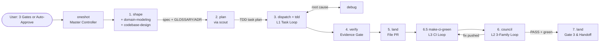

<h1 align="center">Cybernetic SDLC Harness</h1>

<p align="center">
  <em>Sense, act, verify, reach consensus, and land.</em><br/>
  A self-owned cybernetic SDLC control system for OpenCode V2 - one gated controller (<code>oneshot</code>), four closed feedback loops, nine role-contract agent seats routed through a swappable provider profile, and twelve pipeline skills.
</p>

<p align="center">
  <a href="LICENSE"></a>
  
  
  
  
  
  =3.2" />
  
</p>

<p align="center">
  <a href="#-cybernetic-architecture">Architecture</a> •
  <a href="#-all-12-skills-by-role">Skills Map</a> •
  <a href="#-usage--example-prompts">Usage & Prompts</a> •
  <a href="#-provider-layer">Provider Layer</a> •
  <a href="#-structure">Structure</a> •
  <a href="#️-installation-for-agents-and-humans">Installation</a> •
  <a href="#-testing">Testing</a>
</p>

---

> **License:** MIT - see [LICENSE](LICENSE) and [NOTICE](NOTICE) (upstream MIT attribution for `domain-modeling` and `codebase-design` adapted from `mattpocock/skills`).

Autonomous software delivery for **OpenCode V2**. Orchestrates **12 composable pipeline skills** and **9 role-contract subagent seats** across four closed feedback loops (**L1 Task**, **L2 Branch Council**, **L3 CI**, **L4 Meta**). The harness is provider-neutral: which provider, model, and effort runs each role comes from a swappable provider profile (default `tri`, legacy `opencode-go`), and every dispatch names a rung so subagents never inherit the main session model (a seat with no `opencode` rung has no native pin and is reached only through `delegate_task`). Every seat enforces last-match-wins permission guardrails so subagents never leak secrets.

---

## 🧭 Cybernetic Architecture



### Full Pipeline & Seat Wiring (ASCII)

```text
+======================================================================================+
|                           [1. oneshot] (Master Controller)                           |
|       State: $(git rev-parse --git-dir)/info/oneshot-state.md  |  auto-approve: true |
+======================================================================================+
        |
        v
+--------------------------------------------------------------------------------------+
| PHASE 1: DESIGN & ARCHITECTURE                                                       |
|                                                                                      |
|   [2. shape]  <--- explores context via ---> (scout)                                 |
|       |                                                                              |
|       +---> [3. domain-modeling]  (if domain terms/decisions change)                 |
|       |         writes/updates GLOSSARY.md, GLOSSARY-MAP.md, docs/adr/NNNN-slug.md   |
|       |                                                                              |
|       +---> [4. codebase-design]  (if module interfaces or seams change)             |
|       |         applies deep-module vocabulary, DEEPENING.md, DESIGN-IT-TWICE.md     |
|       |                                                                              |
|       +---> writes & commits docs/specs/YYYY-MM-DD-<topic>-design.md (+ glossary/adr)|
|       +---> Gate 1 (user approval, or skipped under auto-approve)                    |
+--------------------------------------------------------------------------------------+
        |
        v
+--------------------------------------------------------------------------------------+
| PHASE 2: TASK DECOMPOSITION                                                          |
|                                                                                      |
|   [5. plan]   <--- maps exact file:line via ---> (scout)                             |
|       |                                                                              |
|       +---> decomposes spec into bite-size TDD tasks + glossary/seam invariants      |
|       +---> writes & commits docs/plans/YYYY-MM-DD-<feature>.md                      |
|       +---> Gate 2 (user approval, or auto-satisfied under auto-approve)             |
+--------------------------------------------------------------------------------------+
        |
        v
+--------------------------------------------------------------------------------------+
| PHASE 3: L1 TASK FEEDBACK LOOP (Per-Task Actuation & Sensing)                        |
|                                                                                      |
|   [6. dispatch]  (orchestrates sequential or parallel task fan-out)                  |
|       |                                                                              |
|       +---> Step 0 branch check (`git branch --show-current` != main/master)         |
|       |                                                                              |
|       +---> Actuators (execute task via [7. tdd] red -> green -> refactor):          |
|       |       - (implementer)                default A                               |
|       |       - (implementer-b)              default B                               |
|       |       - (implementer-deep)           complex/hard                            |
|       |       - (patch)                      1-2 file no-test                        |
|       |                                                                              |
|       +---> On task failure / test red (up to 3 fix attempts -> 2 debug rotations):  |
|       |       routes to [8. debug] (root-cause tracing, defense-in-depth, polluter)  |
|       |       then re-dispatches (escalating to implementer-deep if needed)          |
|       |                                                                              |
|       +---> Per-Task Sensors (ad-hoc role `task-reviewer`):                          |
|               Stage 1: spec-reviewer-prompt.md (checks spec + GLOSSARY.md drift)     |
|               Stage 2: quality-reviewer-prompt.md (council rules on task diff)       |
+--------------------------------------------------------------------------------------+
        |
        v
+--------------------------------------------------------------------------------------+
| PHASE 4: COMPLETION GATE                                                             |
|                                                                                      |
|   [9. verify]                                                                        |
|       +---> runs full test suite, typecheck, linter, and build                       |
|       +---> confirms fresh command output for every spec requirement before Phase 5  |
|       +---> if anything fails: routes back to [8. debug] / [6. dispatch]             |
+--------------------------------------------------------------------------------------+
        |
        v
+--------------------------------------------------------------------------------------+
| PHASE 5: PR FILING                                                                   |
|                                                                                      |
|   [10. land] (Part 1)                                                                |
|       +---> pushes `feat/<topic>` and opens PR (`## Summary`, `## Changes`,          |
|             `## Test plan`)                                                          |
+--------------------------------------------------------------------------------------+
        |
        v
+--------------------------------------------------------------------------------------+
| PHASE 6.5: L3 CI & BOT FEEDBACK LOOP                                                 |
|                                                                                      |
|   [11. make-ci-green]                                                                |
|       +---> bounded poll of `gh pr checks` and `gh pr view --json reviews,labels`    |
|       +---> real failure (max 3 fix_rounds):                                         |
|               - test-running fix -> (implementer / implementer-b) + [9. verify]      |
|               - no-test 1-2 file -> (patch)                                          |
|       +---> suspected flake: requires concrete log-line comment, reruns once max     |
+--------------------------------------------------------------------------------------+
        |
        v
+--------------------------------------------------------------------------------------+
| PHASE 6: L2 BRANCH CONSENSUS LOOP (Max 3 Rounds, Cap 14 Dispatches)                  |
|                                                                                      |
|   [12. council]                                                                      |
|       +---> 3 independent adversarial reviewer families in parallel:                 |
|       |       - Seat A:   (reviewer-a)    independent family 1                       |
|       |       - Seat B:   (reviewer-b)    independent family 2                       |
|       |       - Seat C:   (reviewer-c)    independent family 3                       |
|       |       - Last-res: (reviewer-esc)  fourth family, escalation only             |
|       |                                                                              |
|       +---> checks diff vs spec/plan, security, edge cases, and GLOSSARY.md drift    |
|       +---> on FAIL: dispatches (implementer / implementer-b) or no-test (patch),    |
|             runs [9. verify], pushes, and re-enters [11. make-ci-green] if commits   |
|             were pushed after last green CI receipt                                  |
+--------------------------------------------------------------------------------------+
        |
        | (PASS: >=2/3 seats PASS + 0 confirmed reds + green tests + 1 non-author-family PASS)
        v
+--------------------------------------------------------------------------------------+
| PHASE 7: FINISH & NEXT-FEATURE HANDOFF                                               |
|                                                                                      |
|   [10. land] (Parts 2 & 3 - Gate 3)                                                  |
|       +---> Interactive: 1. Merge PR  2. Keep PR open  3. Keep branch  4. Discard    |
|       +---> Auto-approve: skips menu, defaults to Keep PR open                       |
|       +---> On Merge: squash-merges PR, syncs default branch (worktree-aware),       |
|             prunes merged local branch, removes oneshot-state.md,                    |
|             and records completion in memory (L4 Meta Loop)                          |
+--------------------------------------------------------------------------------------+
```

---

## 🧩 All 12 Skills by Role

| Role in Cybernetic Loop | Skill | When It Runs |
| --- | --- | --- |
| **Master Controller** | [`oneshot`](./skills/oneshot/SKILL.md) | Orchestrates Phases 1 -> 7 end-to-end |
| **Spec & Planning** | [`shape`](./skills/shape/SKILL.md) | Phase 1: Socratic design exploration & spec commit |
| **Spec & Planning** | [`domain-modeling`](./skills/domain-modeling/SKILL.md) | Phase 1 (or standalone): builds/sharpens `GLOSSARY.md` & `docs/adr/` |
| **Spec & Planning** | [`codebase-design`](./skills/codebase-design/SKILL.md) | Phase 1 (or standalone): deep modules, seams, `DESIGN-IT-TWICE.md` |
| **Spec & Planning** | [`plan`](./skills/plan/SKILL.md) | Phase 2: bite-size TDD task decomposition |
| **L1 Task Loop (Actuation)** | [`dispatch`](./skills/dispatch/SKILL.md) | Phase 3: per-task subagent execution + 2-stage review |
| **L1 Task Loop (Discipline)** | [`tdd`](./skills/tdd/SKILL.md) | Phase 3: failing test first -> minimal code -> refactor |
| **L1 Task Loop (Repair)** | [`debug`](./skills/debug/SKILL.md) | Phase 3 & 4: 4-phase root-cause investigation on failures |
| **Gate Sensor** | [`verify`](./skills/verify/SKILL.md) | Phase 4 (and post-fix in L1/L2/L3): fresh command evidence check |
| **L2 Branch Sensor/Loop** | [`council`](./skills/council/SKILL.md) | Phase 6: 3-family adversarial review + fixer loop |
| **L3 CI Sensor/Loop** | [`make-ci-green`](./skills/make-ci-green/SKILL.md) | Phase 6.5: watches PR checks & bots, repairs real failures |
| **PR & Handoff Actuator** | [`land`](./skills/land/SKILL.md) | Phase 5 (files PR) & Phase 7 (Gate 3 merge / next-feature handoff) |

---

## 🚀 Usage & Example Prompts

### 1. Full Autonomous Pipeline (`oneshot` - 3 Human Gates)

Trigger the end-to-end controller by prefixing a task with `oneshot`:

```text
oneshot build a rate-limited webhook delivery worker with exponential backoff, dead-letter queue, and SQLite persistence
```

What happens across the 7 numbered phases plus 6.5:

1. **Phase 1 - `shape` + `domain-modeling` + `codebase-design` (Design & Spec):** creates branch `feat/webhook-delivery-worker`, explores context via `scout`, invokes `domain-modeling` (when domain terms or ADRs change) and `codebase-design` (when module interfaces or seams change), and writes and commits `docs/specs/YYYY-MM-DD-webhook-delivery-worker-design.md` alongside any created or modified `GLOSSARY.md` / `docs/adr/` files. **Pauses at Gate 1 for design approval.**
2. **Phase 2 - `plan` (Task Decomposition):** maps exact `path:line` targets via `scout` and breaks the approved spec into bite-size TDD tasks with exact file paths, glossary/seam invariants, and verification commands in `docs/plans/YYYY-MM-DD-webhook-delivery-worker.md`. **Pauses at Gate 2 for plan approval.**
3. **Phase 3 - `dispatch` + `tdd` (L1 Task Loop):**
   - Dispatches `scout` for compressed `path:line` discovery without polluting main-session context.
   - Dispatches fresh per-task `implementer` or `implementer-b` subagents following strict red-green-refactor TDD.
   - Escalates complex multi-file architecture tasks or 3x task failures (via `debug`) to `implementer-deep`.
   - Runs two-stage review after every task: Stage 1 spec compliance, then Stage 2 code quality (role `task-reviewer`, skipping any rung whose family wrote the code).
4. **Phase 4 - `verify` (Evidence Gate):** runs the full test suite, typecheck, linter, and build, confirming every spec checklist item with fresh command output.
5. **Phase 5 - `land` (PR Filing):** pushes the feature branch and opens a problem-led GitHub PR (`## Summary`, `## Changes`, `## Test plan`).
6. **Phase 6.5 - `make-ci-green` (L3 CI Loop):** watches GitHub Actions and review bots, dispatches implementation-seat fixers on real failures, and requires concrete log-line evidence before retrying a suspected flake.
7. **Phase 6 - `council` (L2 Branch Loop):** dispatches 3 adversarial reviewers from independent model families in parallel (`reviewer-a`, `reviewer-b`, `reviewer-c`, one family each per the active provider profile). Any confirmed red finding triggers implementation-seat fixers and re-review (up to 3 rounds, then `reviewer-esc` on a fourth family). PASS also needs one vote from a seat whose family authored none of the commits; if every seat's family is an author family, `reviewer-esc` supplies it as one extra budgeted dispatch, else `yellow: degraded council`.
8. **Phase 7 - `land` (Gate 3 Finish & Handoff):** presents finish options (merge PR and hand off to default branch, keep PR open, keep branch, or Discard).

### 2. Zero-Gate Unattended Mode (`oneshot` Auto-Approve)

Include an explicit bypass phrase (`auto-approve`, `skip all approvals`, `no approval gates`, or `full autonomy no questions`) in the initial prompt to run Phases 1 through 7 non-stop without human pauses:

```text
oneshot auto-approve: fix the race condition in session token refresh when concurrent requests hit an expired JWT
```

The controller passes `auto-approve: true` (plus the trigger phrase) into `shape` and `plan`, and `shape` writes the exact literal `auto-approve: true` into the spec header before committing the spec. Both `shape` and `plan` read `auto-approve: true` and suppress their own approval waits; the rest of the pipeline then runs autonomously through CI verification and council consensus.

### 3. Confidential Mode (Privacy Gate)

Mark a prompt or diff as confidential to engage the privacy gate automatically:

```text
oneshot [confidential] implement HMAC signature rotation for partner billing webhooks
```

Any rung marked `privacy: trains` in the active provider profile (`PROVIDERS.md`; the routing rule lives in [`AGENTS.md`](./AGENTS.md)) is automatically skipped across both implementation and council seats, routing only to `privacy: ok` rungs. The default `tri` profile has none; the legacy `opencode-go` profile marks `muse-spark-*`.

### 4. Standalone Skills & Individual Loops

Every pipeline skill and seat agent can also be triggered directly outside a full `oneshot` run:

| Example Prompt | Unit Triggered | What It Does |
| --- | --- | --- |
| `"shape a plugin hook system for custom tool permissions"` | `shape` | Socratic design exploration; writes spec to `docs/specs/` |
| `"write a plan for docs/specs/2026-11-04-plugin-hooks-design.md"` | `plan` | Produces a bite-size TDD task plan in `docs/plans/` |
| `"dispatch docs/plans/2026-11-04-plugin-hooks.md"` | `dispatch` | Runs the L1 per-task subagent loop + two-stage review on an existing plan |
| `"implement this feature with tdd"` | `tdd` | Enforces red-green-refactor with a failing behavioral test before production code |
| `"debug why test/webhook-retry.test.ts fails intermittently"` | `debug` | 4-phase root-cause investigation before any fix is proposed |
| `"verify this branch is ready"` | `verify` | Runs test, lint, typecheck, and build commands and confirms output before any completion claim |
| `"council review this branch"` | `council` | Runs the 3-family adversarial review loop (`reviewer-a`, `reviewer-b`, `reviewer-c`) + implementation-seat fixes |
| `"make ci green on this PR"` | `make-ci-green` | Watches PR checks and review bots until green; fixes real bugs through implementation seats |
| `"model the domain for the billing module"` | `domain-modeling` | Builds and sharpens `GLOSSARY.md` and ADRs so code vocabulary matches the domain |
| `"deepen this module's interface"` | `codebase-design` | Applies deep-module vocabulary, seams, and deepening moves to an existing codebase |
| `"land it"` / `"next feature"` | `land` | Files or merges the PR, checks out default branch, pulls latest, and reports ready |

---

## 🧠 Provider layer

The harness is split into three layers so providers can be swapped or mixed without editing it:

| Layer | Owns | Files |
| --- | --- | --- |
| Harness (provider-neutral) | pipeline, loops, caps, gates, council contract, permission policy, role contracts, the Dispatch Adapter, the routing *rules* (ladder walk, family independence, privacy gate, budget guard) | `skills/**`, `agents/*.md` (no `model:` line), [`AGENTS.md`](./AGENTS.md) |
| Provider (swappable) | which provider instance, model, and effort runs each role; fallback ladders; model families; privacy class; quotas and provider notes | `providers/<profile>.md` |
| Install (binding) | binds one profile to one install: copies it as `<dest>/PROVIDERS.md` and renders each seat's native pin | `install.sh --profile <name>` |

No harness file names a concrete model ID, provider quota, or provider-specific effort value. The Dispatch Adapter in [`AGENTS.md`](./AGENTS.md) turns a role into a running subagent: the controller walks each role's rungs in ladder order. For the current rung it dispatches natively with no override when the rung is the seat's installed native pin on an OpenCode host; otherwise through T3 Code `delegate_task` (provider instance, model, and the rung's effort option, or `{}` for `-`) for any provider, including non-pinned `opencode` rungs; or, on an OpenCode host without T3 tools, natively with an explicit `model` override (best-effort if the build ignores overrides). Before the first dispatch the controller calls `orchestrator_capabilities` once; a provider, model, or option it does not list, a disabled provider, or a `delegate_task` rejection makes the rung unreachable. A rung none of these can reach is skipped like an exhausted one (skips cost no council budget). A seat whose ladder has no `opencode` rung installs with no `model:` line and is never dispatched natively. An implementation seat with no reachable rung hands its task to the next implementation seat (`implementer-deep` -> `implementer` -> `implementer-b`, `implementer` <-> `implementer-b`, never revisiting an exhausted seat); with all exhausted, or `scout`/`patch` with none, the dispatch stops and reports, never running on the driver model. Design alternatives run on distinct-family `implementer-deep`, then `implementer`/`implementer-b` rungs (announcing `degraded design: N families` when too few are reachable).

### Default profile `tri`

Three subscriptions: Antigravity (Google + Anthropic models), Codex (OpenAI models), and OpenCode Go (open-weight long tail, cheap high-allowance quota). The distribution principle is token-output efficiency: spend frontier output tokens only where each token carries the most judgment, and push volume to the cheapest model that is still reliable for it.

- **Driver** emits little (briefs, verdicts, gate decisions) but its mistakes fan out to every child: frontier model, high effort.
- **Discovery** is read-heavy, write-light: a long-context flash model at low effort. Output is a compressed `path:line` table, so the expensive part is input, which flash models price lowest.
- **Implementation** produces the bulk of all output tokens: strong mid-tier coders at medium effort; frontier only for `implementer-deep`.
- **Per-task review** runs once per task, often: a flash model from a family that did not write the code.
- **Council** outputs are short and decide the merge: one frontier model per family (Google, Anthropic, OpenAI) at equal `high` effort so votes are comparable. Each council seat demotes inside its own family first, then out of family; every seat's last resort sits on a different provider than its primary, so one provider outage never empties a seat (the exception is `reviewer-esc`, whose whole ladder is OpenCode Go).
- **Escalation** is a fourth family none of the council seats (`reviewer-a`, `reviewer-b`, `reviewer-c`) uses, so its verdict stays independent; implementation rungs do not count. It needs a family unused by council seats this PR: `reviewer-a`'s last resort (zhipu) can consume one escalation rung if it is reached, leaving moonshot and deepseek.

Supported driver setups (the `driver` row stays advisory):

1. **OpenCode host:** native seats, plus `delegate_task` when OpenCode runs inside T3 Code.
2. **Any T3 Code provider session** (for example Antigravity `claude-opus-5-5`): tell it to load `<dest>/HARNESS.md`, `<dest>/PROVIDERS.md`, and the skills from `<dest>/skills/`; it dispatches only via `delegate_task`, and permissions are self-enforced.

| role | primary | fallback | last-resort |
| --- | --- | --- | --- |
| driver (advisory) | antigravity `claude-opus-5-5` high | codex `gpt-6.1-sol` high | - |
| scout | antigravity `gemini-3.8-flash` low | opencode `mimo-v2.6-flash` | codex `gpt-6-luna` low |
| implementer | codex `gpt-6.1-terra` medium | antigravity `claude-sonnet-5-5` medium | opencode `deepseek-v4.1-flash` high |
| implementer-b | antigravity `claude-sonnet-5-5` medium | codex `gpt-6.1-terra` medium | opencode `glm-5.3` high |
| implementer-deep | codex `gpt-6.1-sol` high | antigravity `gemini-4-argon` high | antigravity `claude-opus-5-5` high |
| patch | codex `gpt-6-luna` medium | opencode `deepseek-v4.1-flash` high | antigravity `gemini-3.8-flash` medium |
| task-reviewer | antigravity `gemini-3.8-flash` high | opencode `glm-5.3-flash` high | codex `gpt-6-luna` high |
| reviewer-a (Google) | antigravity `gemini-4-argon` high | antigravity `gemini-3.8-flash` high | opencode `glm-5.3` high |
| reviewer-b (Anthropic) | antigravity `claude-opus-5-5` high | antigravity `claude-sonnet-5-5` high | opencode `claude-haiku-5-5` high |
| reviewer-c (OpenAI) | codex `gpt-6.1-sol` high | codex `gpt-6-sol` high | opencode `gpt-6-luna` high |
| reviewer-esc | opencode `kimi-k3.1-pro` high | opencode `deepseek-v4.1-flash` max | opencode `glm-5.3` high |
| compaction (advisory) | antigravity `gemini-3.8-flash` low | opencode `claude-haiku-5-5` low | - |

`muse-spark-*` (trains on request data) is dropped from `tri`. See [`providers/tri.md`](./providers/tri.md) for the full machine-readable table.

### Legacy profile `opencode-go`

[`providers/opencode-go.md`](./providers/opencode-go.md) carries the original single-provider setup unchanged: every seat on `opencode-go/*`, the same models, efforts, ladders, request quotas, privacy footnotes, and off-peak note, plus `task-reviewer`, advisory `driver`, and `compaction` rows. Install it with `./install.sh --profile opencode-go`; the installed `model:` lines and their position match the pre-decoupling seat files.

### Writing a new profile

Copy an existing profile to `providers/<name>.md` (the name matches `[a-z0-9][a-z0-9-]*`). It is free markdown prose (quotas, privacy notes, rationale) plus one routing table; the installer parses only table rows whose first cell is a known role name:

```text
| role | rung | provider | model | effort | family | privacy |
| --- | --- | --- | --- | --- | --- | --- |
| scout | primary | antigravity | gemini-3.8-flash | thinking_level=low | google | ok |
```

- `rung` is `primary`, `fallback`, or `last-resort`; ladder order is that order. Every profile must define a `primary` row for all ten dispatched roles (the nine seats plus `task-reviewer`); `driver` and `compaction` are advisory: validated when present, never required, never rendered.
- `provider` is the provider instance id (`antigravity`, `codex`, `opencode`, ...); `opencode` is the only value an OpenCode host can dispatch natively.
- `model` is the id exactly as that provider's catalog names it; it starts alphanumeric and uses only `[A-Za-z0-9._/-]`. `effort` is `<option-id>=<value>` in the provider's own vocabulary (`thinking_level=high`, `reasoningEffort=medium`, `variant=max`) or `-` for the provider default; `-` is allowed only in `effort` for dispatched roles, and anywhere on advisory rows.
- `family` drives the independence rules; the same family on two providers is the same family. `privacy` is `ok` or `trains`.
- The installer validates rows strictly: any non-fenced table row whose first cell is a role name must be a valid 7-cell routing row (exactly 7 non-empty cells, `privacy` is `ok` or `trains`, no duplicate role+rung, charset checks on `model`, `effort`, and `family`). Rows inside fenced ``` blocks are ignored, so examples in prose are safe. Two diagnostics, both on stderr with exit 1 and nothing written: `install.sh: profile NAME incomplete: ROLE` (a dispatched role lacks its primary row) and `install.sh: profile NAME invalid row: ROLE RUNG: REASON` (malformed row). The rules live once in [`AGENTS.md`](./AGENTS.md) (Provider Profiles, Validation).

---

## 📂 Structure

```text
agents/           9 role-contract seats:       implementer, implementer-b,
                  implementer-deep,            scout, patch,
                  reviewer-a, reviewer-b,      reviewer-c, reviewer-esc
skills/           12 pipeline skills:          oneshot, shape, plan, dispatch,
                                               tdd, debug, verify, council, land,
                                               make-ci-green, domain-modeling,
                                               codebase-design
providers/        swappable provider profiles: tri (default), opencode-go (legacy)
docs/             design specs and plans:      docs/specs/, docs/plans/
test/install.sh   76-assertion contract suite  (runs in throwaway HOME on Bash >=3.2)
AGENTS.md         harness routing instructions (installed as ~/.config/opencode/HARNESS.md)
install.sh        collision-safe installer     (manifest-scoped prune, symlink guards)
NOTICE            upstream MIT attribution     (mattpocock/skills)
LICENSE           MIT license
```

---

## 🛠️ Installation (For Agents and Humans)

Requires OpenCode V2 as the host. Connect whichever providers your chosen profile uses: the default `tri` profile expects Antigravity, Codex, and OpenCode Go; `--profile opencode-go` needs only OpenCode Go (`/connect`). The `tri` profile needs T3 Code orchestration (`delegate_task`) to reach its antigravity and codex rungs; for standalone OpenCode (no T3 Code), install with `--profile opencode-go`. Config reloads automatically without a restart.

### 1. Clone and run `./install.sh`

```sh
git clone https://github.com/DennisLoska/skills.git
cd skills
./install.sh
```

`./install.sh` copies `agents/`, `skills/`, `NOTICE`, and `LICENSE` into `${OPENCODE_CONFIG:-$HOME/.config/opencode}` and writes [`AGENTS.md`](./AGENTS.md) to `<dest>/HARNESS.md` so any existing `AGENTS.md` is never overwritten. The selected provider profile is copied byte for byte to `<dest>/PROVIDERS.md` (the active routing table that `HARNESS.md` points to); `providers/` itself is not installed. It also records every path it installed in `<dest>/.harness-manifest`: line 1 is `# harness <sha>`, line 2 is `# profile <name>`, followed by one relative path per line.

**Native pin rule:** source `agents/<seat>.md` files carry no `model:` line. At install, a seat's native pin is the first rung (in ladder order) of its profile whose `provider` is `opencode`; the installer writes `model: <model>` (plus `#<value>` when the effort id is `variant`) directly after the `mode: subagent` line so a natively dispatched seat never inherits the main session model; the pin is passed to the rewrite safely (no escape interpretation) and inserted only in the first frontmatter block. A seat with no `opencode` rung is installed without a `model:` line, is never dispatched natively (it would inherit the driver's model), and the installer prints `note: <seat> has no opencode rung; dispatch it through delegate_task only`.

The copy is collision-safe. Before touching anything, the installer runs preflight checks in strict refusal order: destination checks first (refusing empty/whitespace paths, paths equal to `/`, `.`, `..`, `$HOME`, or the repo root, and a destination that exists but is not a directory; an existing symlinked destination is resolved and the install lands in the real directory), then parent-path checks under the destination (exiting immediately on any symlinked or file parent directory before scanning targets, or replacing a symlinked parent with a real directory under `--force`), and finally target collision checks (printing one `collision: <dest path>` line per conflict plus `refusing to overwrite; rerun with --force` and exiting 1 before copying). Preflight refusal is atomic; a mid-copy failure can leave a partial tree, which rerunning the installer repairs. Content is not compared, so a second run always needs `--force`, even when nothing changed.

| Flag | Effect |
| --- | --- |
| `--profile <name>` | bind the install to `providers/<name>.md` (also `--profile=<name>`; default `tri`). Without `--profile`, the previous manifest's `# profile` is reused (else `tri`); a previous manifest without a `# profile` line keeps `opencode-go` and prints `profile: opencode-go (previous install predates profiles)`; an explicit change prints `profile changed: X -> Y`. An unknown profile exits 2 with `install.sh: unknown profile: <name> (available: ...)`; an incomplete or invalid profile exits 1 with `install.sh: profile <name> incomplete: <role>` (a dispatched role without a `primary` row) or `install.sh: profile <name> invalid row: <role> <rung>: <reason>` (a row failing the strict validation above); both are checked before anything is written |
| `--force` | overwrite files that already exist in the destination, and repair any symlinked parent directory under the destination by replacing the link with a real directory (warning: this removes the link) |
| `--prune` | after copying, remove files that the previous `<dest>/.harness-manifest` records as installed but this run no longer produces, then print `pruned N stale file(s)`. Files the installer never wrote are never removed, so personal agents and skills in the same directory survive. With no previous manifest it prints `no previous manifest; prune skipped` and removes nothing |
| `-h`, `--help` | print usage and exit 0 without copying |

Reinstall after pulling changes:

```sh
./install.sh --force              # refresh the harness files
./install.sh --force --profile opencode-go   # switch to the legacy single-provider profile
./install.sh --force --prune      # also drop harness files removed upstream
```

`--prune` is scoped to `<dest>/.harness-manifest`, so it only removes files this installer previously wrote. Anything else under the destination, including your own agents and skills, is left alone. `--force` replaces a destination file symlink instead of writing through it to a file outside the destination, and also repairs a symlinked parent directory under the destination by replacing the link with a real directory (warning: this removes the link).

Set `OPENCODE_CONFIG` to install anywhere other than `~/.config/opencode`:

```sh
OPENCODE_CONFIG="$HOME/.config/opencode-v2" ./install.sh
```

### 2. Register `HARNESS.md` and `PROVIDERS.md` in `~/.config/opencode/opencode.json`

OpenCode V2 loads `~/.config/opencode/AGENTS.md` automatically and then concatenates every file listed in `"instructions"`. Add both `"~/.config/opencode/HARNESS.md"` and `"~/.config/opencode/PROVIDERS.md"` to `"instructions"` in `~/.config/opencode/opencode.json`:

```jsonc
{
  "$schema": "https://opencode.ai/config.json",
  "instructions": [
    "~/.config/opencode/HARNESS.md",
    "~/.config/opencode/PROVIDERS.md"
  ]
}
```

### 3. Verify installation

```sh
grep -q 'HARNESS.md' ~/.config/opencode/opencode.json &&
  grep -q 'PROVIDERS.md' ~/.config/opencode/opencode.json &&
  test -f ~/.config/opencode/HARNESS.md &&
  test -f ~/.config/opencode/PROVIDERS.md &&
  test -f ~/.config/opencode/agents/implementer.md &&
  test -f ~/.config/opencode/agents/implementer-b.md &&
  test -f ~/.config/opencode/agents/implementer-deep.md &&
  test -f ~/.config/opencode/agents/reviewer-a.md &&
  test -f ~/.config/opencode/skills/oneshot/SKILL.md &&
  test -f ~/.config/opencode/skills/council/SKILL.md &&
  echo "installed ok"
```

---

## 🧪 Testing

Run the 76-assertion installer contract suite (uses a throwaway `HOME` under `$TMPDIR` and never touches your real `~/.config/opencode`):

```sh
bash -n install.sh && bash -n test/install.sh
bash test/install.sh
/bin/bash test/install.sh   # macOS Bash 3.2 compatibility check
```

---

## 📄 License

MIT. See [LICENSE](LICENSE) and [NOTICE](NOTICE).
