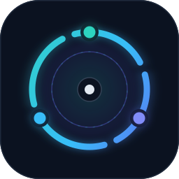
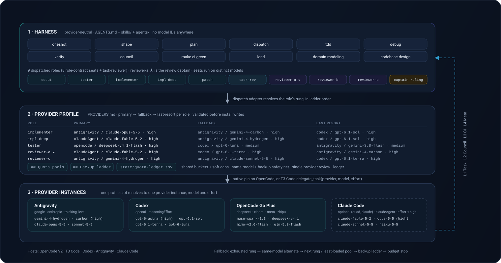
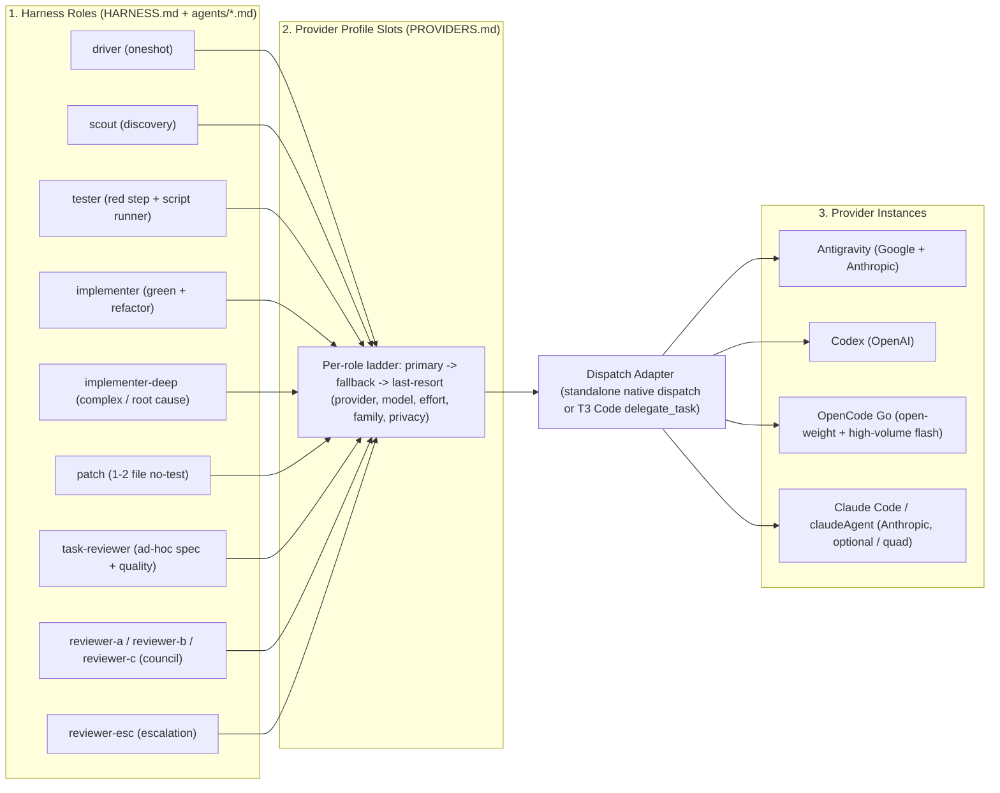
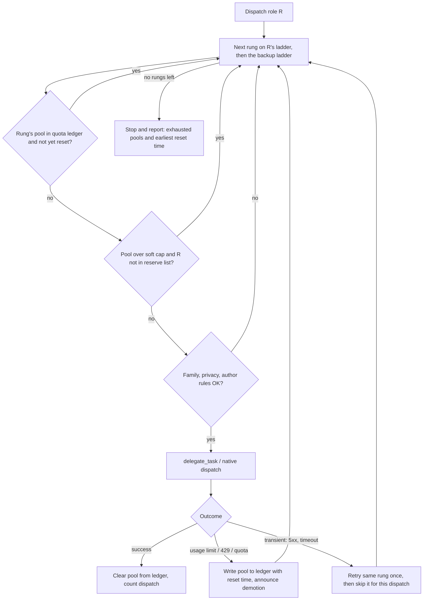

<h1 align="center">Cybernetic SDLC Harness</h1>

<p align="center">
  
</p>

<p align="center">
  <em>Sense, act, verify, reach consensus, and land.</em><br/>
  A self-owned cybernetic SDLC control system for T3 Code, OpenCode V2, Codex, Antigravity, and Claude Code - one gated controller (<code>oneshot</code>), four closed feedback loops, nine role-contract agent seats routed through a swappable provider profile, and twelve pipeline skills.
</p>

<p align="center">
  <a href="LICENSE"></a>
  
  
  
  
  
  =3.2" />
  
  
</p>

<p align="center">
  <a href="#-cybernetic-architecture">Architecture</a> •
  <a href="#-all-12-skills-by-role">Skills Map</a> •
  <a href="#-usage--example-prompts">Usage & Prompts</a> •
  <a href="#-provider-layer">Provider Layer</a> •
  <a href="#️-configure-models">Configure Models</a> •
  <a href="#-agent-quickstart">Agent Quickstart</a> •
  <a href="#-structure">Structure</a> •
  <a href="#️-installation-for-agents-and-humans">Installation</a> •
  <a href="#-testing">Testing</a>
</p>

---

> **License:** MIT - see [LICENSE](LICENSE) and [NOTICE](NOTICE) (upstream MIT attribution for `domain-modeling` and `codebase-design` adapted from `mattpocock/skills`).

Autonomous software delivery for **T3 Code** and standalone **OpenCode V2**, **Codex**, **Antigravity**, and **Claude Code**. Orchestrates **12 composable pipeline skills** and **9 role-contract subagent seats** across four closed feedback loops (**L1 Task**, **L2 Branch Council**, **L3 CI**, **L4 Meta**). The harness is provider-neutral: which provider, model, and effort runs each role comes from a swappable provider profile (default `tri`, `quad` with Claude Code, standalone single-provider `opencode-go`, `codex`, `antigravity`, `claude`, or any custom file via `--profile-file`), and every dispatch names a rung so subagents never inherit the main session model (on OpenCode, a seat with no `opencode` ladder rung installs with no native `model:` pin and never uses Path 1). Every seat enforces last-match-wins permission guardrails so subagents never leak secrets.

---

## 🧭 Cybernetic Architecture

<p align="center">
  
</p>

**At a glance**

| Question | Answer |
| --- | --- |
| What is it? | A gated SDLC controller (`oneshot`) plus 12 pipeline skills and 9 role-contract subagent seats, wired by four closed feedback loops. |
| What runs where? | Every role resolves to a *rung* (`primary` -> `fallback` -> `last-resort`) in a swappable provider profile, then to a provider instance, model, and effort. No harness file names a model. |
| What does it guarantee? | Tests-first task loops, evidence-before-claims verification, three independent council families, author-independent PASS, and hard budget stops instead of silent model downgrades. |
| Where does it install? | OpenCode, Codex, Antigravity, and Claude Code, one profile bound at install time (`--target all` for every host). |
| How do I start? | `./install.sh` then run `oneshot <task>`. See [Installation](#️-installation-for-agents-and-humans). |

### Three-Layer Routing Architecture (Roles -> Profile Slots -> Provider Instances)



### Pipeline Flow (Role Names Only)

```mermaid
flowchart LR
  U(["User: 3 Gates or Auto-Approve"]) --> C["oneshot (driver)"]
  C --> P1["1. shape + domain-modeling + codebase-design (via scout)"]
  P1 -- "spec + GLOSSARY/ADR" --> P2["2. plan (via scout)"]
  P2 -- "TDD task plan" --> P3["3. dispatch + tdd (tester -> implementer / implementer-deep / patch + task-reviewer)"]
  P3 <-- "root cause" --> D["debug (tester + implementer-deep)"]
  P3 --> P4["4. verify (via tester)"]
  P4 --> P5["5. land (file PR)"]
  P5 --> P65["6.5 make-ci-green (tester + implementer / implementer-deep / patch)"]
  P65 --> P6["6. council (reviewer-a, reviewer-b, reviewer-c, reviewer-esc + implementer)"]
  P6 -- "fix pushed" --> P65
  P6 -- "PASS + green" --> P7["7. land (Gate 3 & handoff)"]
```



### Full Pipeline & Seat Wiring (ASCII)

```text
+--------------------------------------------------------------------------------------+
|                           [1. oneshot] (Master Controller)                           |
|       State: $(git rev-parse --git-dir)/info/oneshot-state.md  |  auto-approve: true |
+--------------------------------------------------------------------------------------+
        |
        v
+--------------------------------------------------------------------------------------+
| PHASE 1: DESIGN & ARCHITECTURE                                                       |
|                                                                                      |
|   [2. shape]  <--- explores context via ---> (scout)                                 |
|       |                                                                              |
|       +---> [3. domain-modeling]  (if domain terms/decisions change)                 |
|       |         writes/updates GLOSSARY.md, GLOSSARY-MAP.md, docs/adr/NNNN-slug.md   |
|       |                                                                              |
|       +---> [4. codebase-design]  (if module interfaces or seams change)             |
|       |         applies deep-module vocabulary, DEEPENING.md, DESIGN-IT-TWICE.md     |
|       |                                                                              |
|       +---> writes & commits docs/specs/YYYY-MM-DD-<topic>-design.md (+ glossary/adr)|
|       +---> Gate 1 (user approval, or skipped under auto-approve)                    |
+--------------------------------------------------------------------------------------+
        |
        v
+--------------------------------------------------------------------------------------+
| PHASE 2: TASK DECOMPOSITION                                                          |
|                                                                                      |
|   [5. plan]   <--- maps exact file:line via ---> (scout)                             |
|       |                                                                              |
|       +---> decomposes spec into bite-size TDD tasks + glossary/seam invariants      |
|       +---> writes & commits docs/plans/YYYY-MM-DD-<feature>.md                      |
|       +---> Gate 2 (user approval, or auto-satisfied under auto-approve)             |
+--------------------------------------------------------------------------------------+
        |
        v
+--------------------------------------------------------------------------------------+
| PHASE 3: L1 TASK FEEDBACK LOOP (Per-Task Actuation & Sensing)                        |
|                                                                                      |
|   [6. dispatch]  (orchestrates sequential or parallel task fan-out)                  |
|       |                                                                              |
|       +---> Step 0 branch check (`git branch --show-current` != main/master)         |
|       |                                                                              |
|       +---> Actuators (execute task via [7. tdd] red -> green -> refactor):          |
|       |       - (tester)                     red step (failing tests, uncommitted)   |
|       |       - (implementer)                green + refactor + commit (or parallel) |
|       |       - (implementer-deep)           complex/hard architecture or bugs       |
|       |       - (patch)                      1-2 file no-test                        |
|       |                                                                              |
|       +---> On task failure / test red (up to 3 fix attempts -> 2 debug rotations):  |
|       |       routes to [8. debug] (root-cause tracing, defense-in-depth, polluter)  |
|       |       then re-dispatches (escalating to implementer-deep if needed)          |
|       |                                                                              |
|       +---> Per-Task Sensors (ad-hoc role `task-reviewer`):                          |
|               Stage 1: spec-reviewer-prompt.md (checks spec, GLOSSARY, tester tests) |
|               Stage 2: quality-reviewer-prompt.md (council rules on task diff)       |
+--------------------------------------------------------------------------------------+
        |
        v
+--------------------------------------------------------------------------------------+
| PHASE 4: COMPLETION GATE                                                             |
|                                                                                      |
|   [9. verify]                                                                        |
|       +---> dispatches (tester) to run full test suite, typecheck, linter, and build |
|       +---> confirms compressed pass/fail evidence for every spec requirement        |
|       +---> if anything fails: routes back to [8. debug] / [6. dispatch]             |
+--------------------------------------------------------------------------------------+
        |
        v
+--------------------------------------------------------------------------------------+
| PHASE 5: PR FILING                                                                   |
|                                                                                      |
|   [10. land] (Part 1)                                                                |
|       +---> pushes `feat/<topic>` and opens PR (`## Summary`, `## Changes`,          |
|             `## Test plan`, `## Budget`)                                             |
+--------------------------------------------------------------------------------------+
        |
        v
+--------------------------------------------------------------------------------------+
| PHASE 6.5: L3 CI & BOT FEEDBACK LOOP                                                 |
|                                                                                      |
|   [11. make-ci-green]                                                                |
|       +---> bounded poll of `gh pr checks` and `gh pr view --json reviews,labels`    |
|       +---> failing check logs / local reruns inspected via (tester)                 |
|       +---> real failure (max 3 fix_rounds):                                         |
|               - test-running fix -> (implementer / implementer-deep) + [9. verify]   |
|               - no-test 1-2 file -> (patch)                                          |
|       +---> suspected flake: requires concrete log-line comment, reruns once max     |
+--------------------------------------------------------------------------------------+
        |
        v
+--------------------------------------------------------------------------------------+
| PHASE 6: L2 BRANCH CONSENSUS LOOP (Max 3 Rounds, Cap 14 Dispatches)                  |
|                                                                                      |
|   [12. council]                                                                      |
|       +---> 3 independent adversarial reviewer families in parallel:                 |
|       |       - Seat A:   (reviewer-a)    independent family 1                       |
|       |       - Seat B:   (reviewer-b)    independent family 2                       |
|       |       - Seat C:   (reviewer-c)    independent family 3                       |
|       |       - Last-res: (reviewer-esc)  fourth family, escalation only             |
|       |                                                                              |
|       +---> checks diff vs spec/plan, security, edge cases, and GLOSSARY.md drift    |
|       +---> on FAIL: dispatches (implementer / implementer-deep) or no-test (patch), |
|             runs [9. verify], pushes, and re-enters [11. make-ci-green] if commits   |
|             were pushed after last green CI receipt                                  |
+--------------------------------------------------------------------------------------+
        |
        | (PASS: >=2/3 seats PASS + 0 confirmed reds + green tests + 1 non-author-family PASS)
        v
+--------------------------------------------------------------------------------------+
| PHASE 7: FINISH & NEXT-FEATURE HANDOFF                                               |
|                                                                                      |
|   [10. land] (Parts 2 & 3 - Gate 3)                                                  |
|       +---> Interactive: 1. Merge PR  2. Keep PR open  3. Keep branch  4. Discard    |
|       +---> Auto-approve: skips menu, defaults to Keep PR open                       |
|       +---> On Merge: squash-merges PR, syncs default branch (worktree-aware),       |
|             prunes merged local branch, removes oneshot-state.md,                    |
|             and records completion in memory (L4 Meta Loop)                          |
+--------------------------------------------------------------------------------------+
```

---

## 🧩 All 12 Skills by Role

| Role in Cybernetic Loop | Skill | When It Runs |
| --- | --- | --- |
| **Master Controller** | [`oneshot`](./skills/oneshot/SKILL.md) | Orchestrates Phases 1 -> 7 end-to-end |
| **Spec & Planning** | [`shape`](./skills/shape/SKILL.md) | Phase 1: Socratic design exploration & spec commit |
| **Spec & Planning** | [`domain-modeling`](./skills/domain-modeling/SKILL.md) | Phase 1 (or standalone): builds/sharpens `GLOSSARY.md` & `docs/adr/` |
| **Spec & Planning** | [`codebase-design`](./skills/codebase-design/SKILL.md) | Phase 1 (or standalone): deep modules, seams, `DESIGN-IT-TWICE.md` |
| **Spec & Planning** | [`plan`](./skills/plan/SKILL.md) | Phase 2: bite-size TDD task decomposition |
| **L1 Task Loop (Actuation)** | [`dispatch`](./skills/dispatch/SKILL.md) | Phase 3: per-task subagent execution (`tester` -> `implementer`) + 2-stage review |
| **L1 Task Loop (Discipline)** | [`tdd`](./skills/tdd/SKILL.md) | Phase 3: failing test first -> minimal code -> refactor |
| **L1 Task Loop (Repair)** | [`debug`](./skills/debug/SKILL.md) | Phase 3 & 4: 4-phase root-cause investigation on failures |
| **Gate Sensor** | [`verify`](./skills/verify/SKILL.md) | Phase 4 (and post-fix in L1/L2/L3): fresh command evidence check via `tester` |
| **L2 Branch Sensor/Loop** | [`council`](./skills/council/SKILL.md) | Phase 6: 3-family adversarial review + fixer loop |
| **L3 CI Sensor/Loop** | [`make-ci-green`](./skills/make-ci-green/SKILL.md) | Phase 6.5: watches PR checks & bots (`tester` logs/reruns, implementation-seat fixes) |
| **PR & Handoff Actuator** | [`land`](./skills/land/SKILL.md) | Phase 5 (files PR) & Phase 7 (Gate 3 merge / next-feature handoff) |

---

## 🚀 Usage & Example Prompts

### 1. Full Autonomous Pipeline (`oneshot` - 3 Human Gates)

Trigger the end-to-end controller by prefixing a task with `oneshot`:

```text
oneshot build a rate-limited webhook delivery worker with exponential backoff, dead-letter queue, and SQLite persistence
```

What happens across the 7 numbered phases plus 6.5:

1. **Phase 1 - `shape` + `domain-modeling` + `codebase-design` (Design & Spec):** first ensures the tree is on a feature branch, either in the main checkout (`git switch -c feat/webhook-delivery-worker`) or in a dedicated git worktree (an OpenCode `worktree_create` + `session_move`, or a T3 Code worktree thread). Then it explores context via `scout`, invokes `domain-modeling` (when domain terms or ADRs change) and `codebase-design` (when module interfaces or seams change), and writes and commits `docs/specs/YYYY-MM-DD-webhook-delivery-worker-design.md` alongside any created or modified `GLOSSARY.md` / `docs/adr/` files. **Pauses at Gate 1 for design approval.**
2. **Phase 2 - `plan` (Task Decomposition):** maps exact `path:line` targets via `scout` and breaks the approved spec into bite-size TDD tasks with exact file paths, glossary/seam invariants, and verification commands in `docs/plans/YYYY-MM-DD-webhook-delivery-worker.md`. **Pauses at Gate 2 for plan approval.**
3. **Phase 3 - `dispatch` + `tdd` (L1 Task Loop):**
   - Dispatches `scout` for compressed `path:line` discovery without polluting main-session context.
   - For each task with behaviour to test, dispatches `tester` first (`dispatch/tester-prompt.md`) to write the failing tests and confirm they fail for the right reason (leaving them uncommitted in the working tree), then dispatches `implementer` (`dispatch/implementer-prompt.md`) with the `tester`'s report to make them pass, refactor, and commit tests + implementation together. Mechanical tasks skip `tester`. Parallel fan-out dispatches several `implementer` instances concurrently.
   - Escalates complex multi-file architecture tasks or 3x task failures (via `debug`) to `implementer-deep`.
   - Runs two-stage review after every task: Stage 1 spec compliance, then Stage 2 code quality (role `task-reviewer`, skipping any rung whose family wrote the code).
4. **Phase 4 - `verify` (Evidence Gate):** dispatches `tester` as a script runner to execute the full test suite, typecheck, linter, and build, confirming every spec checklist item from its compressed pass/fail report.
5. **Phase 5 - `land` (PR Filing):** pushes the feature branch and opens a problem-led GitHub PR (`## Summary`, `## Changes`, `## Test plan`, `## Budget`). The `## Budget` block reports pools hit, demotions, backup rungs used, and any degraded seats.
6. **Phase 6.5 - `make-ci-green` (L3 CI Loop):** watches GitHub Actions and review bots, uses `tester` to inspect failing CI logs and rerun checks locally, dispatches implementation-seat fixers (`implementer`, or `implementer-deep` for hard clusters) on real failures, and requires concrete log-line evidence before retrying a suspected flake.
7. **Phase 6 - `council` (L2 Branch Loop):** dispatches 3 adversarial reviewers from independent model families in parallel (`reviewer-a`, `reviewer-b`, `reviewer-c`, one family each per the active provider profile). Any confirmed red finding triggers implementation-seat fixers (`implementer`, or `implementer-deep` for hard clusters) and re-review (up to 3 rounds, then `reviewer-esc` on a fourth family). PASS also needs one vote from a seat whose family authored none of the commits (`implementer*`, `tester` when its tests are committed, `patch`, fixers); if every seat's family is an author family, `reviewer-esc` supplies it as one extra budgeted dispatch, else `yellow: degraded council`.
8. **Phase 7 - `land` (Gate 3 Finish & Handoff):** presents finish options (merge PR and hand off to default branch, keep PR open, keep branch, or Discard). Merging is worktree-aware: inside a linked worktree it fast-forwards the default branch ref instead of checking it out, leaving the main checkout untouched.

### 2. Zero-Gate Unattended Mode (`oneshot` Auto-Approve)

Include an explicit bypass phrase (`auto-approve`, `skip all approvals`, `no approval gates`, or `full autonomy no questions`) in the initial prompt to run Phases 1 through 7 non-stop without human pauses:

```text
oneshot auto-approve: fix the race condition in session token refresh when concurrent requests hit an expired JWT
```

The controller passes `auto-approve: true` (plus the trigger phrase) into `shape` and `plan`, and `shape` writes the exact literal `auto-approve: true` into the spec header before committing the spec. Both `shape` and `plan` read `auto-approve: true` and suppress their own approval waits; the rest of the pipeline then runs autonomously through CI verification and council consensus.

### 3. Confidential Mode (Privacy Gate)

Mark a prompt or diff as confidential to engage the privacy gate automatically:

```text
oneshot [confidential] implement HMAC signature rotation for partner billing webhooks
```

Any rung marked `privacy: trains` in the active provider profile (`PROVIDERS.md`; the routing rule lives in [`AGENTS.md`](./AGENTS.md)) is automatically skipped across all seats, routing only to `privacy: ok` rungs. The default `tri` profile has none; the `opencode-go` profile marks `muse-spark-*`.

### 4. Standalone Skills & Individual Loops

Every pipeline skill and seat agent can also be triggered directly outside a full `oneshot` run:

| Example Prompt | Unit Triggered | What It Does |
| --- | --- | --- |
| `"shape a plugin hook system for custom tool permissions"` | `shape` | Socratic design exploration; writes spec to `docs/specs/` |
| `"write a plan for docs/specs/2026-11-04-plugin-hooks-design.md"` | `plan` | Produces a bite-size TDD task plan in `docs/plans/` |
| `"dispatch docs/plans/2026-11-04-plugin-hooks.md"` | `dispatch` | Runs the L1 per-task subagent loop (`tester` -> `implementer`) + two-stage review on an existing plan |
| `"implement this feature with tdd"` | `tdd` | Enforces red-green-refactor with a failing behavioral test before production code |
| `"debug why test/webhook-retry.test.ts fails intermittently"` | `debug` | 4-phase root-cause investigation before any fix is proposed |
| `"verify this branch is ready"` | `verify` | Dispatches `tester` to run test, lint, typecheck, and build commands and confirms compressed output before any completion claim |
| `"council review this branch"` | `council` | Runs the 3-family adversarial review loop (`reviewer-a`, `reviewer-b`, `reviewer-c`) + implementation-seat fixes |
| `"make ci green on this PR"` | `make-ci-green` | Watches PR checks and review bots until green; inspects logs via `tester` and fixes real bugs through implementation seats |
| `"model the domain for the billing module"` | `domain-modeling` | Builds and sharpens `GLOSSARY.md` and ADRs so code vocabulary matches the domain |
| `"deepen this module's interface"` | `codebase-design` | Applies deep-module vocabulary, seams, and deepening moves to an existing codebase |
| `"land it"` / `"next feature"` | `land` | Files or merges the PR, checks out default branch, pulls latest, and reports ready |

---

## 🧠 Provider layer

The harness is split into three layers so providers can be swapped or mixed without editing it:

| Layer | Owns | Files |
| --- | --- | --- |
| Harness (provider-neutral) | pipeline, loops, caps, gates, council contract, permission policy, role contracts, the Dispatch Adapter, the routing *rules* (ladder walk, family independence, privacy gate, budget guard) | `skills/**`, `agents/*.md` (no `model:` line), [`AGENTS.md`](./AGENTS.md) |
| Provider (swappable) | which provider instance, model, and effort runs each role; fallback ladders; model families; privacy class; quotas and provider notes | `providers/<profile>.md` or external file |
| Install (binding) | binds one profile to one or more host targets (`opencode`, `codex`, `antigravity`, `claude`, or `all`): copies it as `<dest>/PROVIDERS.md` and renders host-native agent files and instructions | `install.sh --profile <name>` / `--profile-file <path>` `--target <targets>` |

No harness file names a concrete model ID, provider quota, or provider-specific effort value (`skills/**` and `agents/*.md` also name zero concrete providers, host names, or T3 Code tools). The Dispatch Adapter in [`AGENTS.md`](./AGENTS.md) turns a role into a running subagent: the controller walks each role's rungs in ladder order (`primary -> fallback -> last-resort`, then sibling implementation hand-off and `## Backup ladder`). For `antigravity` seats, `<contract-path>` is passed literally as `<skills-dir>/_harness/agents/<seat>.md` (`<skills-dir>` = grandparent of `oneshot/SKILL.md`, i.e. parent of `oneshot/`, in the child's `<skills>` list; never substituting the driver's path); for all other providers the driver substitutes `<harness-dir>/agents/<seat>.md`. For the current rung it takes the first matching path: **Path 1** native pin on an OpenCode host (no override when the rung matches the seat's rendered `model:` pin); **Path 2** T3 Code `delegate_task` across any connected provider (calling `orchestrator_capabilities` once before the session's first dispatch); **Path 3** standalone same-provider native dispatch when T3 tools are absent and `provider` matches the active host (`opencode` `subagent`/`task`, `codex` `spawn_agent` + `wait`, `claudeAgent` `Agent`, or `antigravity` `invoke_subagent` `self` with self-enforced contracts for seats/`task-reviewer` and `research` for shell-free `design` when `<model>` equals the session model via `Model: inherit` or is a flash-tier `google` rung on a `google` session via `Model: flash`); or **Path 4** `unreachable` (skipped at zero council budget cost). On OpenCode, a seat whose 3-rung ladder has no `opencode` rung installs with no `model:` line and never uses Path 1. An implementation seat (`implementer`, `implementer-deep`) with no reachable rung hands its task to the other implementation seat (`implementer-deep` <-> `implementer`, never revisiting an exhausted seat); with all exhausted, or `scout`/`tester`/`patch` with none, the dispatch stops and reports, never running on the driver model. Design alternatives run on distinct-family `implementer-deep`, then `implementer` rungs (announcing `degraded design: N families` when too few are reachable).

### Which profile do I pick?

| Subscriptions you have | Profile to install | Command |
| --- | --- | --- |
| **Only OpenCode Go** | `opencode-go` | `./install.sh --profile opencode-go` |
| **Only Codex / ChatGPT** | `codex` | `./install.sh --profile codex --target codex` |
| **Only Antigravity** | `antigravity` | `./install.sh --profile antigravity --target antigravity` |
| **Only Claude Code** | `claude` | `./install.sh --profile claude --target claude` |
| **Antigravity + Codex + OpenCode Go** | `tri` (default) | `./install.sh` (or `./install.sh --profile tri --target all`) |
| **Antigravity + Codex + OpenCode Go + Claude Code** | `quad` | `./install.sh --profile quad --target all` |
| **Any other mix** (e.g., Codex + Claude Code, or Antigravity + OpenCode Go) | Custom profile file | Copy the closest `providers/*.md`, edit rows, and run `./install.sh --profile-file <path>` |

- **Standalone native execution (without T3 Code) vs cross-provider T3 Code orchestration (`delegate_task`):**
  - **With T3 Code:** `delegate_task` dispatches across every enabled provider instance (`antigravity`, `codex`, `claudeAgent`, `opencode`), unlocking multi-subscription ladders (`tri`, `quad`) and cross-family Antigravity ladders (`google` + `anthropic`).
  - **Standalone (without T3 Code):** OpenCode, Codex, Antigravity, and Claude Code each dispatch rungs matching their own provider natively via Dispatch Adapter Path 1/Path 3 (standalone Antigravity `invoke_subagent` uses `self` for all seats and `task-reviewer` with self-enforced contracts so git inspection works, or `research` for shell-free `design`, passing `Model: inherit` only when `<model>` equals the active session model or `Model: flash` only for a flash-tier `google` rung on a `google` session; all other rungs, including cross-family rungs, hit Path 4 `unreachable`). Single-subscription users bind `--profile opencode-go|codex|antigravity|claude`, and a `tri` (on OpenCode, Codex, or Gemini Antigravity; `tri` has no `claudeAgent` backup row) or `quad` (also covering Claude Code) install opened standalone falls back to its matching `*` row in `## Backup ladder` (standalone Claude Antigravity sessions use `--profile antigravity`, and standalone Claude Code uses `--profile claude` or `quad`).
- **Single-family `task-reviewer` fallback & council family minimum:**
  - **Per-task review (`task-reviewer`):** normally skips any rung whose `family` authored the task's code or `tester` red tests. If skipping the author/`tester` family leaves zero reachable `task-reviewer` rungs **solely** because all non-author families are `unreachable` on a standalone single-family host (never when skipped for `exhausted` quota or soft-cap), `task-reviewer` falls back to the first reachable same-family rung and announces `degraded task-review: single-family host (<family>)`.
  - **Branch council (`council`):** strictly requires **`>= 2` independent model families** across `reviewer-a`, `reviewer-b`, and `reviewer-c` (plus at least one PASS vote from a non-author family). Whenever `< 2` families are reachable (such as standalone `codex`, standalone `claude`, or a single-family standalone `antigravity` session), the council stops with `yellow: degraded council` rather than claiming multi-family consensus (`opencode-go` spans multiple families natively on standalone OpenCode).

### Provider setup

| Provider | Instance ID (`provider` column) | Effort Option ID & Values (`effort` column) | Example Model IDs (`model` column) | Where to See Limits |
| --- | --- | --- | --- | --- |
| **OpenCode Go** | `opencode` | `variant` (`low\|medium\|high\|xhigh\|max`, or `-` for single-tier models) | `opencode-go/deepseek-v4.1-flash`, `opencode-go/mimo-v2.6-flash`, `opencode-go/deepseek-v4-pro`, `opencode-go/mimo-v2.6-pro`, `opencode-go/minimax-m3`, `opencode-go/kimi-k3.1-pro`, `opencode-go/claude-haiku-5-5`, `opencode-go/glm-5.3` | `opencode.ai/docs/go` console (monthly dollar limit per model, with a 20% 5-hour cap and a 50% weekly cap; the shipped profiles are sized for the Go Plus $40/mo tier) |
| **Antigravity** | `antigravity` | `thinking_level` (`low\|medium\|high`) | `gemini-4-argon`, `gemini-3.8-flash`, `claude-opus-5-5`, `claude-sonnet-5-5` | `/status` in Antigravity (rolling 5-hour windows per plan) |
| **Codex / ChatGPT** | `codex` | `reasoningEffort` (`low\|medium\|high\|xhigh`) | `gpt-6-astra`, `gpt-6.1-sol`, `gpt-6.1-terra`, `gpt-6-luna`, `gpt-6-sol` | `/status` in Codex (rolling 5-hour windows per plan) |
| **Claude Code / Anthropic** | `claudeAgent` | `effort` (`low\|medium\|high\|xhigh\|max\|ultracode\|ultrathink`) | `claude-opus-5-5`, `claude-sonnet-5-5`, `claude-haiku-5-5`, `claude-fable-5-1` | `/status` in Claude Code (rolling 5-hour windows per plan) |

#### 1. OpenCode Go (`opencode`)
- **Connect:** subscribe at `opencode.ai/docs/go` and run `/connect` in OpenCode.
- **Privacy settings:** in OpenCode Console Privacy, enable **Global region** for DeepSeek models and turn training endpoints off (or rely on the harness privacy gate to skip `privacy: trains` rungs on `[confidential]` work).
- **Verify models & limits:** run `opencode models` to list exact `opencode-go/<model>` catalog IDs; check per-model 5-hour and monthly limits in the OpenCode Go console.
- **Quota structure:** **per-model** by default (`<provider>/<model>` when no `## Quota pools` row matches), because each OpenCode Go model has its own monthly dollar allowance and 5-hour cap. `tri`/`quad` are sized for the **Go Plus ($40/mo)** tier, where allowances scale non-uniformly over the $10 Go tier: flash workhorses roughly double, pro models roughly quadruple, and `glm-5.3` grows 8x. `opencode-go.md` adds an optional `opencode-kimi` pool row to soft-cap `opencode-go/kimi-k3.1-pro` at `6` dispatches and reserve the rest for `reviewer-esc`.
- **Profile columns:** `provider: opencode`, `effort: variant=<low|medium|high|xhigh|max>` (or `-` when the catalog exposes a single default tier).

#### 2. Antigravity (`antigravity`)
- **Connect:** require an active Google AI plan; authenticate in Antigravity (and when orchestrating through T3 Code, enable the **Antigravity** provider instance in T3 Code settings so it shows as enabled in `orchestrator_capabilities`), and ensure account model-training opt-out is enabled.
- **Verify models & limits:** check rolling 5-hour window quotas with `/status` in the provider.
- **Quota structure:** **shared per model family** across two `## Quota pools` rows in `tri`, `quad`, and `antigravity`: `antigravity-claude` (`claude-*`, 5h window, `soft-cap: 6`, shared by `claude-opus-5-5` and `claude-sonnet-5-5`) and `antigravity-gemini` (`gemini-*`, 5h window, shared by `gemini-4-argon` and `gemini-3.8-flash`).
- **Profile columns:** `provider: antigravity`, `effort: thinking_level=<low|medium|high>`, example models `gemini-4-argon`, `gemini-3.8-flash`, `claude-opus-5-5`, `claude-sonnet-5-5`.

#### 3. Codex / ChatGPT (`codex`)
- **Connect:** require an active ChatGPT plan; authenticate in Codex (and when orchestrating through T3 Code, enable the **Codex** provider instance in T3 Code settings so it shows as enabled in `orchestrator_capabilities`), and ensure training opt-out is enabled.
- **Verify models & limits:** check rolling 5-hour window limits with `/status` in Codex; get exact model IDs from the Codex model picker or `~/.codex/models_cache.json`.
- **Quota structure:** **shared across the subscription** via the `codex` pool row (`provider: codex`, `models: *`, `window: 5h`).
- **Profile columns:** `provider: codex`, `effort: reasoningEffort=<low|medium|high|xhigh>`, example models `gpt-6-astra`, `gpt-6.1-sol`, `gpt-6.1-terra`, `gpt-6-luna`, `gpt-6-sol`.

#### 4. Claude Code / Anthropic (`claudeAgent`)
- **Connect:** require an active Claude subscription; authenticate in Claude Code (and when orchestrating through T3 Code, enable the **Claude** provider instance in T3 Code settings — its T3 provider instance ID is `claudeAgent` in camelCase and must show as enabled in `orchestrator_capabilities`).
- **Verify models & limits:** check rolling 5-hour window limits with `/status` in Claude Code.
- **Quota structure:** **shared across the subscription** via the `claude-code` pool row (`provider: claudeAgent`, `models: *`, `window: 5h` in `quad` and `claude`).
- **Profile columns:** `provider: claudeAgent`, `effort: effort=<low|medium|high|xhigh|max|ultracode|ultrathink>`, example models `claude-opus-5-5`, `claude-sonnet-5-5`, `claude-haiku-5-5`, `claude-fable-5-1`.

### When a model runs out of budget

Long-running `oneshot` pipelines can hit 5-hour subscription windows mid-run. Instead of re-trying an exhausted primary on every task or burning scarce review quota during implementation, the harness combines **quota pools**, a **machine-local quota ledger**, **per-run soft caps with role reserves**, and a **profile-wide backup ladder**:



- **Worked Antigravity-Claude example (`antigravity-claude`):** in `tri` and `quad`, Antigravity's `claude-opus-5-5` and `claude-sonnet-5-5` share a single 5-hour subscription bucket declared in `## Quota pools` as `antigravity-claude` (`provider: antigravity`, `models: claude-*`, `window: 5h`, `soft-cap: 6`, `reserve: reviewer-b`).
  1. **Soft-cap reserve:** `implementer-deep` (and `implementer` fallback in `tri`) may use `antigravity-claude` for up to 6 dispatches in a pipeline run (`soft_cap_counts` in `oneshot-state.md`). On the 7th dispatch, the pool counts as **reserved** for `reviewer-b`: non-reserved roles skip straight to their next rung (`codex/gpt-6-astra` or `codex/gpt-6.1-sol`) without writing a ledger row, preserving the remaining Anthropic quota for council Seat B where frontier review judgment matters most.
  2. **Shared-pool exhaustion across dispatches:** if `reviewer-b` primary (`antigravity/claude-opus-5-5`) hits a 429 / usage-limit error, the controller writes `antigravity-claude` to `<dest>/state/quota-ledger.tsv` with its `retry_after` timestamp. When `reviewer-b` walks to its fallback (`antigravity/claude-sonnet-5-5`), that rung maps to the same `antigravity-claude` pool and is skipped immediately without a wasted network call, landing directly on `opencode-go/claude-haiku-5-5` (and subsequent dispatches in any repo on the same machine also skip `antigravity-claude` until `retry_after`).
  3. **Backup ladder & budget stop:** when all 3 rungs of a role's ladder (plus the `implementer <-> implementer-deep` sibling hand-off for implementation seats) are exhausted, unreachable, or reserved, the controller walks `## Backup ladder` (`backup: <role> -> <provider>/<model>`), enforcing all family-independence, author-family, privacy-gate, and never-on-driver rules. If no rung remains, it stops with `budget stop: <role>`, records `earliest_resume` in `oneshot-state.md`, and tells you the earliest reset time to rerun `oneshot`.
- **Inspecting or clearing the machine-local quota ledger:** the ledger lives at `<dest>/state/quota-ledger.tsv` (default `~/.config/opencode/state/quota-ledger.tsv`) with columns `pool  provider  exhausted_at  retry_after  source_role  note`. Expired rows are pruned automatically on read, and a successful dispatch on a pool clears its row. If you upgrade your plan or reset a quota early, inspect or clear it manually:

```sh
cat ~/.config/opencode/state/quota-ledger.tsv
rm -f ~/.config/opencode/state/quota-ledger.tsv
```

### Hosts (T3 Code + Standalone Multi-Host Architecture)

T3 Code has **no separate global `skills/` or `agents/` directory**; OpenCode, Codex, and Claude Code load skills, subagents, and global instructions from their native config directories both standalone and inside T3 Code, whereas T3 Code spawns each Antigravity ACP instance with `GEMINI_HOME=${T3_USERDATA_DIR:-$HOME/.t3/userdata}/providers/antigravity/<id>` (isolated from standalone `${ANTIGRAVITY_CONFIG:-$HOME/.gemini/config}`, with Antigravity ACP's `view_file` `realpath` sandbox blocking symlinks and paths outside `<GEMINI_HOME>/config/skills`). Installing with `./install.sh --target all` (or a comma-separated subset of `opencode,codex,antigravity,claude`) provisions every host at once:

1. **OpenCode (`--target opencode`, default `${OPENCODE_CONFIG:-$HOME/.config/opencode}`):** seats with an `opencode` rung in the active profile are pinned via their rendered `model:` line in `<dest>/agents/<seat>.md` (and when OpenCode runs inside T3 Code, non-`opencode` rungs are dispatched via `delegate_task`).
2. **Codex (`--target codex`, `${CODEX_HOME:-$HOME/.codex}`):** installs `skills/**`, `agents/<seat>.md`, `HARNESS.md`, `PROVIDERS.md`, and a combined `AGENTS.md` (`HARNESS.md` + `PROVIDERS.md`) so standalone Codex CLI/app and T3 Code Codex threads load both automatically.
3. **Antigravity (`--target antigravity`, standalone `${ANTIGRAVITY_CONFIG:-$HOME/.gemini/config}` + discovered T3 Code instances `${T3_USERDATA_DIR:-$HOME/.t3/userdata}/providers/antigravity/*/config`):** installs a flat layout of real regular files (`skills/<name>/...`, `skills/_harness/{HARNESS.md,PROVIDERS.md,NOTICE,LICENSE,agents/<seat>.md}` allowlisted inside `config/skills/` and hidden from the skill picker, `agents/<seat>.md` with Antigravity subagent frontmatter and self-enforced permissions, `rules/HARNESS.md` + `rules/PROVIDERS.md` with `trigger: always_on` each `< 24 KB`, root `HARNESS.md`, `PROVIDERS.md`, `NOTICE`, `LICENSE`, shared `state` symlink, and `.harness-manifest`, migrating any legacy pre-flat manifest/ledger under `--prune`). T3 instance discovery is a clean no-op when `~/.t3/userdata/providers/antigravity` is absent or when `ANTIGRAVITY_CONFIG` is explicitly set without `T3_USERDATA_DIR` (installing only `$ANTIGRAVITY_CONFIG` while still linking `state` to `${OPENCODE_CONFIG:-$HOME/.config/opencode}/state`).
4. **Claude Code (`--target claude`, `${CLAUDE_CONFIG_DIR:-$HOME/.claude}`):** installs `skills/**`, `agents/<seat>.md` rendered with Claude Code subagent frontmatter and tool lists, `HARNESS.md`, `PROVIDERS.md`, and a combined `CLAUDE.md`.

**Worktrees.** The pipeline never requires the main checkout. It runs on a feature branch in either the main checkout or a dedicated git worktree (an OpenCode worktree or a T3 Code worktree thread), keeps its state in `$(git rev-parse --git-dir)/info/oneshot-state.md` so concurrent runs in different worktrees cannot collide, and `land` fast-forwards the default branch ref instead of checking it out when the default branch is already used by another worktree.

### Default profile `tri` (Revision 3, Go Plus sizing)

Three subscriptions: Antigravity (Google + Anthropic models), Codex (OpenAI models), and OpenCode Go Plus ($40/mo, open-weight long tail with a now-large allowance). Zero Google or OpenAI (`gpt-*`) models are routed through OpenCode Go in `tri`/`quad`: all Google models come from Antigravity and all `gpt-*` models come from Codex.

- **Antigravity:** carries `implementer` primary (`gemini-4-argon` at `high`) and fallback (`claude-sonnet-5-5` at `medium`), `implementer-deep` primary (`claude-opus-5-5` at `high`), and `reviewer-b` primary/fallback (`claude-opus-5-5` / `claude-sonnet-5-5`). Keeping `driver`, `scout`, `tester`, `reviewer-a`, and `reviewer-c` off Antigravity primaries leaves room for Argon and the Anthropic review seat (`antigravity-claude` is soft-capped at 6 dispatches and reserved for `reviewer-b`). Antigravity's Claude limits are low; if you also have a Claude Code subscription, use [`providers/quad.md`](./providers/quad.md) (`--profile quad`).
- **Codex:** carries `driver` (`gpt-6.1-sol` medium), per-task review `task-reviewer` (`gpt-6.1-terra` high), council Seat A `reviewer-a` (`gpt-6-astra` -> `gpt-6.1-sol` -> `gpt-6-sol` high), `implementer` last-resort (`gpt-6.1-sol` medium), `implementer-deep` fallback/last-resort (`gpt-6-astra` / `gpt-6.1-sol` high), and `gpt-6-luna` fallbacks for `tester`, `patch`, and `compaction`.
- **OpenCode Go Plus ($40/mo):** carries the high-volume cheap roles (`scout` on `mimo-v2.6-flash` ~60.2k req/5h and `deepseek-v4.1-flash` ~86.7k req/5h; `tester` and `patch` on `deepseek-v4.1-flash` high), the `task-reviewer` fallback (`glm-5.3` high, whose allowance grew 8x on Plus to ~1,760 req/5h), `compaction` on `claude-haiku-5-5` low, council Seat C `reviewer-c` (`deepseek-v4-pro` ~4,200 req/5h -> `mimo-v2.6-pro` ~13,000 req/5h -> `minimax-m3` ~9,600 req/5h), and `reviewer-esc` (`kimi-k3.1-pro` high ~588 req/5h -> `mimo-v2.6-pro` ~13,000 req/5h -> `qwen3.8-max` ~640 req/5h).
- **Council & escalation rationale:** Argon (`gemini-4-argon`) never reviews its own code. Seat A runs OpenAI frontier (`gpt-6-astra` -> `gpt-6.1-sol` -> `gpt-6-sol`), Seat B runs Anthropic frontier (`claude-opus-5-5` -> `claude-sonnet-5-5` -> `opencode-go/claude-haiku-5-5`), and Seat C runs high-budget Open-weight Pro (`opencode-go/deepseek-v4-pro` -> `opencode-go/mimo-v2.6-pro` -> `opencode-go/minimax-m3`). While Argon authors the code under `tri`, all three council seats are non-author families, and `reviewer-esc` (`kimi-k3.1-pro` -> `mimo-v2.6-pro` -> `qwen3.8-max`) starts on `kimi-k3.1-pro` (~588 req/5h, `moonshot`, disjoint from all three council primaries) and skips the MiMo rung to `qwen3.8-max` (`alibaba`) when `reviewer-c` demotes onto `xiaomi`.

| role | primary | fallback | last-resort |
| --- | --- | --- | --- |
| driver (advisory) | codex `gpt-6.1-sol` medium | antigravity `claude-sonnet-5-5` medium | - |
| scout | opencode `mimo-v2.6-flash` - | opencode `deepseek-v4.1-flash` low | antigravity `gemini-3.8-flash` low |
| implementer | antigravity `gemini-4-argon` high | antigravity `claude-sonnet-5-5` medium | codex `gpt-6.1-sol` medium |
| implementer-deep | antigravity `claude-opus-5-5` high | codex `gpt-6-astra` high | codex `gpt-6.1-sol` high |
| tester | opencode `deepseek-v4.1-flash` high | codex `gpt-6-luna` medium | antigravity `gemini-3.8-flash` medium |
| patch | opencode `deepseek-v4.1-flash` high | codex `gpt-6-luna` medium | antigravity `gemini-3.8-flash` medium |
| task-reviewer | codex `gpt-6.1-terra` high | opencode `glm-5.3` high | antigravity `gemini-3.8-flash` high |
| reviewer-a (OpenAI) | codex `gpt-6-astra` high | codex `gpt-6.1-sol` high | codex `gpt-6-sol` high |
| reviewer-b (Anthropic) | antigravity `claude-opus-5-5` high | antigravity `claude-sonnet-5-5` high | opencode `claude-haiku-5-5` high |
| reviewer-c (Open-weight Pro) | opencode `deepseek-v4-pro` - | opencode `mimo-v2.6-pro` - | opencode `minimax-m3` - |
| reviewer-esc | opencode `kimi-k3.1-pro` high | opencode `mimo-v2.6-pro` - | opencode `qwen3.8-max` - |
| compaction (advisory) | opencode `claude-haiku-5-5` low | codex `gpt-6-luna` low | - |

`muse-spark-*` (trains on request data) is excluded from `tri`. See [`providers/tri.md`](./providers/tri.md) for the full 7-column machine-readable routing table, `## Quota pools`, `## Backup ladder`, and budget tables.

### Four-subscription profile `quad`

[`providers/quad.md`](./providers/quad.md) (`./install.sh --profile quad`) is `tri` plus **Claude Code** (`claudeAgent`), moving Anthropic roles onto `claudeAgent` (`effort=high|medium`) with Antigravity's Claude as fallback:

| role | primary | fallback | last-resort |
| --- | --- | --- | --- |
| driver (advisory) | codex `gpt-6.1-sol` medium | claudeAgent `claude-sonnet-5-5` medium | - |
| implementer | antigravity `gemini-4-argon` high | claudeAgent `claude-sonnet-5-5` medium | codex `gpt-6.1-sol` medium |
| implementer-deep | claudeAgent `claude-opus-5-5` high | codex `gpt-6-astra` high | antigravity `claude-opus-5-5` high |
| reviewer-b (Anthropic) | claudeAgent `claude-opus-5-5` high | antigravity `claude-opus-5-5` high | claudeAgent `claude-sonnet-5-5` high |

### Standalone single-provider profiles (`opencode-go`, `codex`, `antigravity`, `claude`)

Each single-subscription profile keeps all 10 required roles, advisory `driver`/`compaction`, `## Quota pools`, and `## Backup ladder` on one provider so you can run standalone without T3 Code (or through T3 Code when only one provider is connected):

- **[`providers/opencode-go.md`](./providers/opencode-go.md) (`--profile opencode-go`):** sized for the Go Plus ($40/mo) tier, with every seat on `opencode-go/*` across multiple families (`deepseek`, `zhipu`, `anthropic`, `openai`, `moonshot`, `xiaomi`, `minimax`, `google`, `meta`), supporting multi-family `task-reviewer` and council natively on standalone OpenCode. Two seats stay scarce and reserved: `implementer-deep` on `gemini-4-argon` (~1,760 req/5h) and `reviewer-esc` on `kimi-k3.1-pro` (~588 req/5h, soft-capped at 6 via `opencode-kimi`).
- **[`providers/codex.md`](./providers/codex.md) (`--profile codex --target codex`):** every seat on `codex` (`gpt-6-astra`, `gpt-6.1-sol`, `gpt-6.1-terra`, `gpt-6-luna`, `gpt-6-sol`, `openai` family), dispatched natively via `spawn_agent` + `wait` (`degraded task-review: single-family host (openai)` and `yellow: degraded council` when standalone).
- **[`providers/antigravity.md`](./providers/antigravity.md) (`--profile antigravity --target antigravity`):** every seat on `antigravity` (`gemini-4-argon`, `gemini-3.8-flash`, `claude-opus-5-5`, `claude-sonnet-5-5` across `google` + `anthropic` families, with `antigravity-claude` soft-capped at 6 and reserved for `reviewer-a,reviewer-b`). Standalone Antigravity dispatches rungs matching the active session model (`Model: inherit`) plus flash-tier `google` rungs on a `google` session (`Model: flash`) via `invoke_subagent` (`degraded task-review: single-family host (<family>)`, `yellow: degraded council`), while T3 Code reaches every `google` and `anthropic` model via `delegate_task`.
- **[`providers/claude.md`](./providers/claude.md) (`--profile claude --target claude`):** every seat on `claudeAgent` (`claude-opus-5-5`, `claude-sonnet-5-5`, `claude-haiku-5-5`, `claude-fable-5-1`, `anthropic` family), dispatched natively via `Agent` (`degraded task-review: single-family host (anthropic)` and `yellow: degraded council` when standalone).

---

## ⚙️ Configure models

You never need to edit the cloned repository to customize which models run each role. Copy a profile outside the repo, edit the rows you want, and bind it with `--profile-file`:

```sh
mkdir -p ~/.config/oneshot
cp providers/tri.md ~/.config/oneshot/my-profile.md
# edit ~/.config/oneshot/my-profile.md
./install.sh --force --profile-file ~/.config/oneshot/my-profile.md
```

- **Binding and refresh:** `--profile-file <path>` (also `--profile-file=<path>`) validates your file, copies it byte for byte to `<dest>/PROVIDERS.md`, renders each seat's native pin from its first `opencode` rung, and records `# profile-file <absolute path>` on line 2 of `<dest>/.harness-manifest`. Subsequent `./install.sh --force` refreshes automatically reuse that recorded `# profile-file` path (if the file was removed, `install.sh` exits 2 with `install.sh: profile file not found: <path>`). `--profile` and `--profile-file` are mutually exclusive (passing both exits 2).
- **Custom profile checklist:** when building a profile for a subset of subscriptions (e.g., Codex + Claude Code), replace every row whose `provider` you do not have connected, ensure all 10 required roles keep a reachable `primary` row, and verify connected provider instance IDs via `orchestrator_capabilities`.
- **One-row override example** (for example, swapping `reviewer-esc` primary from `opencode-go/kimi-k3.1-pro` to `opencode-go/qwen3.8-max` in `~/.config/oneshot/my-profile.md`):

```text
| role | rung | provider | model | effort | family | privacy |
| --- | --- | --- | --- | --- | --- | --- |
| reviewer-esc | primary | opencode | opencode-go/qwen3.8-max | - | alibaba | ok |
```

- **Columns explained (role routing table):**
  - `role`: one of the ten required dispatched roles (`scout`, `tester`, `implementer`, `implementer-deep`, `patch`, `task-reviewer`, `reviewer-a`, `reviewer-b`, `reviewer-c`, `reviewer-esc`) or two optional advisory roles (`driver`, `compaction`). Every profile must define a `primary` row for all ten dispatched roles.
  - `rung`: `primary`, `fallback`, or `last-resort` (walked in that order).
  - `provider`: T3 Code provider instance id matching `^[A-Za-z0-9][A-Za-z0-9-]*$` (camelCase such as `claudeAgent` allowed, e.g. `antigravity`, `codex`, `claudeAgent`, `opencode`); standalone hosts dispatch rungs whose `provider` matches the active host natively, while T3 Code dispatches any connected provider via `delegate_task`.
  - `model`: exact model id from that provider's catalog (`opencode-go/...` for OpenCode Go; starts alphanumeric, `[A-Za-z0-9._/-]` only).
  - `effort`: `<option-id>=<value>` in the provider's vocabulary (`thinking_level=high` for `antigravity`, `reasoningEffort=medium` for `codex`, `effort=high` for `claudeAgent`, `variant=high` for `opencode`), or `-` when the catalog uses a single default tier (`-` is allowed only in `effort` for dispatched roles; on advisory rows it is also allowed in `provider`, `model`, and `family`, never in `rung` or `privacy`).
  - `family`: lowercase model family for council/review independence (`google`, `anthropic`, `openai`, `deepseek`, `moonshot`, `xiaomi`, `minimax`, `alibaba`, `zhipu`, `meta`, ...). Same family on two providers is the same family.
  - `privacy`: `ok` or `trains` (skipped automatically when the privacy gate is active).
- **Optional `## Quota pools` and `## Backup ladder` sections:**
  - `## Quota pools` (`pool | provider | models | window | soft-cap | reserve`): groups models that share a subscription bucket (e.g. `antigravity-claude` for `antigravity` `claude-*` with `window: 5h`, `soft-cap: 6`, `reserve: reviewer-b`). First matching row wins; any rung that matches no row defaults to its own `<provider>/<model>` pool. `window` matches `^[1-9][0-9]*(h|d|w|mo)$`; `soft-cap` is `-` or a positive integer; `reserve` is `-` or a comma list of known roles.
  - `## Backup ladder` (`order | roles | provider | model | effort | family | privacy`): profile-wide safety net walked in ascending `order` after a role's 3 rungs (and sibling `implementer <-> implementer-deep` hand-off) are exhausted, unreachable, or reserved. `roles` is `*` or a comma list of dispatched roles (`scout`, `tester`, `implementer`, `implementer-deep`, `patch`, `task-reviewer`, `reviewer-a`, `reviewer-b`, `reviewer-c`, `reviewer-esc`).
- **Validation diagnostics:** any non-fenced table row in the role section whose first cell is a role name must be a valid 7-cell routing row; non-header rows under `## Quota pools` must be valid 6-cell pool rows, and non-header rows under `## Backup ladder` must be valid 7-cell backup rows (rows inside fenced ``` blocks are ignored). Before writing anything, `install.sh` exits 1 on stderr with `install.sh: profile NAME incomplete: ROLE` (missing required `primary` row), `install.sh: profile NAME invalid row: ROLE RUNG: REASON` (bad role row), `install.sh: profile NAME invalid pool row: POOL: REASON` (bad pool row), or `install.sh: profile NAME invalid backup row: ORDER: REASON` (bad backup row).

---

## 🤖 Agent quickstart

If you are an agent working **on** this repo, read this block and [`AGENTS.md`](./AGENTS.md) before editing. If you are an agent **using** the harness, skip to [Installation](#️-installation-for-agents-and-humans).

| You want to change | Touch only | Then verify |
| --- | --- | --- |
| Which model runs a role | `providers/<profile>.md` (all matching profiles) | update the pin expectations in `test/install.sh`, then `bash test/install.sh` |
| Routing, loops, caps, council contract, permissions | [`AGENTS.md`](./AGENTS.md) plus the affected `skills/*/SKILL.md` | `bash test/install.sh` (HARNESS.md is asserted byte-identical to AGENTS.md) |
| A seat's contract | `agents/<seat>.md` (never add a `model:` line) | `bash test/install.sh` |
| Installer behavior or a new host target | `install.sh` | add a `pass`-gated case in `test/install.sh`, then run it under both `bash` and `/bin/bash` |
| A pipeline stage | the owning `skills/<name>/SKILL.md` | `bash test/install.sh` and the `oneshot` state artifact stays consistent |

**Invariants you must not break**

- Harness files (`skills/**`, `agents/*.md`, `AGENTS.md`) contain **no** concrete model ID, provider quota, or provider-specific effort value (`skills/**` and `agents/*.md` also name no concrete providers, host names, or T3 Code tools). Those live only in `providers/*.md`.
- Every profile defines a `primary` row for all ten dispatched roles (`scout`, `tester`, `implementer`, `implementer-deep`, `patch`, `task-reviewer`, `reviewer-a`, `reviewer-b`, `reviewer-c`, `reviewer-esc`); `driver` and `compaction` are advisory, and every shipped `AGENTS.md + providers/<profile>.md` pair stays uncompacted under the 32,768-byte host instruction cap (`< 24 KB` per Antigravity rule file).
- The council needs at least two independent model `family` values; fewer than two reachable families is `yellow: degraded council`.
- On OpenCode, Path 1 dispatches a seat without model override only when the rung matches its installed `opencode` pin; otherwise dispatches go through T3 Code `delegate_task` (Path 2) or standalone same-provider native dispatch with an explicit model/tier target (Path 3), and no subagent may inherit the driver's model by omission.
- Budget skips (`exhausted`, `unreachable`, soft-cap) never consume council rounds or fix attempts.
- Never commit or push to `main`/`master`; work on `feat/<topic>` and land through a PR.

**Commands**

```sh
bash -n install.sh && bash -n test/install.sh   # syntax gate
bash test/install.sh                            # full contract suite (throwaway HOME)
/bin/bash test/install.sh                       # macOS Bash 3.2 compatibility
./install.sh --force --prune                    # refresh the recorded profile into OpenCode
./install.sh --force --target all --prune       # refresh every host (+ T3 Antigravity instances)
```

**Changing one role's model, end to end**

1. Edit the role's rows in every profile that ships it (`providers/tri.md`, `providers/quad.md`, `providers/opencode-go.md`, `providers/codex.md`, `providers/antigravity.md`, `providers/claude.md`).
2. If the new first `opencode` rung changes a rendered pin, update the `PINS` heredoc and the `tri`/`quad` pin greps in `test/install.sh`.
3. Run `bash test/install.sh`. A stale pin fails as `installed file is byte-identical: agents/<seat>.md`.
4. Run `./install.sh --force` (or `./install.sh --force --target all`) so `<dest>/PROVIDERS.md` and the installed seat files match the repo.

---

## 📂 Structure

```text
agents/           9 role-contract seats:       implementer, implementer-deep,
                  tester, scout, patch,        reviewer-a, reviewer-b,
                  reviewer-c, reviewer-esc
skills/           12 pipeline skills:          oneshot, shape, plan, dispatch,
                                               tdd, debug, verify, council, land,
                                               make-ci-green, domain-modeling,
                                               codebase-design
providers/        swappable provider profiles: tri (default), quad (tri + Claude Code),
                                               opencode-go, codex, antigravity, claude
docs/             design specs and plans:      docs/specs/, docs/plans/
docs/assets/      vector visuals:              logo.svg, architecture.svg
test/install.sh   117-assertion contract suite (runs in throwaway HOME on Bash >=3.2)
AGENTS.md         harness routing instructions (installed as <dest>/HARNESS.md)
install.sh        multi-host installer         (opencode, codex, antigravity, claude, all)
NOTICE            upstream MIT attribution     (mattpocock/skills)
LICENSE           MIT license
```

---

## 🛠️ Installation (For Agents and Humans)

Requires T3 Code, OpenCode V2, Codex, Antigravity, or Claude Code as the host. Connect whichever providers your chosen profile uses: `tri` combines Antigravity, Codex, and OpenCode Go; `quad` adds Claude Code (`claudeAgent`); single-provider profiles (`opencode-go`, `codex`, `antigravity`, `claude`) require only that single subscription. Inside T3 Code, `delegate_task` reaches every enabled provider across `tri` and `quad`; standalone hosts without T3 Code dispatch same-provider rungs natively (either via `--profile opencode-go|codex|antigravity|claude`, or via same-provider rungs and `## Backup ladder` under `tri`/`quad`). Config reloads automatically without a restart.

### 1. Clone and run `./install.sh`

```sh
git clone https://github.com/DennisLoska/skills.git
cd skills
./install.sh                  # default: installs into OpenCode (${OPENCODE_CONFIG:-$HOME/.config/opencode})
./install.sh --target all     # installs into OpenCode, Codex, Antigravity (+ T3 instances), and Claude Code
```

`./install.sh` installs into one or more host targets selected via `--target` (default `opencode`):
- **`opencode` (`${OPENCODE_CONFIG:-$HOME/.config/opencode}`):** copies `agents/*.md` (with rendered `model:` pins from the first `opencode` rung), `skills/**`, `NOTICE`, `LICENSE`, `HARNESS.md`, and `PROVIDERS.md`.
- **`codex` (`${CODEX_HOME:-$HOME/.codex}`):** copies `agents/*.md` as-is, `skills/**`, `NOTICE`, `LICENSE`, `HARNESS.md`, `PROVIDERS.md`, and a combined `AGENTS.md` (`AGENTS.md` + `PROVIDERS.md`).
- **`antigravity` (`${ANTIGRAVITY_CONFIG:-$HOME/.gemini/config}` + discovered T3 Code instances `${T3_USERDATA_DIR:-$HOME/.t3/userdata}/providers/antigravity/*/config`):** installs a flat layout of real regular files (`skills/**`, `skills/_harness/{HARNESS.md,PROVIDERS.md,NOTICE,LICENSE,agents/<seat>.md}`, `agents/*.md` rewritten with Antigravity subagent frontmatter `subagent: true`, `mainAgent: false`, `tools: [...]` and self-enforced permissions, `rules/HARNESS.md` and `rules/PROVIDERS.md` with `trigger: always_on` each `< 24 KB`, plus root `HARNESS.md`, `PROVIDERS.md`, `NOTICE`, `LICENSE`, shared `state` symlink, and `.harness-manifest`). When `~/.t3/userdata/providers/antigravity` is absent ("without T3 Code"), only `${ANTIGRAVITY_CONFIG:-$HOME/.gemini/config}` is installed; when `ANTIGRAVITY_CONFIG` is explicitly set without `T3_USERDATA_DIR`, T3 discovery is skipped so isolated overrides never touch `$HOME/.t3/userdata`.
- **`claude` (`${CLAUDE_CONFIG_DIR:-$HOME/.claude}`):** copies `skills/**`, `agents/*.md` rewritten with Claude Code subagent frontmatter (`name`, `description`, `tools`), `HARNESS.md`, `PROVIDERS.md`, `NOTICE`, `LICENSE`, and a combined `CLAUDE.md`.

In every target `<dest>`, `./install.sh` also sets up `<dest>/state` (real directory at `${OPENCODE_CONFIG:-$HOME/.config/opencode}/state`, symlinked from `codex`, `antigravity`, T3 instances, and `claude` so `<dest>/state/quota-ledger.tsv` is shared machine-wide) and records every installed file in `<dest>/.harness-manifest` (`state/` and `quota-ledger.tsv` are never listed in `.harness-manifest`, so `--prune` never touches them): line 1 is `# harness <sha>`, line 2 is `# profile <name>` (or `# profile-file <abs path>` when installed with `--profile-file`), followed by one relative path per line.

**Native pin rule (`opencode` target):** source `agents/<seat>.md` files carry no `model:` line. At install, a seat's native pin is the first rung (in ladder order) of its profile whose `provider` is `opencode`; the installer writes `model: <model>` (plus `#<value>` when the effort id is `variant`) directly after the `mode: subagent` line so a natively dispatched seat never inherits the main session model; the pin is passed to the rewrite safely (no escape interpretation) and inserted only in the first frontmatter block. A seat with no `opencode` ladder rung (`implementer`, `implementer-deep`, and `reviewer-a` under `tri`, plus `reviewer-b` under `quad`) is installed without a `model:` line, never uses Path 1 (it dispatches via `delegate_task` in T3 Code, or via Path 3 with an explicit `model` override when falling back to an `opencode` backup rung standalone), and the installer prints `note: <seat> has no opencode rung; dispatch it through delegate_task only`.

The copy is collision-safe. Before touching anything, the installer runs preflight checks atomically across all selected targets and discovered T3 Antigravity instances in strict refusal order: destination and T3 userdata checks first (refusing empty/whitespace paths, paths equal to `/`, `.`, `..`, `$HOME`, or the repo root, symlinked T3 provider/instance directories, and a destination that exists but is not a directory; an existing symlinked destination is resolved and the install lands in the real directory), then parent-path checks under the destination (exiting immediately on any symlinked or file parent directory before scanning targets, or replacing a symlinked parent with a real directory under `--force`), and finally target collision checks (printing one `collision: <dest path>` line per conflict plus `refusing to overwrite; rerun with --force` and exiting 1 before copying). Preflight refusal is atomic; a mid-copy failure can leave a partial tree, which rerunning the installer repairs. Content is not compared, so a second run always needs `--force`, even when nothing changed.

| Flag | Effect |
| --- | --- |
| `--target <targets>` | comma-separated host targets: `opencode`, `codex`, `antigravity`, `claude`, or `all` (also `--target=<targets>`; default `opencode`; `antigravity` installs standalone `${ANTIGRAVITY_CONFIG:-$HOME/.gemini/config}` plus any T3 Code instances under `${T3_USERDATA_DIR:-$HOME/.t3/userdata}/providers/antigravity/*/config`). An unknown or empty target exits 2 with `install.sh: unknown target: <token> (available: opencode codex antigravity claude all)` before writing anything |
| `--profile <name>` | bind the install to `providers/<name>.md` (also `--profile=<name>`; default `tri`, available: `antigravity`, `claude`, `codex`, `opencode-go`, `quad`, `tri`). Mutually exclusive with `--profile-file` (exit 2). Without `--profile` or `--profile-file`, the previous manifest's `# profile` or `# profile-file` is reused (else `tri`); a previous install that predates profiles (a manifest with entries but no `# profile` line, or `HARNESS.md` with no manifest) keeps `opencode-go` and prints `profile: opencode-go (previous install predates profiles)`; an explicit change prints `profile changed: X -> Y`. An unknown profile exits 2 with `install.sh: unknown profile: <name> (available: ...)`; an incomplete or invalid profile exits 1 with `install.sh: profile <name> incomplete: <role>` (a dispatched role without a `primary` row), `install.sh: profile <name> invalid row: <role> <rung>: <reason>`, `install.sh: profile <name> invalid pool row: <pool>: <reason>`, or `install.sh: profile <name> invalid backup row: <order>: <reason>`; all are checked before anything is written |
| `--profile-file <path>` | bind the install to an external profile file at `<path>` (also `--profile-file=<path>`), recorded in `<dest>/.harness-manifest` line 2 as `# profile-file <abs path>` and reused on subsequent refreshes. Mutually exclusive with `--profile` (exit 2). If `<path>` (or a recorded `# profile-file` on refresh) does not exist, exits 2 with `install.sh: profile file not found: <path>` before writing anything; validates with the same `incomplete` / `invalid row` / `invalid pool row` / `invalid backup row` rules as `--profile` |
| `--force` | overwrite files that already exist in the destination, and repair any symlinked parent directory under the destination by replacing the link with a real directory (warning: this removes the link) |
| `--prune` | after copying, remove files that the previous `<dest>/.harness-manifest` records as installed but this run no longer produces, then print `pruned N stale file(s)` (on `--target antigravity`, also migrates any legacy pre-flat manifest/ledger and prunes its stale entries while preserving user files). Files the installer never wrote are never removed, so personal agents and skills in the same directory survive. With no previous manifest it prints `no previous manifest; prune skipped` and removes nothing |
| `-h`, `--help` | print usage and exit 0 without copying |

Reinstall after pulling changes (upgraders from older revisions—or when T3 Code mints a new Antigravity instance—should run `./install.sh --force --prune --target all` once so removed upstream files are pruned):

```sh
./install.sh --force                                    # refresh OpenCode (reuses recorded profile or profile-file)
./install.sh --force --prune --target all               # refresh OpenCode, Codex, Antigravity (+ T3 instances), and Claude Code
./install.sh --force --profile quad --target all        # switch to tri + Claude Code (claudeAgent)
./install.sh --force --profile opencode-go              # single-provider OpenCode Go profile
./install.sh --force --profile codex --target codex     # single-provider Codex profile
./install.sh --force --profile antigravity --target antigravity  # single-provider Antigravity profile
./install.sh --force --profile claude --target claude   # single-provider Claude Code profile
./install.sh --force --profile-file ~/.config/oneshot/my-profile.md   # bind a custom profile file
```

`--prune` is scoped to `<dest>/.harness-manifest`, so it only removes files this installer previously wrote. Anything else under the destination, including your own agents and skills, is left alone. `--force` replaces a destination file symlink instead of writing through it to a file outside the destination, and also repairs a symlinked parent directory under the destination by replacing the link with a real directory (warning: this removes the link).

Override any target's config root or T3 userdata directory via environment variables (`OPENCODE_CONFIG`, `CODEX_HOME`, `ANTIGRAVITY_CONFIG`, `CLAUDE_CONFIG_DIR`, `T3_USERDATA_DIR`; setting `ANTIGRAVITY_CONFIG` alone skips T3 instance discovery and installs only `$ANTIGRAVITY_CONFIG`, linking `state` to `${OPENCODE_CONFIG:-$HOME/.config/opencode}/state`, without scanning `$HOME/.t3/userdata` unless `T3_USERDATA_DIR` is also set):

```sh
OPENCODE_CONFIG="$HOME/.config/opencode-v2" ./install.sh
ANTIGRAVITY_CONFIG="$HOME/.gemini/config" T3_USERDATA_DIR="$HOME/.t3/userdata" ./install.sh --force --target antigravity
```

### 2. Register `HARNESS.md` and `PROVIDERS.md` in `~/.config/opencode/opencode.json`

OpenCode V2 loads `~/.config/opencode/AGENTS.md` automatically and then concatenates every file listed in `"instructions"`. Add both `"~/.config/opencode/HARNESS.md"` and `"~/.config/opencode/PROVIDERS.md"` to `"instructions"` in `~/.config/opencode/opencode.json`:

```jsonc
{
  "$schema": "https://opencode.ai/config.json",
  "instructions": [
    "~/.config/opencode/HARNESS.md",
    "~/.config/opencode/PROVIDERS.md"
  ]
}
```

### 3. Verify installation

```sh
grep -q 'HARNESS.md' ~/.config/opencode/opencode.json &&
  grep -q 'PROVIDERS.md' ~/.config/opencode/opencode.json &&
  test -f ~/.config/opencode/HARNESS.md &&
  test -f ~/.config/opencode/PROVIDERS.md &&
  test -f ~/.config/opencode/agents/implementer.md &&
  test -f ~/.config/opencode/agents/implementer-deep.md &&
  test -f ~/.config/opencode/agents/tester.md &&
  test -f ~/.config/opencode/agents/reviewer-a.md &&
  test -f ~/.config/opencode/skills/oneshot/SKILL.md &&
  test -f ~/.config/opencode/skills/council/SKILL.md &&
  echo "installed ok"
```

---

## 🧪 Testing

Run the 117-assertion installer contract suite (uses a throwaway `HOME` under `$TMPDIR` and never touches your real `~/.config/opencode`):

```sh
bash -n install.sh && bash -n test/install.sh
bash test/install.sh
/bin/bash test/install.sh   # macOS Bash 3.2 compatibility check
```

---

## 📄 License

MIT. See [LICENSE](LICENSE) and [NOTICE](NOTICE).
