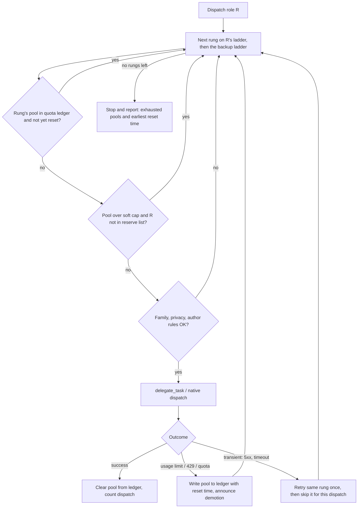

# Budget exhaustion and backup layer - design

Status: proposed (side-chat design, 2026-11-09). Builds on
[2026-11-09-provider-decoupling-design.md](./2026-11-09-provider-decoupling-design.md)
and [2026-11-09-role-rebalance-design.md](./2026-11-09-role-rebalance-design.md) revision 2.

## Problem

The harness already walks a per-role ladder (`primary -> fallback -> last-resort`) when a
dispatch hits a usage limit. That covers one dispatch. It does not cover a pipeline that
runs for hours:

1. **No memory between dispatches.** After Antigravity's Claude returns a usage-limit error,
   the next dispatch starts again at the exhausted primary and pays another failed call. This
   happens for every role and every council round.
2. **No shared quotas.** One Antigravity Claude quota is shared by `claude-opus-5-5` and
   `claude-sonnet-5-5`. In `tri`, `reviewer-b` has Opus as primary and Sonnet as fallback on
   that same quota, and `implementer-deep` also starts on it. One limit error should take
   all of those rungs out at once.
3. **No reserve for scarce quota.** `implementer-deep` can use up Antigravity Claude before
   the council needs it for Seat B, where it matters most.
4. **Three rungs is the ceiling.** When all three rungs are gone, the role stops (or the
   council stops with `yellow: degraded council`), even if the user has more providers.
5. **No reset time.** A stopped run can't tell the user when it can resume.

## Principles

- **Harness = rules, profile = data.** No backup model, provider, quota, or window is
  hardcoded in `AGENTS.md`, `skills/**`, or `agents/*.md`. All of it lives in the profile
  (`providers/<name>.md` or `--profile-file`).
- **Additive and optional.** A profile with no new sections behaves as it does today: each
  rung is its own pool, nothing is reserved, and there is no backup ladder. The 7-column
  routing table is unchanged, so existing `--profile-file` copies stay valid.
- **Existing safety rules come first.** Family independence, author-family, privacy gate,
  and "never run a role on the driver model" all apply to backup rungs exactly as they do
  to ladder rungs.

## Design



### 1. Quota pools (profile data, optional section `## Quota pools`)

```markdown
| pool | provider | models | window | soft-cap | reserve |
| --- | --- | --- | --- | --- | --- |
| antigravity-claude | antigravity | claude-* | 5h | 6 | reviewer-b |
| antigravity-gemini | antigravity | gemini-* | 5h | - | - |
| codex | codex | * | 5h | - | - |
| claude-code | claudeAgent | * | 5h | - | - |
```

- `models` is a glob matched against the routing table's `model` column for that `provider`.
  The first matching pool row wins.
- A rung that matches no pool row is its own pool, `<provider>/<model>`. That fits
  OpenCode Go, where each model has its own monthly limit and 5-hour cap, so it needs no rows.
- `window`: how long to wait before trying an exhausted pool again when the error has no
  retry time (`5h`, `1d`, `7d`, `1mo`).
- `soft-cap`: the most dispatches per pipeline run before the pool counts as **reserved**.
  `-` means no cap.
- `reserve`: the roles that may keep using a reserved pool. A comma list, or `-`. Other roles
  skip it, which does not count as exhaustion.

Example: `implementer-deep` can use Antigravity Opus for 6 dispatches. After that it moves
to `gpt-6-astra`, and the rest of the Claude quota is left for council Seat B.

### 2. Quota ledger (harness rule, machine-local state)

- Location: `<dest>/state/quota-ledger.tsv`, next to the install. It is per machine and
  shared by every repo and run, because quotas belong to the account, not the repo. It is
  never committed.
- Row: `pool  provider  exhausted_at  retry_after  source_role  note`.
- `retry_after` comes from the provider's error (`Retry-After`, "resets at ...") when present,
  otherwise `exhausted_at + window`.
- Read before every ladder walk. Expired rows are ignored and pruned. A successful dispatch
  on a pool deletes its row, because limits can reset earlier than the window says.
- The controller keeps per-run soft-cap counters in the existing `oneshot-state.md`, so
  resume honours them.

### 3. Failure classes (harness rule)

| Class | Signals | Action |
| --- | --- | --- |
| exhausted | 429, "usage limit", "quota", "rate limit reached", plan-limit messages | Write the **pool** to the ledger, announce, try the next rung |
| unreachable | missing from `orchestrator_capabilities`, provider disabled, `delegate_task` rejection | Skip for the session (as today), no ledger row |
| transient | 5xx, network timeout, stream cut | Retry the same rung once, then skip it for this dispatch only |
| task failure | bad output, failing tests | Not a budget event: use the existing fix and debug caps |

Budget skips never use up council rounds or fix attempts (existing rule, now covering all
classes above).

### 4. Backup ladder (profile data, optional section `## Backup ladder`)

When a role's own rungs are all exhausted, unreachable, or reserved, the controller walks a
profile-wide backup list before stopping:

```markdown
| order | roles | provider | model | effort | family | privacy |
| --- | --- | --- | --- | --- | --- | --- |
| 1 | implementer,implementer-deep,tester,patch | opencode | opencode-go/deepseek-v4-pro | - | deepseek | ok |
| 2 | reviewer-a,reviewer-b,reviewer-c,task-reviewer | opencode | opencode-go/mimo-v2.6-pro | - | xiaomi | ok |
| 3 | * | opencode | opencode-go/minimax-m3 | - | minimax | ok |
```

- `roles`: a comma list or `*`. Other columns are validated like routing rows.
- Backup rungs go through the same pool, ledger, soft-cap, family, author-family, and
  privacy checks. On a council seat, a backup rung is used only if its family is not active
  on another seat in this PR and is not the `reviewer-esc` family. Otherwise the existing
  degraded-council rule applies.
- A demotion onto a backup rung is announced as `backup: <role> -> <provider>/<model>`.
- Implementation seats keep the existing hand-off (`implementer` <-> `implementer-deep`)
  **before** the backup ladder, so a stronger sibling seat is tried first.

This gives people with one or two providers a safety net without filling every role's
ladder, and it lets `quad` users list Claude Code as a backup for everything.

### 5. Stop and resume

When no rung is left, the controller stops and reports:

```
budget stop: reviewer-b
  exhausted: antigravity-claude (until 18:40), opencode-go/claude-haiku-5-5 (until 16:05)
  earliest resume: 16:05  -> rerun `oneshot` to resume from state
```

The earliest reset time goes into `oneshot-state.md`. On resume, the ledger decides which
rungs are live again, and no closed round is reopened (existing rule).

At the end of every run, the PR body and the final report get a **Budget** block: pools hit,
demotions, backup rungs used, and any degraded seats.

## Changes by file

| Area | File(s) | Change |
| --- | --- | --- |
| Rules | `AGENTS.md` Routing Rules + Dispatch Adapter | Pools, ledger, failure classes, soft cap and reserve, backup walk order, stop report |
| Skills | `skills/dispatch`, `skills/council`, `skills/oneshot` | Point to the new rules (no restating). Oneshot state gets soft-cap counters and earliest reset. PR body gets the Budget block |
| Profiles | `providers/tri.md`, `quad.md`, `opencode-go.md` | Add `## Quota pools` (Antigravity Claude reserved for `reviewer-b`) and `## Backup ladder` (no GPT through OpenCode Go, per revision 2) |
| Installer | `install.sh` | Parse and validate both optional sections (known roles, valid provider, effort and privacy grammar, `window` and `soft-cap` syntax, `reserve` roles known). Render them into `PROVIDERS.md`. Create `<dest>/state/`. Works with `--profile-file` |
| Tests | `test/install.sh` | Red cases: profile without the sections still installs. Bad window, soft-cap, or unknown reserve role is rejected. Backup row with unknown role is rejected. Sections render into `PROVIDERS.md`. `state/` is created, and the ledger is never part of the managed manifest (uninstall keeps it or removes it on purpose) |
| Docs | `README.md` | New section **"When a model runs out of budget"** with the flowchart, a worked Antigravity-Claude example, how to read and clear the ledger (`rm <dest>/state/quota-ledger.tsv`), and how to add pools and backups to your own `--profile-file`. Add both sections to "Configure models". Each per-provider setup guide says whether its quota is shared (pool row) or per model |

## Out of scope

- Live quota checks (no provider exposes a reliable remaining-quota API to the harness).
  The ledger is driven only by errors.
- Spending money automatically (no pay-as-you-go fallbacks unless the user lists them in the
  profile).
