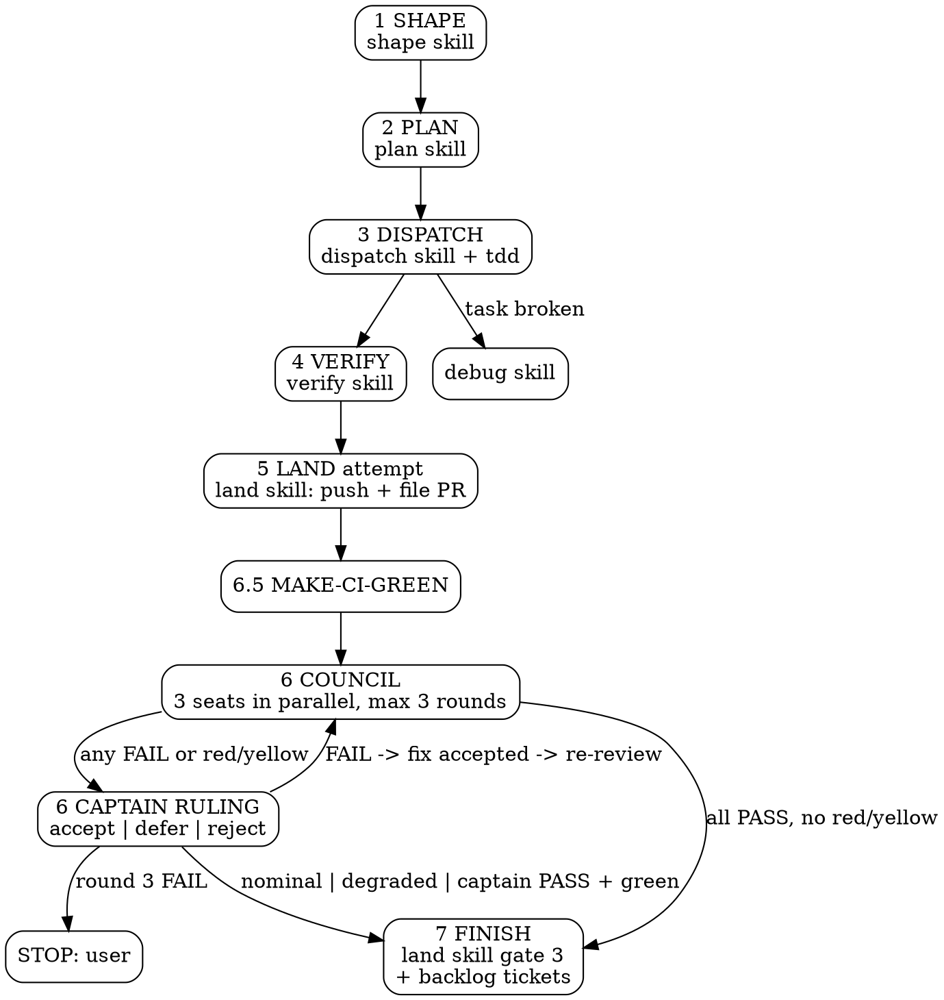

# Oneshot Pipeline

**Operational terminal boundary:** For `scout`, `tester`, `patch`, `implementer` and `implementer-deep`, explicit last-resort is terminal: ineligibility or routing failure stops the original role with `budget stop: <role>`, without terminal same-model alternates, sibling hand-off, wildcard or explicit backups. Primary/fallback retain same-model alternates; transient retries once. Task failures retain fix/debug caps, never budget failures. Roles without explicit last-resort retain legacy sibling/backup routing; review/design/planner are unchanged. Every alternate, backup and hand-off instruction below is subject to this boundary.

**Context-scoped effort ceiling:** Non-council work, including driver sessions, defaults, advisory/design work, task-reviewer, fixing and testing, must never request or inherit effort above `high`. Only runtime council reviewer-a/b/c seats and fresh captain rulings may use profile-configured `xhigh`; council is the only skill permitting above high, with maximum `xhigh`. `max`, `ultra`, `ultrathink`, `ultracode`, and equivalent higher levels are forbidden everywhere. Verify provider capabilities before dispatch; use explicit provider-native options from `PROVIDERS.md`. Argon uses explicit `thinking_level=high` because it has no xhigh support. Unknown/unsafe defaults require an explicit safe option or an unreachable rung; non-council defaults must be verified at most `high`. Shared reviewer contracts do not grant task reviews the council exception. Invoking a skill never changes the driver session or its ceiling.

Autonomous end-to-end SDLC: task -> spec -> plan -> implementation -> verification -> PR -> CI watch -> council consensus (with review captain) -> land (plus backlog tickets).

**Core principle:** Full autonomy once started. No pauses between phases. User consulted only at design approval (Gate 1), plan approval (Gate 2), and the final branch decision (Gate 3).

**Auto-approve bypass:** If the initial task description explicitly asks for it ("auto-approve", "skip all approvals", "no approval gates", "full autonomy no questions"), skip all 3 gates. Shape writes `auto-approve: true` plus the quoted trigger phrase on the same header line of the spec BEFORE committing it; oneshot verifies that header line is present and never edits the spec after shape commits it. User instruction at start overrides default gates. Later turns never override it.

**Auto-approve propagation:** when `auto-approve: true` is recorded, the flag travels into the shape and plan dispatch prompts, and those skills must suppress their own approval waits.

**Announce at start:** "Oneshot pipeline starting for: [task description]"

**Visibility:** The whole pipeline runs in the main session. Announce every phase transition. Stream every subagent result back into main as it returns.

**Context hygiene:** Main orchestrates. Main never writes implementation code inline. Per-task and per-round work is dispatched to fresh subagents through the AGENTS.md Dispatch Adapter. Never delegate a whole phase or the whole pipeline to one subagent.

**Model routing:** Skills never hardcode models. Role rows, optional `## Quota pools`, and optional `## Backup ladder` live in the active provider profile (`PROVIDERS.md`); the `HARNESS.md` (`AGENTS.md`) Routing Rules (quota pools & ledger `<dest>/state/quota-ledger.tsv`, failure classes, soft cap & reserve, same-model alternate, balanced seat fallback, single-provider review, context-scoped effort ceiling, backup ladder walk, and budget stop & resume) and Dispatch Adapter govern how a role becomes a running subagent. On a usage-limit or 429-style provider error (`exhausted`, written to the quota ledger), an `unreachable` rung, a failed `transient` retry, or a soft-cap reserved pool, stop at the operational terminal boundary; otherwise re-dispatch the same role on the next eligible rung (same-model alternate first, then its ladder, sibling implementation hand-off, and `## Backup ladder`), announce it (`backup: <role> -> <provider>/<model>` on backup rungs), or stop with `budget stop: <role>` when no eligible non-review rung remains; unavailable review roles record attempted/skipped members and proceed with green verification. Routing-file note: the installed copy of the harness rules is `HARNESS.md`; `<dest>/AGENTS.md` is the user's own file and is never overwritten.

**Closed review eligibility:** Apply the active profile's review allowlist to task reviews, council seats, captain rulings, backups, and single-provider recovery. Never introduce an excluded model to fill a seat. Self-review is allowed. Unavailable reviewers are skipped after configured fallback attempts; available results and green verification remain required.

## Step 0: Routing Bootstrap

<HARD-GATE>
Before entering Phase 1 or spawning ANY subagent, complete all three bootstrap checks:
1. **Load `HARNESS.md` and `PROVIDERS.md` into context:** Verify that `# Cybernetic SDLC Harness` (`HARNESS.md`) AND the active provider profile routing table (`PROVIDERS.md`) are BOTH already loaded verbatim in this session. If either is missing, read `../_harness/HARNESS.md` and `../_harness/PROVIDERS.md` (or `../../HARNESS.md` and `../../PROVIDERS.md`) relative to this skill's directory NOW before taking any other action (quota ledger read/updated via shell at `../../state/quota-ledger.tsv`).
2. **Select the `HARNESS.md` Dispatch Adapter path (including lazy MCP servers):** Inspect both eager tools and any lazy-loaded MCP server schemas in your environment before choosing a subagent tool. Run the one-time session capability check required by `HARNESS.md` `## Dispatch Adapter` Path 1 when cross-provider orchestration tools are present (reading their lazy MCP schema files first when needed), and NEVER fall back to native same-session subagent tools while Path 1 orchestration tools are available. Hold the active Dispatch Adapter path and resolved primary rungs in session memory until Phase 1 step 1 activates the feature branch or worktree.
3. **Forbid same-model inheritance:** Every subagent (`scout`, `tester`, `implementer`, `implementer-deep`, `patch`, `task-reviewer`, `designer`, `planner`, `design`, `reviewer-a`, `reviewer-b`, `reviewer-c`, captain ruling) MUST resolve its exact `<provider>/<model> (<effort>)` rung from `PROVIDERS.md` per `HARNESS.md` `## Dispatch Adapter`: seat dispatches (`scout`, `tester`, `implementer`, `implementer-deep`, `patch`, `reviewer-*`) carry `Role contract:` + `Rung:` (or `Rung:` only on autoloaded pinned seats), while `task-reviewer`, `designer`, `planner` and `design` carry `Rung:` only (no `Role contract:`, as they have no agent file). Spawning native `inherit`/same-model subagents across roles when `PROVIDERS.md` routes those roles to distinct providers or models is a hard protocol violation.
</HARD-GATE>

## Pipeline Overview



Run phases sequentially 1 -> 7 in the main session. No skipping. Validate the prior phase artifact exists before entering the next phase. When a step says to invoke a skill via the `skill` tool and the current host has no `skill` tool, read `../<skill>/SKILL.md` relative to this skill's directory instead.

---

## Phase 1: SHAPE

**Skill:** `shape`
**Output:** `docs/specs/YYYY-MM-DD-<topic>-design.md` (spec)

1. Ensure the working directory (main checkout or git worktree) is on a feature branch (e.g. `feat/<topic>`). If the tree sits on the default branch (`master`/`main`), either switch to a new `feat/<topic>` branch or create and move into a feature worktree (use the host's worktree tool when available, or a linked git worktree). When already inside a dedicated feature worktree/branch, reuse its branch. Once the feature branch or worktree is active, run `mkdir -p "$(git rev-parse --git-dir)/info"` and record the active Dispatch Adapter path and resolved primary rungs in `$(git rev-parse --git-dir)/info/oneshot-state.md`. This is the FIRST step, before the shape skill runs: shape writes and commits the spec, so the feature branch must be active before it runs. All pipeline commits after this point happen on a feature branch.
2. Invoke the `shape` skill exactly once via the `skill` tool (or read `../shape/SKILL.md`). Follow its Socratic design checklist: purpose, constraints, success criteria, 2-3 approaches with trade-offs, user-approved design. Any codebase search touching >1 file or 50+ lines dispatches `scout` through the `HARNESS.md` Dispatch Adapter (`HARNESS.md` Context Hygiene). Shape invokes `domain-modeling` when the design introduces or renames domain concepts, and `codebase-design` when it changes a module interface. The driver executing shape owns the spec writes/commit on that branch; shape alone delegates its design draft to optional `designer` (legacy driver drafting if absent). Oneshot does not separately dispatch a designer. Draft workers return read-only text/decisions, never gates, artifacts, execution or children.
3. The spec commit is owned by shape (step 2). Oneshot only verifies the spec artifact exists at `docs/specs/YYYY-MM-DD-<topic>-design.md` and proceeds. Do not run `git add` or `git commit` here.
4. Gate 1: user approves the design (skip under bypass; verify the `auto-approve: true` header line shape wrote before committing, do not edit the spec here). One owner for plan handoff: shape returns control to the controller at the end of Phase 1, and the controller will invoke plan exactly once in Phase 2. Shape never invokes plan when running under oneshot, and plan is invoked only by the controller.

---

## Phase 2: PLAN

**Skill:** `plan`
**Output:** `docs/plans/YYYY-MM-DD-<feature>.md` (implementation plan)

1. At the end of Phase 1, shape returns control to the controller, and oneshot will invoke plan exactly once in Phase 2 (shape never invokes plan when running under oneshot, and plan is invoked only by the controller). Invoke the `plan` skill via the `skill` tool (or read `../plan/SKILL.md`). Plan alone delegates the implementation-plan draft to optional `planner` (legacy driver drafting if absent). Oneshot does not separately dispatch a planner. The driver reads/applies the returned draft and decomposes the spec into bite-size tasks with exact file paths, commands, and commit points. No placeholders.
2. Save to `docs/plans/YYYY-MM-DD-<feature>.md`. Shape owns the spec commit, oneshot owns the plan commit. Commit the plan with this explicit form:
```
if ! git check-ignore -q docs/plans/YYYY-MM-DD-<feature>.md; then
  git add docs/plans/YYYY-MM-DD-<feature>.md
  git commit -m "docs: plan for [topic]"
fi
```
If the path IS ignored, record the local path and never use `git add -f`.
3. Gate 2: user approves the plan (skip under bypass).
4. Execution mode is subagent-driven only. Do not offer inline execution.

---

**T3 Code review dispatch:** Every task-review stage, council seat and captain ruling uses `delegate_task` with `role: "review"`, `mode: "async"`, `target: { providerInstanceId, model, options }` resolved from its permitted profile rung, a fresh `clientRequestId`, a self-contained `task` and `isolation: "shared"` for the stable review checkout. Never pass `modelSelection`, top-level `provider`, or `cwd`. Save the returned `taskId` with the reviewed HEAD, scope, seat/stage, rung and request ID; every re-check, replacement and round gets a new request ID and fresh dispatch.

**Delegate lifecycle:** Retain `childThreadId` as storage/reference only; never use `t3_thread_send`, `create_threads`, `t3_thread_launch`, or `t3_thread_interrupt` on it. Follow `next` and end the turn when awaiting a reactive completion wakeup. Never poll `task_status` before a completion wakeup. Timeout or missing output is neither approval nor child termination: call `task_cancel` with the saved `taskId` for replaced, timed-out or aborted runs before starting a replacement. A missing task ID requires recovery using the original request ID and authoritative tool schema, never a blind duplicate.

**Shared review scope:** No scoped-file edits while shared-checkout reviewers run. Driver and delegates wait for every active reviewer of that scope to finish or be cancelled before any fixer edits. Council seats may review the same frozen scope in parallel; task-review stages remain sequential. Overlapping parallel editing requires `isolation: "worktree"` and a fresh review of the integrated result.

## Phase 3: DISPATCH

**Skills:** `dispatch` + `tdd`
**Error routing:** `debug`

1. Invoke `dispatch` and `tdd` via the `skill` tool (or read `../dispatch/SKILL.md` and `../tdd/SKILL.md`).
2. Work on the active feature branch (in the current checkout or dedicated worktree from Phase 1). Clean `git status` first; create the feature branch or worktree here only if Phase 1 was skipped (e.g. resume into Phase 3).
3. For each plan task with behaviour to test, dispatch `tester` first through the `HARNESS.md` Dispatch Adapter with the red-step brief from `dispatch/tester-prompt.md` (writes failing tests in the working tree, runs them to confirm the failure reason, never writes production code, never commits). Then dispatch `implementer` (or `implementer-deep` for tasks flagged complex) through the `HARNESS.md` Dispatch Adapter with the task brief from `dispatch/implementer-prompt.md` and the `tester`'s report: `implementer` starts from the `tester`-written red tests, writes the minimal implementation to turn them green, refactors, runs the suite, and commits tests + implementation together (unless Parallel mode: stage only, main commits serially). Mechanical tasks with no new behaviour to test skip `tester` and dispatch `implementer` directly. After each task commit, run both per-task `task-reviewer` stages through the `HARNESS.md` Dispatch Adapter - Stage 1 spec compliance (`dispatch/spec-reviewer-prompt.md`), then Stage 2 code quality (`dispatch/quality-reviewer-prompt.md`), without author-model or family exclusions - and after all tasks complete, run the final `task-reviewer` review before exiting Phase 3. When a GLOSSARY.md exists, the task brief carries the name of any glossary term the task must honor. Seat models and effort levels come from the active provider profile (routed by the `HARNESS.md` Dispatch Adapter); fallback rungs live in the profile's role ladders. Stage 1 and Stage 2 are separate, sequential dispatches; never combine their prompts. Await Stage 1 completion and resolve its findings, or record its configured unavailability, before dispatching Stage 2.
4. Independent tasks run in parallel as separate fresh `implementer` subagent instances (parallel fan-out lives inside `dispatch`).
5. Stream task results to the user as they return (task name, pass/fail, key outputs).
6. Task failure routes to `debug`: root cause first, then re-dispatch (escalating to `implementer-deep` when a bug resists standard fixes). Unfixable after the debug loop: escalate to user with failure context.
7. Record the author model and family per task: after each task commit, append the commit sha, task, and the implementing rung's `<provider>/<model>` and `family` (plus the `tester` rung's `<provider>/<model>` and `family` when `tester`-written tests are committed in that commit; `provider`, `model`, and `family` columns of the active provider profile) to the author commit log in `$(git rev-parse --git-dir)/info/oneshot-state.md`, and update `author_models:` and `author_families:` in that state artifact. In parallel mode the driver commits staged child work serially; record the child's rung `<provider>/<model>` and family, not the driver's. Driver commits of spec, plan, or docs-only state record nothing (AGENTS.md Council Contract).

Fix-loop caps: at most 3 implementer fix attempts per task, then route to `debug`. Debug gets at most 2 rotations; past that, STOP and escalate to the user with context. Escalation after exhausting caps is an explicit allowed stop point - the no-pause rule never overrides budget exhaustion.

---

## Phase 4: VERIFY

**Skill:** `verify`

1. Invoke `verify` via the `skill` tool.
2. Dispatch `tester` as a script runner through the AGENTS.md Dispatch Adapter to run the test suite, lint, typecheck, build, and project scripts (if no suite exists, run what the project docs define and note it), and act on its compressed pass/fail report (failing test/check names and first-error excerpts, never full raw logs in the main session).
3. Cross-check implementation against the spec checklist.
4. Fix failures or route to `debug`. Never proceed on failures.

---

## Phase 5: LAND - push and file the PR

**Skill:** `land`

1. Invoke `land` via the `skill` tool.
2. Push the feature branch, create the PR: body leads with the problem, not the change inventory (`## Summary`, `## Changes`, `## Test plan`, `## Budget`; Phase 6 adds `## Backlog` when the captain defers findings). The `## Budget` block reports pools hit, demotions, backup rungs used, and any degraded seats (updated again in Phase 7 if CI or council rounds trigger further budget events). Reference local spec/plan paths when they are gitignored.
3. Save the full PR URL as `pr_url` using the lossless state policy. In T3 Code, immediately after the PR is created, taken over or pushed, make the next tool call `link_pull_request` with the full PR URL, or `link_pull_requests` for multiple PRs. Resolve an existing PR URL before pushing. If `gh pr create`, `gh pr view` or `gh pr checks` hits GraphQL rate limits, follow land's REST fallback using `gh api repos/{owner}/{repo}/pulls`; check for an existing PR before retrying creation. Reuse `html_url`, and preserve all existing same-head evidence.

---

## Phase 6.5: MAKE-CI-GREEN

**Skill:** `make-ci-green`

1. Invoke `make-ci-green` via the `skill` tool (skip if the repo has no CI/review bots; say "no CI to babysit" and move on).
2. Watch checks and bot reviews. Failing check logs and local reruns are inspected via `tester` (script runner, compressed failure report). Real finding -> fresh fixer subagent (`implementer`, or `implementer-deep` for hard clusters) -> rerun CI (record the fixer rung's `<provider>/<model>` and family per commit in the author commit log and update `author_models:` and `author_families:` in the state artifact, as in Phase 3). No new information -> no rerun. No blind loops, no flake chasing.
3. In T3 Code, the parent thread inspects checks and comments first, finishes any needed branch update and push, immediately calls `link_pull_request` with the full PR URL, then, only when checks or reviews remain pending, uses `watch_pull_request` with one watcher per PR and ends the turn for a reactive wakeup. If the initial inspection already shows green checks on the final HEAD with no unresolved findings, proceed directly to step 4 without watching. delegate_task children never call `watch_pull_request`; they report PR URL, head SHA, check/review state and blockers to the parent. Existing watchers persist across pushes; avoid duplicates. Never run a manual 30-second polling loop in T3 Code. The wakeup path re-enters step 3/4 before any green handoff: re-read current checks/comments and remote HEAD before acting. For GraphQL-limited checks use `gh api repos/{owner}/{repo}/commits/{sha}/check-runs`, plus paginated commit-status/review evidence as needed. Outside T3 Code, retain make-ci-green's bounded CLI polling flow.
4. Call `unwatch_pull_request` before handback, stopping, or asking the user a question, including the completed handoff to council. A turn ending solely to await the requested watcher wakeup keeps monitoring active. Preserve phase, head and fix counters across wakeups; do not mark CI green until actual checks on the final HEAD are green.

While awaiting the reactive wakeup, end the turn.

---

## Phase 6: COUNCIL (consensus with review captain, max 3 rounds)

**Skills:** `council`
**Gate to Phase 7:** Council PASS under the available-seat criteria, or explicit SKIPPED/unavailable with all configured attempts/skips recorded and green actual checks. Actual review FAIL and unresolved accepted findings block. Availability alone never blocks. Self-review is allowed; author metadata is audit-only.

1. Invoke `council` via the `skill` tool.
2. Seat the council per council availability routing: try configured seats/fallbacks, keep active models distinct, record attempted/skipped members and reasons with HEAD, and select the first healthy captain (A, B, C). One available reviewer may PASS with its real final vote regardless of provider count. Zero available reviewers records review skipped, never PASS, and requires green actual verification before proceeding.
3. Findings merge into one numbered list (`F<n> [<seats>]: path:line: emoji severity: problem. fix.`).
4. Captain ruling: when any seat voted FAIL or any red/yellow finding exists, dispatch a fresh captain ruling on the captain's rung (merged findings, diff, spec, plan) -> one `<finding-id>: accept | defer | reject: <reason>` line per finding plus `Captain verdict: PASS | FAIL`. The driver verifies every accepted red against code, and overrides to `accept` any deferred or rejected red it confirms as an in-scope correctness, security, or data-loss bug introduced by this diff (`captain overruled: <finding-id>`). Each `defer` writes `backlog: <finding line> (<reason>)` to the state artifact and the PR body's `## Backlog` section. Apply the T3 Code review envelope and saved-task lifecycle above; the ruling is a fresh dispatch, never a message to a previous child thread.
5. Round loop (max 3 rounds, never stops mid-loop):
   - FAIL, or any unresolved `accept` (red or yellow, even when seat votes pass) -> record the canonical single verdict when selected, otherwise `council_verdict: FAIL round=<n> mode=<nominal|degraded> head=<sha>` (where `<sha>` is `git rev-parse HEAD`) -> dispatch fresh implementation-seat fixer subagents for accepted findings only (`implementer`, or `implementer-deep` for hard clusters, one per cluster, max 2 files each; see `AGENTS.md` Review contracts; record each fixer commit's rung `<provider>/<model>` and family and update `author_models:` and `author_families:`) -> push -> re-review next round with all active seats and a fresh ruling.
   - Single mode records `council_verdict: PASS|FAIL round=<n> mode=single reviewer=<provider/model> head=<sha>` with same-head captain, final real vote and green actual checks; no no-tests exception. A ruling never changes single to captain. Zero reviewers records `council_verdict: SKIPPED round=<n> mode=unavailable head=<sha>` with configured attempt/skip reasons; availability cannot erase a FAIL or unresolved accepted findings.
   - Normal modes only: PASS + green (after the CI freshness gate on final HEAD) -> record `council_verdict: PASS round=<n> mode=<nominal|degraded> head=<sha>` when the seat votes carry it, or `council_verdict: PASS round=<n> mode=captain head=<sha>` when only the captain verdict does (where `<sha>` is `git rev-parse HEAD`), break, proceed to Phase 7.
   - CI freshness gate: if any council fix round pushed commits after the last green `make-ci-green` receipt, re-enter Phase 6.5 on the final HEAD before Phase 7. A stale green receipt never satisfies the gate.
   - If that 6.5 re-entry pushes further CI-repair commits, the final HEAD needs one delta council round on the changed files (counted against the 3-round budget, updating `council_verdict` for the new `HEAD` `<sha>`). If CI repairs land after round 3 with no rounds left, STOP and report to the user - require fresh council availability evidence and green verification before land.
   - Round 3 FAIL (no nominal, degraded, captain, or single PASS) -> record the canonical single verdict when selected, otherwise `council_verdict: FAIL round=3 mode=<nominal|degraded> head=<sha>`, STOP, and report to the user with round count, findings, rulings, backlog entries, and test output. There is no escalation seat. Do not proceed.
6. Confirm available review results, zero unresolved accepted findings and green verification on the final HEAD. If a captain/ruling becomes unavailable while actual findings remain unresolved, record FAIL; never turn it into availability SKIPPED.
7. No test suite: see `AGENTS.md` Review contracts for the `no-tests` gate rule (`mode=nominal` only; `mode=degraded`, `mode=captain` and `mode=single` require green tests). Label a `no-tests` PASS `provisional: no-tests` in the verdict, and have the reviewer flag `no tests` as yellow. Record any `no-tests decision: proceed` in the state artifact; for a standalone council run the state artifact is `$(git rev-parse --git-dir)/info/oneshot-state.md` in the target repo or worktree, created if missing (`mkdir -p "$(git rev-parse --git-dir)/info"`).

**Rules:** Reviewer never edits during review; dispatch fresh fixers and reviewers, allowing the same model. Fresh subagents every round. Rounds 1-2 never pause for user input; stream results in passing. Verify every finding against real code before acting; fixers touch accepted findings only.

---

## Phase 7: FINISH

**Skill:** `land` (Gate 3)

**T3 Code finish lifecycle:** If finishing creates, takes over or pushes to a PR, immediately call `link_pull_request` with the full PR URL, or `link_pull_requests` for multiple PRs. On GraphQL rate limits use land's REST PR/check recovery, checking for an existing PR before retrying creation. If an authorized merge still waits on checks or reviews, inspect current evidence, complete any branch update/push and linking, then call parent-owned `watch_pull_request` and end the turn. Revalidate merge evidence and remote HEAD on wakeup. Call `unwatch_pull_request` before handback, stopping, or asking the user a question; only a turn ending to await the requested watcher wakeup retains it. Do not remove state when merely awaiting a watcher wakeup; remove the state artifact only when the run is completed.

1. Read the effective last `council_verdict` in `$(git rev-parse --git-dir)/info/oneshot-state.md` immediately before merge. Accept `council_verdict: PASS` with mode in `nominal|degraded|captain|single`, or `council_verdict: SKIPPED` with `mode=unavailable` and all configured attempted/skipped members and reasons recorded. Require `head=<sha>` matching local `git rev-parse HEAD` and remote PR head via `gh pr merge --squash --match-head-commit <sha>`. Verify the profile review allowlist, same-head available reviewer votes/rulings, zero unresolved accepted findings and green actual checks (no no-tests exception for single/unavailable). For mode=single, require the final real `reviewer_vote: PASS reviewer=<provider/model> head=<sha>` matching the verdict reviewer and captain. A skipped review never means PASS. Actual review FAIL, unresolved review failures, stale/missing evidence and unrecognized verdict/mode combinations refuse merge. Standalone uses the same evidence in the current session or state; run council if absent. Authorship and provider counts are not gates.
2. Refresh the PR body's `## Budget` block and include a **Budget** summary block in the final report (pools hit, demotions, backup rungs used, and any degraded seats; `AGENTS.md` Routing Rules, budget stop & resume). Landed options: merge PR and clean up, keep PR open, keep branch, discard. Present options (skip under bypass: default keep PR open).
3. `land` executes the user choice. It reuses the standard flow: create-PR-if-none, merge open PR, checkout default, pull (the "next feature" handoff). After a merge, `land` files one backlog ticket per `backlog:` line in the state artifact according to `backlog_tracker` (`## Project management` in `PROVIDERS.md`); with `none`, no merge, or a filing failure, the PR body's `## Backlog` list stays and the final report lists the entries.
4. Record it with the memory tool: mode "add", content "oneshot completed: [task] on [branch]". Do not remove state when merely awaiting a watcher wakeup; remove the state artifact only when the run is completed.

---

## State Artifact

**Lossless state updates:** Preserve all canonical keys in `$(git rev-parse --git-dir)/info/oneshot-state.md`: `dispatch_adapter`, `primary_rungs`, `phase`, `branch`, `pr_url`, `author_models`, `author_families`, `author_commits`, `tests_status`, `council_round`, `council_verdict`, `captain`, `backlog`, and `soft_cap_counts`. Preserve existing values unless the current event explicitly updates them, and preserve unknown keys, standing findings, `earliest_resume`, member attempts/skips, votes, rulings, backlog filing receipts and task lifecycle records. Use append for event history or read-merge-write for a keyed update, retaining unrelated content and the effective-last-verdict convention. Never overwrite the state artifact with a truncated summary. A council-only run creates missing state but merges with existing pipeline state; it never replaces routing or author history.

Single mode records `council_verdict: PASS|FAIL round=<n> mode=single reviewer=<provider/model> head=<sha>`, same-head captain and final real `reviewer_vote: PASS|FAIL reviewer=<provider/model> head=<sha>` plus green actual checks. Zero reviewers records `council_verdict: SKIPPED round=<n> mode=unavailable head=<sha>`. Record `council_member: <seat> <provider/model> status=<reviewed|skipped> reason=<reason> head=<sha>` for all configured attempts/skips; provider counts and author history are audit-only.

Once the feature branch or worktree is active (Phase 1 step 1, or Phase 3 step 2 when resuming directly into Phase 3), and at every phase transition or budget event thereafter, run `mkdir -p "$(git rev-parse --git-dir)/info"` (so both standard checkouts where `.git` is a directory and linked git worktrees where `.git` is a file work cleanly) and record or update `$(git rev-parse --git-dir)/info/oneshot-state.md` (using the lossless append or read-merge-write policy above): active Dispatch Adapter path, resolved primary rungs, phase, branch, PR URL, `author_models:` (deduplicated authoring `model` IDs), `author_families:` (deduplicated authoring `family` IDs), author commit log (`<sha> <task> <provider>/<model> <family>`), tests status, council round count, `council_verdict: PASS|FAIL round=<n> mode=<nominal|degraded|captain> head=<sha>` (where `<n>` is `1..3`, `head=<sha>` must match `git rev-parse HEAD`, and consumers evaluate the effective last `council_verdict` line), `captain: <seat> <provider>/<model>`, `captain overruled: <finding-id>` lines, `backlog: <finding line> (<reason>)` lines (one per deferred finding, filed by `land` after merge), `single-provider review: <provider>` (while active), standing findings (one line each), `soft_cap_counts` (per-pool dispatch counts in this pipeline run, every pool; drives soft caps and balanced seat fallback), and `earliest_resume` (earliest reset timestamp across exhausted pools when stopped on `budget stop: <role>`). On interrupt or after a budget stop, resume from the state artifact plus `<dest>/state/quota-ledger.tsv`, the spec, and the plan; the state file is the truth for round counters, `council_verdict`, `captain:`, `backlog:`, `author_models:`, `author_families:`, `soft_cap_counts`, `earliest_resume`, and standing findings - never re-open a closed round or re-spend a burnt budget. `$(git rev-parse --git-dir)/info/oneshot-state.md` is the only per-run state location: it is machine-local and worktree-local, never committed, never `git add -f`'d, and removed at the end of Phase 7.

## Error Handling

| Symptom | Route | Action |
| --- | --- | --- |
| Task fails during execution | debug | Root cause, fix, retry |
| Unfixable bug | User | Report phase + error + context |
| Council FAIL (rounds 1-2) | council loop | Fix -> re-review automatically |
| Council FAIL (round 3, no nominal, degraded, captain, or single PASS) | User | Stop, present findings, rulings, backlog + test output |
| Captain defers a finding | Backlog | `backlog:` line in state + PR `## Backlog`; `land` files the ticket after merge |
| Spec incomplete | Phase 1 | Fix gaps, re-approve |
| Plan has gaps | Phase 2 | Add missing tasks |
| Non-review model / pool exhausted or soft-capped | Active provider profile ladder + `## Backup ladder` (`AGENTS.md` Routing Rules) | Record pool in `quota-ledger.tsv` on exhaustion; stop at operational terminal boundary, otherwise demote or walk backup ladder (`backup: <role> -> <provider>/<model>`), announce, continue; if no rung left, report `budget stop: <role>` with `earliest_resume` |
| User interrupts | Resume | Restart from state artifact + spec + plan |

## Red Flags - Never

- Skip a phase; proceed without loading the phase skills
- Proceed past Gate 1/2 without approval (unless bypass at start)
- Merge without verification; continue past failures
- Pause, ask, or present options mid-loop after a FAIL round (1-2 in council, all rounds in task loop)
- Delegate the whole pipeline or a whole phase to one subagent
- Run silently: no transition announcements, no streamed results
- Hardcode a model ID; route by role through the active provider profile and AGENTS.md routing rules
- Treat reviewer availability as PASS or erase actual review failures with SKIPPED
- `git add -f` a gitignored path
- Exceed caps: 3 council rounds, 15 reviewer dispatches; continuing after a round-3 FAIL
- Let the captain defer or reject a confirmed in-scope correctness, security, or data-loss red
- Request or inherit reasoning above `high` for any model/provider/role

## Key Principles

- **Gated autonomy:** 3 gates only, everything between runs without stopping
- **Artifact-based resume:** state artifact + spec + plan on disk are the truth for resume
- **Context-clean:** implementation only via fresh per-task subagents
- **Visible:** every phase change and subagent result announced in main
- **TDD always:** failing test before production code, per task
- **Consensus over single gatekeeper:** council on distinct models, a captain who rules but cannot waive real bugs, honest degradation
- **Model-agnostic skills:** routing rules live only in AGENTS.md and the model table only in the provider profile
